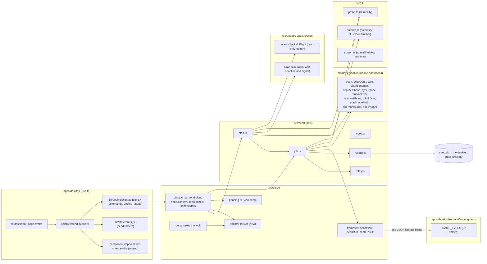
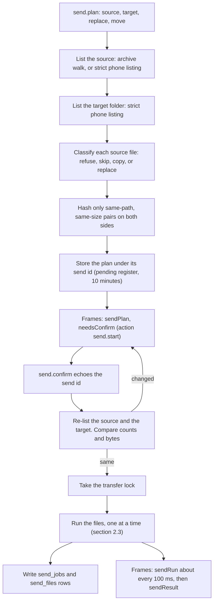
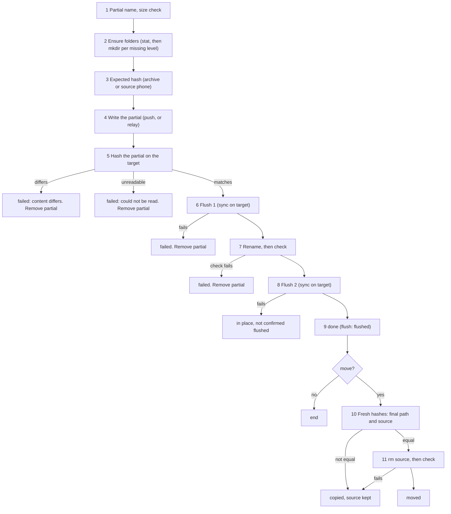
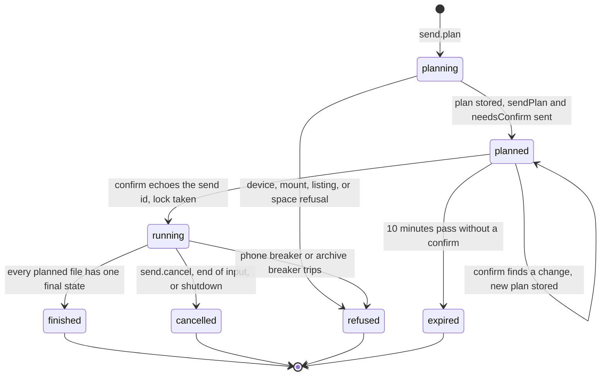

# Design Document: send-to-phone

**Feature:** send-to-phone
**Spec type:** feature
**Workflow:** requirements-first, design phase
**Requirements:** requirements.md. Its status is "Draft for owner review", and its Open questions and defaults are not approved. This design treats each default as a working assumption and lists it under Open items as a pending owner decision.
**Status:** Draft. No code is written. Spikes S1 to S4 have not run. A decision that depends on a spike is marked **pending measurement**. A decision that needs the owner is marked **pending owner decision**.

Section numbers used in cross-references: 1 Overview; 2 Architecture; 3 Components and Interfaces; 4 Data Models; 5 Error Handling; 6 Correctness Properties; 7 Testing Strategy; 8 Measurement and Evidence Plan; 9 CI and ui:sweep Changes; 10 Migration and Compatibility; 11 Risks and Ceilings; 12 Requirements Traceability; 13 Open Items; 14 Deviations from the Direction and the Requirements. Subsections are numbered within their section, for example 2.5 is the spike gates.

## Overview

A drive-to-phone send copies an archive folder onto a folder the owner picks on a phone. A phone-to-phone send copies a phone folder onto a folder on a second phone, and the host relays the bytes, because adb cannot copy between two phones directly. The feature adds:

- an engine module, `src/send/`, for planning, the per-file job, the relays, and the send record;
- phone operations on the adb adapter, `src/device/adb.ts`;
- three frames (`sendPlan`, `sendRun`, `sendResult`), four commands (`send.plan`, `send.confirm`, `send.cancel`, `send.folders`), and one new value in the confirmation action list (`send.start`);
- a Send screen in the desktop app, with its state in a module singleton.

Four rules shape the design.

1. A send never writes to the archive (R6.7). The durability feature's flush rules (its R1) do not gate sends, because sends write only to phones and to host files outside the archive. The probe rules (its R2) and the mount rule (its R2.14) do gate sends. This narrows requirement 18.1 (deviation SD-15).
2. A file is done only when its bytes hash equal on the target phone, and both flushes on that phone return ok (R9, R10). The expected hash is taken before the write, so a file that fails verification never reaches a flush.
3. The engine runs one send job at a time, and a pull and a send cannot overlap (R5.7, R11.9). Plan and confirm answer at once, and the job runs in the background, so the command loop is never held by a send (R11.1).
4. The send record is a local SQLite file under the desktop's state directory. It is not the archive journal, and the journal schema does not change.

### 1.1 Sources read

- `.kiro/specs/send-to-phone/requirements.md` (input for this phase).
- `AGENTS.md`, for the rules and the definition of done.
- `.kiro/specs/transfer-durability-and-fs-hardening/requirements.md` and `design.md`. Its probe, mount, and deadline rules are reused. Its status is "Draft for owner review" in the requirements header, while its design says "final and approved" (SD-20).
- The code and tests named in the tables in sections 1.3 and 1.4.

External sources used for API and tool behaviour:

- Bun, `Bun.spawn` (stdin as pipe or ReadableStream, AbortSignal, killSignal): https://bun.sh/docs/api/spawn
- Android Debug Bridge (`adb exec-out` for raw output): https://developer.android.com/tools/adb
- fast-check, property-based testing for any test runner: https://fast-check.dev/

### 1.2 Working assumptions

Each item below is a working assumption, and section 13 gives the owner decision it depends on.

| ID    | Assumption                                                                                                                                                                                                                                                                |
| ----- | ------------------------------------------------------------------------------------------------------------------------------------------------------------------------------------------------------------------------------------------------------------------------- |
| DD-1  | Archive reads go through `probe()` and `statDrive()` (transfer-durability design.md, Components). Sends never call the durability write helpers.                                                                                                                          |
| DD-2  | Phone calls use `probe(null, ...)`, which does not wait for archive flushes and does not count toward the archive breaker. The send keeps its own phone breaker per job (three deadline timeouts in a row, R5.9).                                                         |
| DD-3  | Phone operations are typed methods on `Adb`. Every path in a command passes through `quoteShellArg`. The function moves to `src/util/spawn.ts`, and `src/serve/browse.ts` re-exports it, so `src/device` does not import from `src/serve`. Its behaviour does not change. |
| DD-4  | A partial name is `.portage-partial-<8 characters>-<basename>.part`. The suffix `.part` is kept, because the scan treats it as in flight and a pull never offers it as media (R10.2; SD-4).                                                                               |
| DD-5  | The order is: expected hash, write, hash the partial, flush, rename, flush (R10.3, R16.1). The direction's order (flush before hash) is not used (SD-1).                                                                                                                  |
| DD-6  | Missing folders are created one level at a time. Each level gets one stat, then one non-recursive `mkdir` if it is missing, so the result can list each folder the send created (R7.2; SD-7).                                                                             |
| DD-7  | Replace uses `mv -f`, and only after verification. Copy uses `mv -n`. Each rename is followed by one shell check that the partial is gone and the final name exists.                                                                                                      |
| DD-8  | One send job at a time. One file in flight per target phone (the v1 default, pending owner decision OI-3).                                                                                                                                                                |
| DD-9  | The send record is `send.db` in the desktop state directory (`$XDG_STATE_HOME/portage`, else `~/.local/state/portage`). It uses the same rule as the desktop log (`engine.rs` lines 68 to 78).                                                                            |
| DD-10 | `send.plan` and `send.confirm` answer at once. The plan, the progress, and the result arrive as frames, so the command loop is free while a send runs.                                                                                                                    |
| DD-11 | Cancel aborts the child processes of the current step through `AbortSignal`, removes the partial, and ends the job. It never restarts the engine (R11.7). A rename that already happened is finished, including its second flush (R11.4).                                 |
| DD-12 | End of input on stdin and the `shutdown` command both cancel a running send and wait for its cleanup. The wait is bounded by the deadlines of the calls that are in flight.                                                                                               |
| DD-13 | The Send screen keeps its state in a singleton, `lib/state/send.svelte.ts`. Frames reach it through an observer, and on mount it reads `engine_status.last` so that a late mount still sees the last send frames (direction item 8).                                      |
| DD-14 | Protocol changes are additive: three frames, four commands, one value in the confirmation action list, and four names added to `FRAME_TYPES` (`trash` and the three send frames). The protocol version stays 1 (R15.7; Q7).                                               |
| DD-15 | Both folder choosers show at most 500 entries and say when a list is partial (R14.4). A chooser list that fails says "could not be read" and never shows an empty list (R14.5).                                                                                           |

### 1.3 The direction's verification items

Each item is either confirmed or a deviation. The evidence column gives file and line.

| Item                                                                 | Result                                                                                                                                                                                                                                                                                                                | Evidence                                                                                                                                                                                                                                                                                                                                                                                                                          | Handling                                                                                                                                                                        |
| -------------------------------------------------------------------- | --------------------------------------------------------------------------------------------------------------------------------------------------------------------------------------------------------------------------------------------------------------------------------------------------------------------- | --------------------------------------------------------------------------------------------------------------------------------------------------------------------------------------------------------------------------------------------------------------------------------------------------------------------------------------------------------------------------------------------------------------------------------- | ------------------------------------------------------------------------------------------------------------------------------------------------------------------------------- |
| Trash frame gap in `FRAME_TYPES`                                     | **Confirmed.** The Rust list has 18 names and no `trash`. The engine writes 19 frame types. The TypeScript hydration list also has no `trash`.                                                                                                                                                                        | `apps/desktop/src-tauri/src/engine.rs:85` (18 names). `src/serve/frames.ts:115` writes `trash`. `src/serve/protocol.ts:505-526` declares 19 types, with `trash` at line 519. `apps/desktop/src/lib/state/app.svelte.ts:80-92` (`HYDRATION_ORDER`) omits `trash`.                                                                                                                                                                  | Add `trash` and the three send frames to `FRAME_TYPES` (22 names). A root test compares the list with the frame writers (section 7). The hydration gap is an open item (OI-15). |
| Browse partial-result behaviour                                      | **Confirmed.** `browseLevel` throws only when both `find` calls fail and both lists are empty. If one call fails, the other list is returned with no error. `browseTree` has the same rule.                                                                                                                           | `src/serve/browse.ts:119-123` and `:195-199`.                                                                                                                                                                                                                                                                                                                                                                                     | The send's listings fail when either listing fails (EH-1). The send does not call `browseLevel` or `browseTree`.                                                                |
| Can a running pull be cancelled today without restarting the engine? | **No.** `pull.stop` sets a flag. The engine checks the flag before each file, so the file in flight always finishes.                                                                                                                                                                                                  | `src/serve/run.ts:186-192`. `src/serve/run-loop.ts:38-46` and `:200`. `src/xfer/engine.ts:138`. AGENTS.md, "Traps", says a scan stop restarts the engine.                                                                                                                                                                                                                                                                         | Cancel for sends is new work (DD-11). The pull's stop does not change.                                                                                                          |
| Can a pull and another transfer overlap?                             | **Yes.** The one-run rule covers pull against pull only. `purge.apply`, `trash.empty`, and `dupes.apply` never read the run controller.                                                                                                                                                                               | `src/serve/run.ts:113-117` (the only refusal). `src/serve/dispatch.ts`: the only `ctx.runs` uses are at lines 650, 660, 671, 682, and 1145. `dupes.apply` (792 onward), `purge.apply` (917 onward), and `trash.empty` (1045 onward) have no check. A pull's pre-run scan also holds the command loop: `run-loop.ts:154` awaits the phone scan before `startPull` returns at `:214`, and `index.ts:148` waits for each `dispatch`. | The send takes one lock in the serve layer, shared with pull (section 2.6). Whether purge, trash, and dupes apply take it is open (OI-16).                                      |
| 480 Mbit auto-drop in the scheduler                                  | **Not implemented.** `isUsb2` is used only for Doctor's warning. `linkMbps` is always null. `jobs` is only the worker count. The rule is a plan in the docs.                                                                                                                                                          | `src/device/adb.ts:478-481`. `src/serve/doctor.ts:113-123`. `src/serve/sink.ts:108`. `src/xfer/engine.ts:133`. `docs/milestones.md:123` (M3-4). `docs/decisions.md:24` (the D2 row). `TODO.md:196`: "auto-drop not confirmed by a run".                                                                                                                                                                                           | Sends keep one file in flight per phone (DD-8, OI-3). R11.12 and R11.13 are not implemented and do not apply to sends in v1.                                                    |
| Phone listing in `adb.ts`, and its timeout                           | **Partly.** `adb.ts` has no folder listing. `walk` lists files only (`-type f`), has a 120 s timeout, and returns `[]` on a non-zero exit, which is the same value as an empty folder. The browse listing runs `adb.shell`, whose default timeout is 30 s. Neither meets the 3 s probe rule (D18).                    | `src/device/adb.ts:267-274` (`walk`). `:239-242` (`shell`, 30 s default). `src/serve/browse.ts:97-123`.                                                                                                                                                                                                                                                                                                                           | The send adds strict listing methods (section 3.6). The listing deadline is open (OI-1).                                                                                        |
| Drive and phone folder listings share one code path?                 | **No.** The drive side is `ScanIo.walk`, which runs the Rust Helper or the glob walker and returns files with error counts. The phone side is an `adb` `find`. The exclusion rules also differ. `isExcludedRelative` matches a suffix (`scan-io.ts:102`), and `matchesExclude` matches whole segments (`scan.ts:72`). | `src/dedupe/scan-io.ts:92-110`. `src/scan/scan.ts:69-74`.                                                                                                                                                                                                                                                                                                                                                                         | The two sides share a result type, `ListingResult`, and the honesty rule (EH-1). Each keeps its own walker. Each send records which walker ran (R6.9).                          |

### 1.4 Other facts that shape the design

| Fact                                                                                                                                                                                                               | Evidence                                                                                                                                       | Effect                                                                                                                                           |
| ------------------------------------------------------------------------------------------------------------------------------------------------------------------------------------------------------------------ | ---------------------------------------------------------------------------------------------------------------------------------------------- | ------------------------------------------------------------------------------------------------------------------------------------------------ |
| `deviceId` falls back to the adb serial when `ro.serialno` is empty. R5.2 says refuse.                                                                                                                             | `src/device/adb.ts:422-425`.                                                                                                                   | The send reads `ro.serialno` itself and refuses when it is empty (EH-16). Pull is unchanged.                                                     |
| `hashRemote` returns `null` for a timeout, a non-zero exit, and bad output alike. `exists` runs `test -f` and returns false on a timeout.                                                                          | `src/device/adb.ts:298-304` and `:396-400`.                                                                                                    | The send adds typed methods. The old methods stay for pull, which is out of scope.                                                               |
| Four phone methods quote paths with bare single quotes. A name with an apostrophe breaks the shell command.                                                                                                        | `src/device/adb.ts:273`, `:299`, `:391`, `:397`.                                                                                               | The send quotes every path with `quoteShellArg`. The four methods are open (OI-17).                                                              |
| `realSpawn` ignores stdin and decodes stdout as text, so a binary stream cannot use it.                                                                                                                            | `src/util/spawn.ts:56-97` (`stdin: "ignore"` at line 61).                                                                                      | Streams use `Bun.spawn` directly. The precedent is `execOutTail` (`src/device/adb.ts:335-351`), which writes binary output in the resume path.   |
| Text decoding replaces invalid UTF-8 bytes with U+FFFD, so a bad name is changed before anything can refuse it.                                                                                                    | `src/util/spawn.ts` (`Response(...).text()`).                                                                                                  | The strict listing decodes stdout bytes with a fatal decoder. A name that does not decode is skipped with a reason and is never renamed (EH-21). |
| `adb exec-out` is the documented way to get raw output.                                                                                                                                                            | developer.android.com/tools/adb (its screenshot example).                                                                                      | Phone sources are read with `exec-out cat`.                                                                                                      |
| Hydration replays `last` frames through `applyFrame`, which does not notify observers. Live frames go through `#dispatch`, which does. So a late screen never sees a replayed plan or report through its observer. | `apps/desktop/src/lib/state/app.svelte.ts:244-248` (hydrate), `:327-331` (`#dispatch`). `screens-routing.ts` says the opposite in its comment. | The Send screen reads `engine_status.last` on mount (DD-13). The existing screens are unchanged.                                                 |
| The desktop's confirmation sheet lists `pull.start`, which the engine never sends. The engine's list has three values.                                                                                             | `src/serve/protocol.ts:456`. `apps/desktop/src/lib/engine/protocol.ts:642`. `confirm-sheet.svelte`.                                            | `send.start` is added to both lists. The stray `pull.start` is not touched here.                                                                 |
| The engine's confirm gate compares the echoed id with the record id. The typed word lives only in the desktop sheet.                                                                                               | `src/serve/dispatch.ts:824` (`args.confirm !== entry.id`). `confirm-sheet.svelte`.                                                             | Every send uses the id echo and the typed word (R12.2, R12.8, R14.8).                                                                            |
| The pending register has a fixed `kind` union and a 10 minute TTL. Expired records are dropped on read.                                                                                                            | `src/serve/pending.ts` (`PendingKind`, `PENDING_TTL_MS`, `get`).                                                                               | Add `"send"` and an optional `send` field (section 3.13).                                                                                        |
| Progress constants: the ETA needs 3 samples and 30,000,000 bytes, and a copying row stalls after 10 s.                                                                                                             | `src/serve/view.svelte.ts:26-27`, `:32`. `apps/desktop/src/lib/state/run.ts:25`.                                                               | Send progress reuses `honestEta` and these constants (R13.10).                                                                                   |
| The Helper walk has a fixed 180 s kill timer. Its kill path waits for the pipes to close after SIGKILL.                                                                                                            | `src/dedupe/scanner.ts:17`. `ask()` in the same file.                                                                                          | A send walk passes its own deadline and an abort signal (section 3.15).                                                                          |
| The durability modules (`probe.ts`, `durable.ts`, `readMount`, `probeDestination`) are not in the code yet.                                                                                                        | No `src/util/probe.ts` exists. The durability design specifies them at `design.md:188-331`.                                                    | The send depends on them. Section 10 gives the sequence. SD-15 covers the gate in R18.1.                                                         |
| Durability's breaker limit is 3 (`BREAKER_LIMIT = 3`, EH-3). One sentence in its probe section says "decided default 6".                                                                                           | Durability `design.md:192`, `:224`, `:544-547`.                                                                                                | The send uses 3 (R5.9, R6.10). The durability inconsistency is noted for that spec (SD-21).                                                      |
| The requirements cite X3 (1372 ms for a 400 MB hash) as an owner fact. The facts table has X1 and X2 only. The figure is a code comment.                                                                           | `requirements.md` facts table. `src/xfer/adb.ts:12`.                                                                                           | The 1372 ms figure is unmeasured until S1 and S2 record it (SD-18).                                                                              |
| The UI sweep writes screenshots to `/tmp/portage-ui`, outside the repository.                                                                                                                                      | `apps/desktop/scripts/ui-sweep.ts:18`.                                                                                                         | Evidence copies go to `bench/evidence/send-to-phone/` (section 8).                                                                               |
| Rail letters in use are h, p, t, d, u, o, and s. `g` arms the chord.                                                                                                                                               | `apps/desktop/src/routes/+layout.svelte` (`NAV`).                                                                                              | The Send screen uses `e`.                                                                                                                        |
| No property-based testing library is in the repository. The test runner is `bun test`.                                                                                                                             | `package.json` (dependencies and devDependencies).                                                                                             | Property tests need fast-check, a new devDependency, which R18.5 does not allow (SD-16, OI-12).                                                  |

### 1.5 Scope of this design

In scope: sends in both directions, the phone and archive primitives they need, the protocol additions, the desktop screen, the evidence plan, and the tests for each. Out of scope, as the requirements say: pull behaviour, the journal, `scripts/apull.sh`, `crates/portage-scan`, `src/scan`, the production CSP, Windows, and Apple. The design changes two shared helpers that the send needs and that are not frozen: the scanner walk gets a deadline and an abort signal, and `quoteShellArg` moves. Neither changes pull's behaviour.

## Architecture

### 2.1 Module map



`src/send/` has five files: `types.ts`, `plan.ts`, `job.ts`, `relay.ts`, and `record.ts`. The task phase splits any file that passes about 300 lines. No file in `src/xfer`, `src/index`, `src/plan`, or `src/scan` changes (R18.2, R18.3).

### 2.2 Data flow



The plan reads the target once, as a strict listing. It hashes a file only when the same relative path exists on the target with the same size (R7.5, R7.7). A file of a different size is "different file at this path" without a hash (R7.6).

### 2.3 Per-file order of operations

The order is fixed. The table names the function that runs each step, the deadline, and the result when the step fails.

| Step | Action                                                                                                                                 | Function (section 3)                | Deadline                    | Result on failure                                                                                           | Requirement             |
| ---- | -------------------------------------------------------------------------------------------------------------------------------------- | ----------------------------------- | --------------------------- | ----------------------------------------------------------------------------------------------------------- | ----------------------- |
| 1    | Pick a new partial name, `.portage-partial-<8>-<basename>.part`. Check that the source size equals the planned size.                   | `job.ts`, `nextPartialName`         | none                        | Size differs: `failed`, "changed since the plan". Name too long: `failed`, "name too long for the phone".   | R10.10, R8.13, DD-4     |
| 2    | Ensure the target folder chain: stat each missing level, then `mkdir` that level without `-p`. Record each folder created.             | `Adb.statPhonePath`, `Adb.mkdirOne` | 3 s each                    | Unreadable: `could-not-read-target`. `mkdir` failed: `failed`.                                              | R7.2, R7.8              |
| 3    | Compute the expected hash. Drive source: `sha256File` of the archive file. Phone source: `Adb.sha256Phone` on the source phone.        | `job.ts`, `expectedHash`            | size rule (flushDeadlineMs) | Missing: `missing-since-plan`. Unreadable: `could-not-read-source`.                                         | R7.4, R9.7, R9.6        |
| 4    | Write the partial. Drive source: `adb push -Z` to the partial. Phone source: the relay (stream or temp file).                          | `Adb.push`, `relay.ts`              | size rule; relay stall 30 s | `failed` with the step's reason. Partial removed.                                                           | R7.12, R8.1, R8.2, R8.7 |
| 5    | Hash the partial on the target. For a relay, also compare the host hash of the streamed bytes with the source hash.                    | `Adb.sha256Phone`, `relay.ts`       | size rule                   | Different: `failed`, "content differs". Unreadable: `could-not-read-target`. Partial removed in both cases. | R9.1, R9.2, R9.5, R9.6  |
| 6    | Flush 1: `sync` on the target.                                                                                                         | `Adb.syncPhone`                     | size rule                   | `failed`. Partial removed.                                                                                  | R10.3, R10.7            |
| 7    | Rename: `mv -f` for a replace, `mv -n` for a copy. One shell check that the partial is gone and the final name exists.                 | `Adb.renameOver`                    | 3 s                         | Check fails: `failed`, with the reason. Partial removed.                                                    | R10.4, R7.11, DD-7      |
| 8    | Flush 2: `sync` on the target.                                                                                                         | `Adb.syncPhone`                     | size rule                   | `in-place-not-confirmed`. The file is not done.                                                             | R10.5, R10.7            |
| 9    | Record the file as done, with flush outcome `flushed`.                                                                                 | `record.ts`                         | none                        | None.                                                                                                       | R10.6, R13.6            |
| 10   | Move only (phone source): fresh hash of the final path on the target, and fresh hash of the source. Both must equal the expected hash. | `Adb.sha256Phone` (twice)           | size rule                   | Not equal: the source is kept, and the result is `copied-source-kept` with a reason.                        | R8.11; requirements D22 |
| 11   | Move only: `rm -f` the source, then one shell check that it is gone.                                                                   | `Adb.removePhone`                   | 3 s                         | Failed or unconfirmed: `copied-source-kept`.                                                                | R8.11, R8.12            |

Steps 4 to 8 run on the target phone, and one file is in flight per target phone (DD-8). Steps 6 and 8 run after step 5, so a file whose bytes differ never reaches a flush (DD-5). Step 5 hashes the partial before the flush, because the phone's `sha256sum` reads through the page cache. The flush does not change what the hash reads, so the order costs nothing in correctness.



### 2.4 Job lifecycle



### 2.5 Spike gates

Each gate states both branches. A branch is chosen only after its record exists in `bench/results/send-to-phone/` (section 8). The code paths for both branches are written and tested. The record decides which one is the default.

**S1: binary stream in both directions, plus push, rename, and writable folder checks (R1).**

- Pass. Phone-to-phone files use the stream relay (R8.1). Drive-to-phone writes use `adb push -Z` (R7.12). Replace is allowed when the `mv -f` check passes. `mv -n` is used for copies.
- Fail, stream only. Phone-to-phone files use the temporary file relay (R8.2, R1.6). The host file is written to the target with `push` when `push` passes. If `push` fails and `shell -T cat` passes, the host file is written with `shell -T cat`.
- Fail, no safe write method. If neither `push` nor `shell -T cat` moves the bytes unchanged, the send is refused on that phone with "no write method on this phone was proven safe".
- `mv -f` over an existing file fails. Replace is refused on that phone. Copies continue with `mv -n`.
- `mv -n` is not honoured. The send falls back to a check-then-move for copies, with the race window written in the record. The record names the flag that failed.
- Exec-in is not used. S3 decides whether it may be used (see below).

**S2: `sync` on the phone flushes storage, measured (R2.4 to R2.6, R10.3, R10.5).**

- Pass. Each finished file gets flush outcome `flushed` (R13.6). The flush deadline is the size rule (D18).
- Fail, or undetermined. The send is not merged into use (R2.6, OI-4). Until the owner decides Q1, a file that reaches step 8 ends in `in-place-not-confirmed`, and never `done`. A move stops before step 10 and keeps the source. The direction's label "done, not flushed" is not used, because R10.6, R10.7, and R13.4 forbid "done" here (SD-5).

**S3: `adb exec-in` in this build (R3).**

- Record only, with its result for each size, and the `adb help` listing.
- Exec-in is not used by the first implementation. It becomes a third write method only when S1's shell write fails and S3 shows that exec-in moves the bytes unchanged. Otherwise the send does not use it.

**S4: tauri-dev driver connects to the debug build (R4).**

- Pass. The tauri-dev journeys T-1 to T-8 (section 7) run, with the screenshots and DOM reads committed.
- Fail. The journeys are recorded as not run, with the tool's error text (R4.4, R16.6). The fixture journeys in ui:sweep do not depend on S4 and still run.

### 2.6 Concurrency, the lock, and cancel

**The lock.** `TransferLock` (section 3.9) is one object in the serve context. It holds one lease at a time, and the lease names its holder, `"pull"` or `"send"`. `RunController.start` acquires `"pull"` before it does anything else. A send acquires `"send"` when its confirm is accepted, and not at plan time, because a plan writes nothing. Each refusal names the other holder: "a send is running" or "a pull is running" (R5.7).

**One file in flight per target phone (DD-8).** A send runs one file at a time. Sends do not read the owner's `jobs` setting in v1 (OI-3). The 480 Mbit rule has no scheduler to attach to (section 1.3). R11.11 and R11.12 wait for OI-3.

**Plans do not take the lock.** A plan reads listings and hashes. It may run while a pull runs, and its phone reads share the adb link. The confirm refuses while a pull holds the lock.

**Cancel.** Each child process of a step is started with an `AbortSignal` (section 3.7). `send.cancel` does four things and returns at once (R11.2):

1. sets `cancelRequested` on the job;
2. aborts the children of the step in progress, which kills them;
3. stops the job from starting another file;
4. lets the step in progress decide its end, as follows.

- Before step 7 (rename): remove the partial, check that it is gone, and record the removal or the leftover (R10.8, R11.3).
- After step 7 (rename): do not kill the second flush. Wait for it, within its deadline, and report done or in-place (R11.4).
- During a relay: kill both sides, then remove the host temporary file and check it is gone (R11.5, R8.5).

The engine process keeps its id (R11.7). A cancel never changes the pull's behaviour. A cancel also stops a plan in progress, and the plan then stores nothing (OI-20).

**End of input and shutdown (DD-12).** Both run the same cancel, then wait for the job to settle, then write `bye` (`index.ts:159-162`). The wait ends at the job's own deadlines, so it is bounded.

### 2.7 Record location

The record is `send.db` in `$XDG_STATE_HOME/portage`, or `~/.local/state/portage` when `XDG_STATE_HOME` is unset. The desktop log uses the same rule (`apps/desktop/src-tauri/src/engine.rs:68-78`). The engine opens the file with `bun:sqlite` in WAL mode, as the journal does (`src/index/journal.ts:5`, `:19`). If the file cannot be opened, `send.plan` refuses with "the send record cannot be opened", because R13.12 requires the record (EH-18). The archive journal and its schema do not change. Retention is open (OI-6).

### 2.8 Phone paths and names

- **Roots.** Target and phone-source folders must lie under the allowed roots. The recommended default is `/sdcard` and `/storage/emulated/0` (OI-2). `/sdcard` is a symlink to `/storage/self/primary` (`src/serve/browse.ts:94-96`). So the roots are compared as literal paths, and `find -H` is used on each root.
- **Normalisation.** A path with a `..` segment, an empty segment, or a file-manager mount marker is refused. The check reuses `refuseMountPath` (`src/serve/browse.ts`). A trailing slash is removed.
- **Names.** A name that contains a control character, a U+FFFD from text decoding, or a byte sequence that does not decode as UTF-8 is skipped with a reason (R7.10 is about case, and D27 about names). A name is never renamed. Names with spaces, quotes, brackets, and non-ASCII letters are sent as they are (R16.2). A partial name adds 31 bytes to the basename. A basename that would exceed 255 bytes is refused with "name too long for the phone". It is never truncated.
- **Case.** Two source names that differ only in letter case are both refused (R7.10, D27).
- **Symbolic links.** Listings do not follow symbolic links. A symbolic link in a source or target listing is skipped with the reason "symbolic link" (OI-21).
- **Zero-byte and in-flight files.** Zero-byte files are skipped with the reason "zero bytes" (the pull's rule; SD-10). A phone source file whose name has an in-flight suffix, or whose modification time is within `quiet_seconds`, is skipped (R8.15). The suffix list and the rule are the scan's (`src/config/schema.ts:123`, `src/scan/scan.ts:81-84`), and this design only reads them.

## Components and Interfaces

Signatures only. Bodies are left to the task phase. Each signature names the requirements it serves. Types named here are defined in section 4.

### 3.1 `src/send/types.ts` (new)

Exports the types in section 4 (request, plan, file row, file result, job summary, run state, outcome, and the final state union). It has no logic and imports nothing from `src/serve`, so the engine's frames and the send can both use it.

### 3.2 `src/send/plan.ts` (new): read-only planning

```ts
export interface SendDeps {
  adb: Adb; // phone calls, typed (section 3.6)
  spawn: SpawnFn; // for the archive mount and free space probes
  scanIo: ScanIo; // archive walk, with deadline and signal (section 3.15)
  stateDir: string; // host temporary files and the record folder
  headroomFraction: number; // space_headroom (R18.6)
  quietSeconds: number; // quiet_seconds (R8.15)
  now: () => number;
  newId: () => string;
}

/** Builds the plan for one request. Read-only. Refuses on any unreadable listing (R14.5, EH-1). */
export function buildSendPlan(
  request: SendRequest,
  deps: SendDeps,
): Promise<SendPlanResult>;

/** Pure. Judges one source file against its target, in the order of section 2.3 step 3 and R7.5 to R7.7. */
export function judgePlanFile(input: PlanFileInput): PlanFileJudgement;

/** Pure. R14.11, R6.1, R6.2: refuses an unmounted, read-only, or root-filesystem archive, and an unreadable mount. */
export function judgeArchiveMount(
  state: MountState,
  archiveRoot: string,
): ArchiveJudgement;

/** Pure. R7.13, R7.14, D20: the phone's free space against the bytes to write plus the headroom. */
export function judgeFreeSpace(input: {
  free: number | null;
  total: number | null;
  bytesToWrite: number;
  headroomFraction: number;
}): SpaceJudgement;

/** Pure. R12.8: the confirm word is "move" when a move is included, else "replace" when any file is replaced, else "copy". */
export function confirmWordFor(input: {
  move: boolean;
  replaces: number;
}): "copy" | "replace" | "move";
```

`MountState` is the durability design's type (`readMount`, Components, durability `design.md:294-310`). `judgeArchiveMount` refuses every value except `mounted` with a target other than `/` and with `ro` absent from the options. An `unreadable` value is refused as "could not be read", never as "not mounted" (R6.2).

### 3.3 `src/send/job.ts` (new): one run of a plan

```ts
export interface SendSink {
  run(state: SendRunState): void; // about 10 Hz, latest wins (DD-10)
  result(outcome: SendOutcome): void; // once, terminal
  notice(level: "info" | "warn" | "error", message: string): void;
}

export interface SendJobHandle {
  readonly sendId: string;
  readonly settled: Promise<SendOutcome>; // resolves after cleanup
  cancel(): CancelEffect; // returns at once (R11.2)
}

export interface CancelEffect {
  ok: boolean;
  effect: string;
}

/** Starts the job in the background and returns its handle. Takes the transfer lock first (section 3.9). */
export function startSendJob(
  plan: SendPlan,
  deps: SendDeps & {
    lock: TransferLock;
    record: SendRecord;
    relays: RelayChoice;
  },
  sink: SendSink,
): SendJobHandle | { refused: string; fix: string };

/** Partial name for one file (DD-4). Null when the name would exceed 255 bytes (EH-22). */
export function nextPartialName(
  basename: string,
  randomChars: () => string,
): string | null;

/** The per-file order of section 2.3. Exported for the fake-adb order test (R16.1). */
export function runFileSteps(
  file: PlanFile,
  ctx: FileContext,
): Promise<FileResult>;
```

`RelayChoice` is the S1 record's result (section 2.5): `{ phoneToPhone: "stream" | "temp-file"; writeFromHostFile: "push" | "shell-cat" | "none"; replaceAllowed: boolean; renameMode: "mv-n" | "check-then-move" }`. The constant is set from the S1 record and is never probed at run time.

### 3.4 `src/send/relay.ts` (new): the two relays and the hash pump

```ts
export interface RelayInput {
  sourceSerial: string; // phone source
  sourcePath: string;
  targetSerial: string;
  partialPath: string; // on the target
  expectedSize: number;
  stallMs: number; // 30 s (D18, R8.7)
  signal: AbortSignal;
  onBytes: (total: number) => void; // progress for sendRun
}

export interface RelayOutcome {
  kind: "copied" | "failed" | "stalled" | "cancelled";
  bytes: number;
  hostSha256: string | null; // SHA-256 of the bytes that passed the host (R9.2)
  sourceExit: number | null;
  targetExit: number | null;
  reason: string | null;
}

/** R8.1: exec-out cat on the source, pumped through the host, into shell -T cat on the target. Both exits must be 0 and the bytes must equal the size (R8.6). */
export function streamRelay(input: RelayInput, adb: Adb): Promise<RelayOutcome>;

/** R8.2, R8.3: exec-out cat into a host file under the state directory, then the host file to the partial. */
export function tempFileRelay(
  input: RelayInput & { hostTempPath: string; hostTempBudgetBytes: number },
  adb: Adb,
  spawn: SpawnFn,
): Promise<RelayOutcome & { hostTempRemoved: boolean | null }>;

/** Copies chunks from a readable to a writable, hashing each chunk and resetting the stall watchdog after each write. */
export function pumpWithHash(
  source: ReadableStream<Uint8Array>,
  sink: ChunkSink,
  watchdog: StallWatchdog,
): Promise<PumpOutcome>;

export class StallWatchdog {
  constructor(stallMs: number, onStall: () => void, now?: () => number);
  touch(bytes: number): void; // any byte moved resets the clock (R8.7)
  stop(): void;
  silentForMs(): number; // for the 10 s UI label (R13.11)
}
```

`ChunkSink` is a minimal writer: `write(chunk): void | Promise<void>` and `end(): Promise<number>`. Bun's `FileSink` from `Bun.spawn(..., { stdin: "pipe" })` fits it (Bun spawn documentation).

### 3.5 `src/send/record.ts` (new): the send record

```ts
/** Pure. The record path for a given environment (DD-9, section 2.7). */
export function sendRecordPath(
  env: Record<string, string | undefined>,
  home: string,
): string;

export class SendRecord {
  static open(path: string): SendRecord; // creates the file and tables on first use (EH-18)
  insertJob(job: JobRow): void; // at confirm, state running
  insertFile(row: FileRow): void; // at confirm, one per planned file, state not-started
  updateFile(sendId: string, rowId: number, patch: Partial<FileRow>): void;
  finishJob(sendId: string, patch: JobFinish): void;
  listJobs(limit: number): JobRow[];
  reconcileInterrupted(now: number): number; // EH-25: running rows from a dead engine become cancelled
  close(): void;
}
```

`SendRecord` uses `bun:sqlite`, as `src/index/journal.ts` does (`journal.ts:19`). It opens its own file. It never opens the archive journal.

### 3.6 `src/device/adb.ts` (changed): phone operations

Each method adds to the `Adb` class. Every path goes through `quoteShellArg`. Every method takes an explicit timeout and, where it can be cancelled, an `AbortSignal`. Results are typed so that a timeout cannot be read as an answer (EH-1, EH-2).

```ts
export type PhoneCall =
  | { kind: "ok" }
  | { kind: "failed"; exitCode: number; reason: string }
  | { kind: "timeout"; deadlineMs: number }
  | { kind: "refused"; reason: string };

export type PhoneHash =
  | { kind: "ok"; sha256: string }
  | { kind: "missing" }
  | { kind: "unreadable"; reason: string };          // timeout, non-zero exit, no digest, or no tool

sha256Phone(serial: string, path: string, timeoutMs: number, signal?: AbortSignal): Promise<PhoneHash>;     // R9.1, R9.7
syncPhone(serial: string, timeoutMs: number, signal?: AbortSignal): Promise<PhoneCall>;                   // R10.3, R10.5
renameOver(serial: string, from: string, to: string, replace: boolean, timeoutMs: number): Promise<PhoneCall>;  // mv -f or mv -n, then the check (DD-7)
removePhone(serial: string, path: string, timeoutMs: number): Promise<PhoneCall>;                         // rm -f, then the check (R8.11, R10.8)
mkdirOne(serial: string, path: string, timeoutMs: number): Promise<{ kind: "created" | "exists" } | PhoneCall>;   // one level, no -p (DD-6)
statPhonePath(serial: string, path: string, timeoutMs: number): Promise<PhoneStat>;                       // R7.8, R7.9
listPhoneStrict(serial: string, root: string, mode: "folders" | "tree", timeoutMs: number, limit: number): Promise<ListingResult<PhoneEntry>>;   // EH-1, R14.4
freeBytesAt(serial: string, path: string, timeoutMs: number): Promise<{ free: number; total: number } | null>;   // R7.13, df on the folder path (C4)
push(serial: string, localPath: string, remotePath: string, timeoutMs: number, signal?: AbortSignal): Promise<PhoneCall>;   // adb push -Z, no --sync (R7.12, D27)
```

`PhoneStat` is `{ kind: "file"; size: number } | { kind: "folder" } | { kind: "other" } | { kind: "missing" } | { kind: "unreadable"; reason: string }`. `statPhonePath` runs one shell `if` chain and prints one word, so a shell that answers with no word is "unreadable", not "missing" (EH-1).

`ListingResult<T>` is `{ kind: "ok"; entries: T[]; truncated: boolean; total: number } | { kind: "unreadable"; reason: string } | { kind: "missing" }`. `listPhoneStrict` runs `find` with `-H` on the root, writes an end sentinel after the last record, and is `ok` only when the exit is 0, the sentinel is present, and every record parses. Names are read from stdout bytes and decoded with a fatal decoder (EH-21).

`syncPhone` runs the device shell's `sync` through `adb -s <serial> shell`. It never calls the `adb sync` subcommand, which pushes system partitions (`adb help`, the `sync [-l] …` line). The send's flush is therefore a shell command on the phone and nothing else.

Streams are not methods that return a result. They return a process handle, because the caller pumps them:

```ts
execOutStream(serial: string, remotePath: string, signal?: AbortSignal): Promise<StreamProcess>;   // adb exec-out cat (R8.1, D3)
shellStreamIn(serial: string, remoteCommand: string, signal?: AbortSignal): Promise<StreamProcess>;  // adb shell -T <command>, stdin piped (R8.1)
```

`StreamProcess` is `{ stdout?: ReadableStream<Uint8Array>; stdin?: FileSink; exited: Promise<number>; kill(): void }`. `execOutStream` follows the `execOutTail` precedent (`src/device/adb.ts:335-351`).

Existing methods keep their behaviour for pull: `walk`, `hashRemote`, `exists`, `removeDeviceFile`, and `deviceFreeBytes`. Their quoting and their silent failures are open (OI-17).

### 3.7 `src/util/spawn.ts` (changed)

```ts
export function quoteShellArg(value: string): string; // moved from src/serve/browse.ts; browse re-exports it (DD-3)
export interface RunOptions {
  /* existing fields */ signal?: AbortSignal;
} // realSpawn kills the child on abort; pull passes none
```

`RunOptions` gains `signal`. `realSpawn` kills the child when the signal aborts, and the pull path does not pass one, so pull's behaviour does not change.

### 3.8 Durability helpers the send uses (not yet in code)

These come from the durability design. The send calls them and does not change them.

```ts
export function probe<T>(
  root: string | null,
  label: string,
  task: () => Promise<T>,
  timeoutMs?: number,
): Promise<ProbeResult<T>>; // durability design.md:201
export function statDrive(
  root: string,
  path: string,
  timeoutMs?: number,
): Promise<ProbeResult<DriveStat>>; // design.md:208
export function flushDeadlineMs(size: number): number; // design.md:238; 30 s + ceil(size / 10,000,000) s
export function readMount(
  spawn: SpawnFn,
  path: string,
  timeoutMs?: number,
): Promise<MountState>; // design.md:307
export function diskSpaceAsync(
  spawn: SpawnFn,
  path: string,
): Promise<DiskSpace | null>; // src/util/fs.ts:74, 3 s inside
```

The send uses `probe(null, ...)` for every phone call, so phone calls do not touch the archive breaker (DD-2). It uses `probe(archiveRoot, ...)` for archive probes, and `flushDeadlineMs(size)` as the deadline for archive reads of file contents (R6.3). `diskSpaceAsync` is the only host free-space reader the send uses (D20).

### 3.9 `src/serve/transfer-lock.ts` (new)

```ts
export type TransferKind = "pull" | "send";
export interface Lease {
  readonly kind: TransferKind;
  release(): void;
}
export interface LockRefusal {
  refused: true;
  holder: TransferKind;
}
export class TransferLock {
  holder(): TransferKind | null;
  acquire(kind: TransferKind): Lease | LockRefusal; // R5.7, R11.9, D21
}
```

The lock is created once in `createContext` (`dispatch.ts:98`) and passed to `RunController` and to the send controller. A lease is released exactly once, in a `finally` at the end of the owner's work.

### 3.10 `src/serve/protocol.ts` (changed): schemas

```ts
export const SendSourceSchema: v.GenericSchema; // strictObject union: { kind: "drive", folder } | { kind: "phone", deviceId, folder }
export const SendTargetSchema: v.GenericSchema; // strictObject: { deviceId, folder }
// ArgsSchemas gains "send.plan", "send.confirm", "send.cancel", "send.folders" (section 4.5). Each is a strictObject (R15.1).
export const SendPlanFrameSchema: v.GenericSchema; // frameHeader("sendPlan") + plan body (section 4.4)
export const SendRunFrameSchema: v.GenericSchema; // frameHeader("sendRun") + run body
export const SendResultFrameSchema: v.GenericSchema; // frameHeader("sendResult") + outcome body
// NeedsConfirmFrameSchema.action gains "send.start" (protocol.ts:456)
// FRAME_SCHEMAS gains sendPlan, sendRun, sendResult, and keeps trash (protocol.ts:505-526)
export type SendPlanFramePayload = Omit<
  v.InferOutput<typeof SendPlanFrameSchema>,
  "v" | "type"
>;
export type SendRunFramePayload = Omit<
  v.InferOutput<typeof SendRunFrameSchema>,
  "v" | "type"
>;
export type SendResultFramePayload = Omit<
  v.InferOutput<typeof SendResultFrameSchema>,
  "v" | "type"
>;
```

### 3.11 `src/serve/frames.ts` (changed): writers

```ts
export interface Frames {
  // existing writers, unchanged
  sendPlan(payload: SendPlanFramePayload): void; // one JSON line (frames.ts:115 is the pattern)
  sendRun(payload: SendRunFramePayload): void;
  sendResult(payload: SendResultFramePayload): void;
}
```

The writers follow the pattern of `trash` at `frames.ts:115`: `write({ ...head("sendPlan"), ...payload })`.

### 3.12 `src/serve/dispatch.ts` (changed): commands

```ts
interface ServeContext { /* existing fields */ lock: TransferLock; sends: SendController }   // dispatch.ts:78-88

export interface SendController {
  plan(request: SendRequest): { sendId: string };                       // returns at once; planning runs in the background (DD-10)
  confirm(sendId: string, confirm: string): SendConfirmOutcome;         // answers now; the job runs in the background
  cancel(sendId: string): CancelEffect | null;                          // null when no such send is running (EH-19)
  folders(args: SendFoldersArgs): Promise<SendFoldersAnswer>;           // strict listings (EH-1)
  dispose(): Promise<void>;                                             // cancel, then wait for cleanup (DD-12)
}

// handlerTable entries (dispatch.ts:396 onward), each typed from its own schema:
"send.plan":    (args: ArgsFor<"send.plan">, ctx: ServeContext) => Promise<{ sendId: string; status: "planning" }>;
"send.confirm": (args: ArgsFor<"send.confirm">, ctx: ServeContext) => Promise<SendConfirmAnswer>;
"send.cancel":  (args: ArgsFor<"send.cancel">, ctx: ServeContext) => Promise<{ cancelling: true; effect: string }>;
"send.folders": (args: ArgsFor<"send.folders">, ctx: ServeContext) => Promise<SendFoldersAnswer>;
```

`shutdown` (`dispatch.ts:1142-1148`) and the end of input in `serve()` (`index.ts:145-163`) call `ctx.sends.dispose()` before they write `bye`. Pull's `runs.dispose()` call stays as it is.

### 3.13 `src/serve/pending.ts` (changed)

```ts
export type PendingKind = "dupes" | "purge" | "trash" | "send"; // was three kinds
export interface PendingEntry {
  /* existing fields */ send?: SendPendingRecord;
}
export interface SendPendingRecord {
  plan: SendPlan;
  confirmed: boolean;
}
```

The TTL and the expiry in `get` are unchanged (R12.4). A send plan is removed when its job starts, so a confirmed plan cannot be confirmed twice.

### 3.14 `src/serve/run.ts` (changed): pull takes the lock

`RunController` receives the `TransferLock` in its constructor. `start()` calls `lock.acquire("pull")` before anything else, and returns `{ ok: false, reason: "a send is running", fix }` when the lock is held (R5.7). The lease is released when `handle.summary` settles, and also when `starter` throws (`run.ts:124-127`). The pull's stop, pause, and resume do not change.

### 3.15 `src/dedupe/scanner.ts` and `src/dedupe/scan-io.ts` (changed): walk deadline and signal

```ts
export function scannerWalk(
  binary: string,
  roots: string[],
  excludeDirs: string[],
  minSize?: number,
  options?: { timeoutMs?: number; signal?: AbortSignal },
): Promise<ScannerWalkBody>; // scanner.ts:190
export interface WalkOptions {
  minSize?: number;
  timeoutMs?: number;
  signal?: AbortSignal;
} // scan-io.ts
```

The default `timeoutMs` stays 180 s (`scanner.ts:17`), so the drive scan is unchanged. A send passes its listing deadline (OI-1), so the Helper child is killed when the send's probe resolves. `globIo` checks `signal` between entries. These are the only changes to shared scan code, and `src/scan` is not touched.

### 3.16 `apps/desktop/src-tauri/src/engine.rs` (changed)

```rust
const FRAME_TYPES: [&str; 22];   // section 4.6; replaces the 18-name array at line 85
```

The change adds `trash` and the three send frames. Nothing else in `engine.rs` changes. The Rust shell still reads only each frame's `type` (`engine.rs:322-326`).

### 3.17 Desktop engine mirror: `apps/desktop/src/lib/engine/protocol.ts` (changed)

```ts
// CommandArgs (protocol.ts:362 onward) gains 'send.plan', 'send.confirm', 'send.cancel', 'send.folders'.
// ANSWER_KEYS (protocol.ts:377) gains one shape list per command (section 4.5).
// NeedsConfirmFrame.action (protocol.ts:642) gains 'send.start'.
// Frame (protocol.ts:659) gains SendPlanFrame | SendRunFrame | SendResultFrame.
```

This file must stay import-free (`test/units.test.ts:171-172` guards it, and `test/serve-contract.test.ts:37` imports it).

### 3.18 Desktop state, routing, and screen

```ts
// apps/desktop/src/lib/state/send.svelte.ts (new)
export type SendStep = "source" | "target" | "review" | "run-or-result";
export class SendScreen {
  step: SendStep;
  sourceKind: "drive" | "phone" | null;
  source: SendSourceChoice | null; // R14.2
  target: { deviceId: string; folder: string } | null; // R14.3
  plan: SendPlanFrame | null; // $state.raw (a plan is replaced wholesale)
  run: SendRunFrame | null;
  result: SendResultFrame | null;
  pendingConfirm: NeedsConfirmFrame | null;
  sheetOpen: boolean;
  failure: Band | null;
  listing: ChooserListing | null; // strict, with partial flag (R14.4)
  reset(): void; // called by +layout.svelte on stopped and restarting (R14.12)
  routeSendFrame(frame: Frame): void; // observer target (screens-routing)
  readOnMount(status: EngineStatus): void; // DD-13: reads last sendPlan and sendRun
}
export const send: SendScreen;
```

```ts
// apps/desktop/src/lib/state/prefs.ts (changed)
// PREF_KEYS (prefs.ts:28) gains: sendFolders: 'portage-send-folders'
export function asSendFolders(value: unknown): Record<string, string> | null; // R14.15, C34
```

```ts
// apps/desktop/src/lib/state/screens-routing.ts (changed)
// startScreenRouting also observes frames for send (the observer calls send.routeSendFrame).
```

```ts
// apps/desktop/src/routes/+layout.svelte (changed)
// NAV (about line 49 to 56) gains { href: '/send', label: 'Send', letter: 'e', icon: Send }.
// The reset effect (lines 131 to 137) also calls send.reset().
```

```ts
// apps/desktop/src/lib/components/app/confirm-sheet.svelte (changed)
// action union gains 'send.start', and the sentence gains a branch for it (copy, replace, or move wording, R12.9).
```

The route `routes/send/+page.svelte` renders the four steps of R14 and the result. It adds no state of its own.

### 3.19 Tests (names only)

Section 7 lists the tests with their IDs. Engine suites: `test/send-plan.test.ts`, `test/send-job.test.ts`, `test/send-relay.test.ts`, `test/send-record.test.ts`, `test/send-contract.test.ts`, and `test/frame-types.test.ts`. Desktop suites: `apps/desktop/tests/send-state.test.ts` and `apps/desktop/tests/send-prefs.test.ts`.

## Data Models

### 4.1 Request and plan

```ts
export type SendKind = "drive-to-phone" | "phone-to-phone";

export interface SendRequest {
  source:
    | { kind: "drive"; folder: string }
    | { kind: "phone"; deviceId: string; folder: string };
  // drive: folder relative to dest_root, checked with resolveInside (src/util/paths.ts:72)
  // phone: absolute phone path under the allowed roots (OI-2)
  // single: true when the owner picks one file, not a folder (OI-8, recommended). The target gets the file's basename.
  target: { deviceId: string; folder: string }; // absolute phone path, must exist (R7.3)
  replace: boolean; // default false (R12.6)
  move: boolean; // default false; phone source only (R8.10)
}

export type PlanVerdict =
  | "copy"
  | "replace"
  | "skip-already-there"
  | "skip-different-file"
  | "refuse"
  | "could-not-read-source"
  | "could-not-read-target"
  | "missing-since-plan";

export interface PlanFile {
  rowId: number; // stable within the plan, from 1 (R13.4)
  relative: string; // path under the source folder, or with the folder's own name first (OI-7)
  sourcePath: string; // archive absolute path or phone absolute path
  targetPath: string; // phone absolute path
  size: number;
  mtime: number | null;
  verdict: PlanVerdict;
  reason: string | null; // the sentence shown with the verdict (EH list)
  relay: "push" | "stream" | "temp-file" | null; // null for skips and refusals (R8.8)
  expectedSha256: string | null; // set in the plan only for same-size pairs; otherwise computed at start (R7.4)
  replaces: { oldSize: number; oldSha256: string | null } | null; // D23: the old file's facts
  foldersToCreate: string[]; // folders this file's chain needs that are missing (R7.2)
}

export interface PlanCounts {
  sourceFiles: number;
  toCopy: number; // copy and replace
  skipped: number; // already there and different file (R13.2)
  refused: number;
  notReadable: number; // could-not-read-source and could-not-read-target
}

export interface SendPlan {
  sendId: string;
  kind: SendKind;
  createdAt: number;
  expiresAt: number; // createdAt + 10 minutes (R12.4)
  source: {
    kind: "drive" | "phone";
    label: string;
    folder: string;
    deviceId: string | null;
    walker: "scanner" | "glob" | "phone-find";
  }; // R6.9, R13.1
  target: {
    deviceId: string;
    model: string;
    folder: string;
    freeBytes: number | null;
    totalBytes: number | null;
    headroomBytes: number | null;
  };
  files: PlanFile[];
  counts: PlanCounts; // toCopy + skipped + refused + notReadable = sourceFiles (R13.2)
  bytesToWrite: number;
  bytesSkipped: number;
  moveIncluded: boolean;
  replaceIncluded: boolean;
  confirmWord: "copy" | "replace" | "move"; // R12.8
  linkSpeed: "not read"; // R13.1, OI-3
  leftoverPartials: string[]; // R10.11
  folderCreates: string[]; // R13.7
  warnings: string[];
}
```

### 4.2 The job and the file result

```ts
export type FinalState =
  | "verified-done"
  | "replaced"
  | "skipped-already-there"
  | "skipped-different-file"
  | "refused"
  | "could-not-read-source"
  | "could-not-read-target"
  | "missing-since-plan"
  | "failed"
  | "cancelled"
  | "not-started"
  | "copied-source-kept"
  | "in-place-not-confirmed"; // R13.4: exactly one per planned file

export type WriteMethod =
  | "push"
  | "stream"
  | "temp-file-push"
  | "temp-file-shell-cat"
  | "none";

export interface FileResult {
  rowId: number;
  state: FinalState;
  reason: string | null;
  relay: "push" | "stream" | "temp-file" | "none"; // R13.5
  writeMethod: WriteMethod;
  bytesMoved: number;
  expectedSha256: string | null;
  targetSha256: string | null; // the partial's hash (R9.1)
  hostSha256: string | null; // stream and temp-file relays (R9.2)
  finalSha256Fresh: string | null; // move only (R8.11)
  sourceSha256Fresh: string | null; // move only (direction item 3)
  flushFirst: "flushed" | "failed" | "timeout" | "not-run";
  flushSecond: "flushed" | "failed" | "timeout" | "not-run";
  flushOutcome: "flushed" | "not-flushed" | "not-run"; // R13.6, shown for done files
  partialPath: string | null;
  partialRemoved: boolean | null; // null when no partial was written
  hostTempPath: string | null;
  hostTempRemoved: boolean | null;
  replacedOld: { size: number; sha256: string | null } | null; // D23
  foldersCreated: string[]; // R13.7
  startedAt: number | null;
  finishedAt: number | null;
}

export type JobState =
  | "planning"
  | "planned"
  | "running"
  | "finished"
  | "cancelled"
  | "refused"
  | "expired";

export interface SendRunState {
  sendId: string;
  state: "running" | "cancelling";
  current: {
    rowId: number;
    path: string;
    phase:
      | "hash-source"
      | "write"
      | "hash-target"
      | "flush-1"
      | "rename"
      | "flush-2"
      | "hash-final"
      | "remove-source"
      | "stalled";
    relay: "push" | "stream" | "temp-file";
    bytesDone: number;
    bytesTotal: number;
    stalledSeconds: number | null; // shown after 10 s (R13.11, view.svelte.ts STALL_MS)
  } | null;
  filesDone: number;
  filesTotal: number;
  failed: number;
  skipped: number;
  refused: number;
  notReadable: number;
  cancelled: number;
  bytesDone: number;
  bytesTotal: number;
  instantBps: number | null; // "Instant rate" (R13.3)
  averageBps: number | null; // "Average rate"
  timeLeftSeconds: number | null; // "Time left"; null until 3 samples and 30,000,000 bytes (view.svelte.ts:26-27, honestEta)
}

export interface SendOutcome {
  sendId: string;
  state: JobState;
  startedAt: number;
  finishedAt: number;
  files: FileResult[]; // exactly one final state each (R13.4)
  counts: Record<FinalState, number>; // sums to the planned file count (R13.4)
  folderCreates: string[];
  leftoverPartials: string[]; // R10.8, R13.7
  hostTempRemaining: string[]; // R8.5, R13.7
  freeBefore: number | null; // move only, df on the source phone (R13.8)
  freeAfter: number | null;
  recordPath: string; // R13.12
  refusal: { reason: string; fix: string } | null;
}
```

### 4.3 Record tables (`send.db`)

One row per job and one row per planned file. A plan that is refused or that expires before its confirm writes nothing, because it wrote nothing to a phone.

**`send_jobs`**

| Column                                                        | Type              | Meaning                                                |
| ------------------------------------------------------------- | ----------------- | ------------------------------------------------------ |
| `send_id`                                                     | text, primary key | The send id (R12.1).                                   |
| `kind`                                                        | text              | `drive-to-phone` or `phone-to-phone`.                  |
| `source_kind`                                                 | text              | `drive` or `phone`.                                    |
| `source_label`                                                | text              | Archive folder or phone folder, as the owner chose it. |
| `source_device_id`                                            | text, nullable    | Phone source only (R5.10).                             |
| `target_device_id`                                            | text              | Device id of the target (R5.10).                       |
| `target_folder`                                               | text              | Absolute phone path.                                   |
| `walker`                                                      | text              | `scanner`, `glob`, or `phone-find` (R6.9).             |
| `replace_included`                                            | integer           | 0 or 1.                                                |
| `move_included`                                               | integer           | 0 or 1.                                                |
| `files_planned`                                               | integer           | Source files in the plan.                              |
| `bytes_planned`                                               | integer           | Bytes to write.                                        |
| `state`                                                       | text              | A `JobState`. Starts at `running`.                     |
| `refusal`                                                     | text, nullable    | Reason and fix, when refused.                          |
| `started_at`, `finished_at`                                   | integer, nullable | Milliseconds since the epoch.                          |
| `folders_created`, `leftover_partials`, `host_temp_remaining` | text (JSON array) | R13.7.                                                 |
| `relays`                                                      | text (JSON array) | The relay per phone (R8.8).                            |

**`send_files`**

| Column                                                                                         | Type                       | Meaning                                           |
| ---------------------------------------------------------------------------------------------- | -------------------------- | ------------------------------------------------- |
| `send_id`, `row_id`                                                                            | text, integer              | Primary key together. Foreign key to `send_jobs`. |
| `source_path`, `target_path`                                                                   | text                       | The paths as planned.                             |
| `size`                                                                                         | integer                    | Planned size.                                     |
| `expected_sha256`, `target_sha256`, `host_sha256`, `final_sha256_fresh`, `source_sha256_fresh` | text, nullable             | The hashes of section 4.2.                        |
| `relay`, `write_method`                                                                        | text                       | Section 4.2.                                      |
| `state`                                                                                        | text                       | A `FinalState`. Starts at `not-started`.          |
| `reason`                                                                                       | text, nullable             | The sentence shown.                               |
| `bytes_moved`                                                                                  | integer                    |                                                   |
| `flush_first`, `flush_second`, `flush_outcome`                                                 | text                       | Section 4.2.                                      |
| `partial_path`, `partial_removed`                                                              | text and integer, nullable | R10.8.                                            |
| `host_temp_path`, `host_temp_removed`                                                          | text and integer, nullable | R8.5.                                             |
| `old_size`, `old_sha256`                                                                       | integer and text, nullable | D23.                                              |
| `started_at`, `finished_at`                                                                    | integer, nullable          |                                                   |

The archive journal's tables, and its file `.portage/portage.db`, are not touched.

### 4.4 Frames

All three frames carry `v` (1) and `type`, and each is one JSON line (R15.3, R15.4). The schemas are `strictObject`, so an unknown key rejects the frame in the contract test.

| Frame                                                  | When                                                                                               | Body                                                                                                                                                        |
| ------------------------------------------------------ | -------------------------------------------------------------------------------------------------- | ----------------------------------------------------------------------------------------------------------------------------------------------------------- |
| `sendPlan`                                             | After a plan is stored (`send.plan`), and after a confirm finds a change.                          | `plan: SendPlan` (section 4.1).                                                                                                                             |
| `needsConfirm` (existing type, `action: "send.start"`) | With each `sendPlan`, and on a confirm that does not echo the id.                                  | `actionId` (the send id), `action: "send.start"`, `paths` (replaced target paths, and source paths for a move; R12.10), `count`, `bytes`, `trashDir: null`. |
| `sendRun`                                              | About every 100 ms while a send runs, and on each change of state (DD-10, `run.ts` STATE_TICK_MS). | `run: SendRunState` (section 4.2).                                                                                                                          |
| `sendResult`                                           | Once, when the job settles.                                                                        | `outcome: SendOutcome` (section 4.2).                                                                                                                       |

The `needsConfirm` frame keeps its fields, so the desktop's existing confirmation sheet can show a send without a new component (R14.8).

### 4.5 Commands and answers

Each command is validated with `ArgsSchemas` (`protocol.ts:93`), and each answer has exactly one `answer` frame (R15.2).

| Command        | Args                                                                                                                  | Answer data (keys)                                                                                                                                        | Other frames                                                                                                  |
| -------------- | --------------------------------------------------------------------------------------------------------------------- | --------------------------------------------------------------------------------------------------------------------------------------------------------- | ------------------------------------------------------------------------------------------------------------- |
| `send.plan`    | `source`, `target`, `replace` (default false), `move` (default false). `move` with a drive source is refused (R8.10). | `sendId`, `status` (`"planning"`).                                                                                                                        | `sendPlan`, `needsConfirm`, or `sendResult` (refused) when planning ends.                                     |
| `send.confirm` | `sendId`, `confirm` (the echo).                                                                                       | Re-asked: `needsConfirm`, `sendId`, `count`, `bytes`. Stale: `needsConfirm`, `sendId` (new), `stale`. Started: `started`, `sendId`.                       | `sendPlan` and `needsConfirm` when the plan changed; `sendRun` and `sendResult` while and after the job runs. |
| `send.cancel`  | `sendId`.                                                                                                             | `cancelling`, `effect`.                                                                                                                                   | `sendRun` (state `cancelling`), then `sendResult`.                                                            |
| `send.folders` | `side: "drive"` with optional `folder` (relative), or `side: "phone"` with `deviceId` and `path`.                     | `listing` (`ok`, `unreadable`, or `missing`), and on `ok`: `folders`, `truncated`, `total`, `source` (`readdir` or `phone-find`). On a failure: `reason`. | None.                                                                                                         |

`send.folders` answers with the strict listing and never with a partial list, except that `truncated` marks a list capped at 500 entries (R14.4, DD-15). A drive listing uses `readdir` under `probe()` and skips symlinks and `.portage` (R6.8). It states that no walker ran (SD-17).

### 4.6 Frame types the shell remembers

`FRAME_TYPES` (22 names, in this order): `ready`, `notice`, `log`, `config`, `devices`, `volumes`, `scan`, `plan`, `state`, `run`, `dupes`, `purgePlan`, `doctor`, `trash`, `status`, `browse`, `needsConfirm`, `answer`, `bye`, `sendPlan`, `sendRun`, `sendResult`. The engine's frame writers are the source of truth. A root test checks that every `head("…")` in `src/serve/frames.ts` appears in the list, and that the list has no name the engine does not write (section 7, test U-FT).

## Error Handling

Every error below names its trigger, what the engine does, and the words the owner sees. A failure is never reported as "missing", "empty", "healthy", or "done" unless the rule below allows it. The table keeps the wording of the requirements where a requirement sets it.

| ID    | Trigger                                                                                                                                                            | Behaviour                                                                                                                                                                        | Result text (owner sees)                                                                                                                                                | Requirement                          |
| ----- | ------------------------------------------------------------------------------------------------------------------------------------------------------------------ | -------------------------------------------------------------------------------------------------------------------------------------------------------------------------------- | ----------------------------------------------------------------------------------------------------------------------------------------------------------------------- | ------------------------------------ |
| EH-1  | A listing (phone or archive) times out, exits non-zero, has no end sentinel, or has a record that does not parse.                                                  | The listing is `unreadable`. A plan refuses. A chooser shows no folders. Nothing is treated as empty.                                                                            | "could not be read" with the reason (for example "timed out after 3 s").                                                                                                | R14.5, R6.2, R6.5                    |
| EH-2  | A hash times out, returns no digest, or the tool is missing.                                                                                                       | Target hash: `could-not-read-target`. Source hash: `could-not-read-source`. A missing `sha256sum` on the target refuses the send to that phone, because nothing can be verified. | "could not be read on the target" or "could not be read on the source". "sha256sum is not on this phone, so nothing here can be verified".                              | R9.6, R9.7, R16.2                    |
| EH-3  | Three phone calls in a row reach their deadlines. Any call that returns, with a result or an error, resets the count.                                              | The job ends. The file in progress is cleaned up under EH-9. The phone is marked as not read.                                                                                    | "phone could not be read: three calls in a row timed out"                                                                                                               | R5.9, D25                            |
| EH-4  | Three archive calls in a row reach their deadlines (durability R2.12, breaker on the archive root).                                                                | No further archive work. The archive is unreadable until the engine restarts.                                                                                                    | "the archive drive could not be read, so the send stopped. Restart the engine after the drive answers again"                                                            | R6.10, durability R2.12              |
| EH-5  | A relay moves no bytes for 30 s (`StallWatchdog`).                                                                                                                 | Both sides are killed. The file fails. The UI shows "stalled" after 10 s, before the failure.                                                                                    | "stalled: no bytes moved for 30 seconds"                                                                                                                                | R8.7, R11.14, R13.11                 |
| EH-6  | The target or source phone is not in state `device` during a file.                                                                                                 | The file fails. The job stops at the next file boundary. Files not started are `not-started`. The state names the adb state.                                                     | "phone not attached" (state: unauthorized, offline, or unknown). For unauthorized: "accept the USB debugging prompt on the phone".                                      | R5.6, R5.8, D26                      |
| EH-7  | Flush 1 fails or times out.                                                                                                                                        | The file fails. The partial is removed under EH-9. Nothing is renamed.                                                                                                           | "flush before the rename failed" or "flush before the rename timed out"                                                                                                 | R10.7                                |
| EH-8  | Flush 2 fails or times out, after the rename.                                                                                                                      | The file is `in-place-not-confirmed`. It is not done. The final file stays where it is.                                                                                          | "in place, not confirmed flushed"                                                                                                                                       | R10.7, R13.4                         |
| EH-9  | A partial cannot be removed, or its removal cannot be confirmed.                                                                                                   | The result lists the partial by path. Later plans list it as a leftover. The send never deletes a leftover it did not create.                                                    | "partial left at <path>"                                                                                                                                                | R10.8, R10.11, R10.12                |
| EH-10 | The host temporary file cannot be removed.                                                                                                                         | Listed by path in the result. The file's state is not changed by this.                                                                                                           | "host temporary file left at <path>"                                                                                                                                    | R8.5                                 |
| EH-11 | A move's source removal fails or cannot be confirmed.                                                                                                              | The file is `copied-source-kept`. It is not counted as moved.                                                                                                                    | "copied, source kept: <reason>"                                                                                                                                         | R8.12                                |
| EH-12 | The target's free space cannot be read, or is short. The host's free space cannot be read, or is short for the temporary file.                                     | The send is refused, or the file is refused. The shortfall is stated.                                                                                                            | "free space on the phone could not be read" or "the phone needs N more bytes" or "the host has no room for the temporary file"                                          | R7.13, R7.14, R8.3, R8.4             |
| EH-13 | A confirm arrives after the plan expired, or after the listings changed.                                                                                           | The engine re-lists. If the counts or bytes changed, it stores a new plan and asks again. Expired plans are dropped.                                                             | "the folder changed since the plan, so here is the new plan" or "the plan expired after 10 minutes"                                                                     | R12.4, R12.5                         |
| EH-14 | A confirm does not echo the send id.                                                                                                                               | The engine answers with `needsConfirm` again. It starts nothing.                                                                                                                 | None (the sheet asks again).                                                                                                                                            | R12.3                                |
| EH-15 | A pull and a send overlap.                                                                                                                                         | The second one is refused, and the answer names the holder.                                                                                                                      | "a pull is running" or "a send is running". Fix: wait for it to finish.                                                                                                 | R5.7, R11.9                          |
| EH-16 | Device identity fails: `ro.serialno` empty; the target is the same device or serial as the source; no target named; not exactly two ready phones for a phone send. | Refused before any write. The phone is named by its serial and model. The list of ready phones names each by id and model.                                                       | "this phone did not report its serial number, so it cannot be named safely" and similar.                                                                                | R5.1 to R5.5, D11                    |
| EH-17 | The archive is not mounted, is read-only, sits on the root filesystem, or its mount read is unreadable.                                                            | Refused, or the mount is unreadable.                                                                                                                                             | "the archive drive is not mounted", "the archive is mounted read-only", "the archive is on the root filesystem", or "the mount could not be read" (never "not mounted") | R6.1, R6.2, R14.11, durability R2.14 |
| EH-18 | The send record cannot be opened or created.                                                                                                                       | `send.plan` refuses before it plans.                                                                                                                                             | "the send record cannot be opened" with the path and the fix "check that the state directory is writable".                                                              | R13.12                               |
| EH-19 | `send.cancel` for a send that is not running.                                                                                                                      | An error answer.                                                                                                                                                                 | "no send is running with that id"                                                                                                                                       | R11.2                                |
| EH-20 | Cancel arrives during a stream or a temporary file relay.                                                                                                          | Kill both sides. Remove the host temporary file and check it.                                                                                                                    | "cancelled during a relay"                                                                                                                                              | R11.3, R11.5                         |
| EH-21 | A name does not decode as UTF-8, or contains a control character, or contains U+FFFD after decoding.                                                               | The file is skipped with the reason. It is never renamed.                                                                                                                        | "name is not valid text, so it is skipped" or "name has a control character, so it is skipped"                                                                          | D27, R7.10 (case is separate), R16.2 |
| EH-22 | A basename plus the 31 bytes of partial-name overhead exceeds 255 bytes.                                                                                           | The file is refused. It is never truncated.                                                                                                                                      | "name too long for the phone"                                                                                                                                           | DD-4 (design rule)                   |
| EH-23 | A source file's size at the start of its copy differs from the plan. A source file is missing at its turn. A source file cannot be read.                           | `failed` with "changed since the plan". `missing-since-plan`. `could-not-read-source`.                                                                                           | As named.                                                                                                                                                               | R8.13, R6.6, R6.5, R8.10             |
| EH-24 | A source file has zero bytes.                                                                                                                                      | Skipped in the plan with the reason. The file is never sent.                                                                                                                     | "zero bytes"                                                                                                                                                            | Direction item 10; SD-10             |
| EH-25 | The engine stops during a send (crash, kill).                                                                                                                      | The next engine start marks each `running` job as `cancelled` with the reason "engine stopped". Its partials show as leftovers in the next plan.                                 | "engine stopped during this send; its partial files are listed as leftovers"                                                                                            | R10.11, R13.12 (design rule)         |
| EH-26 | The desktop closes the pipe, or sends `shutdown`, during a send.                                                                                                   | Cancel as in section 2.6, wait for the cleanup within the deadlines, and then exit.                                                                                              | Recorded as `cancelled` with the reason "closed by the app".                                                                                                            | R11.3, DD-12                         |
| EH-27 | A drive-to-phone file's bytes differ from its archive hash after the push.                                                                                         | `failed`, "content differs", with the first 12 characters of each hash. The partial is removed. The archive is untouched.                                                        | "content differs: phone <12 characters>, archive <12 characters>"                                                                                                       | R9.5                                 |
| EH-28 | The target folder disappears between the plan and the confirm.                                                                                                     | The re-list shows a change, so the engine returns a new plan.                                                                                                                    | "the folder changed since the plan"                                                                                                                                     | R12.5                                |
| EH-29 | A folder creation fails midway through a file's chain.                                                                                                             | The file fails. Folders already created are listed.                                                                                                                              | "could not create <path> on the phone" and the list of created folders                                                                                                  | R7.2, R13.7                          |
| EH-30 | A target path is a folder, or the name matches a folder on the phone.                                                                                              | The file is refused.                                                                                                                                                             | "a folder is at this path"                                                                                                                                              | R7.9                                 |

Errors that cross layers keep one reason string. The desktop shows the engine's text and the engine's fix, and never builds its own count or reason (R13.9).

## Correctness Properties

This feature uses property-based testing, because the planning rules, the per-file order, the verification gate, the confirm gate, the counting rules, the frame schemas, and the lock are pure functions over inputs that vary in ways a fixed list of examples would miss. The UI rendering, the spike results, the real-device runs, and the protocol contract with fixed command shapes are not property tests (section 7 assigns them).

The prework analysis covers every acceptance criterion of requirements.md, and section 6.1 summarises it. The properties in section 6.2 come from it after a reflection step.

### 6.1 Prework and reflection

The prework analysis was recorded with the prework tool before the properties were written. It classifies each of the 187 acceptance criteria, and it gives the reason in its thoughts. A criterion is `property` when a generated-input test covers it, `example` when a fixed example covers it, and `not automated` when a measurement, a CI gate, a journey, or a review covers it.

| Requirement                 | Criteria | Property | Example | Not automated |
| --------------------------- | -------- | -------- | ------- | ------------- |
| 1 (spike S1)                | 8        | 0        | 3       | 5             |
| 2 (spike S2)                | 7        | 0        | 2       | 5             |
| 3 (spike S3)                | 6        | 0        | 1       | 5             |
| 4 (spike S4)                | 5        | 0        | 2       | 3             |
| 5 (device identity)         | 10       | 6        | 4       | 0             |
| 6 (archive checks)          | 10       | 5        | 5       | 0             |
| 7 (drive-to-phone)          | 15       | 8        | 7       | 0             |
| 8 (phone-to-phone)          | 15       | 9        | 6       | 0             |
| 9 (verification)            | 7        | 6        | 1       | 0             |
| 10 (flush, names, partials) | 12       | 12       | 0       | 0             |
| 11 (cancel, concurrency)    | 14       | 8        | 6       | 0             |
| 12 (confirmation)           | 10       | 7        | 3       | 0             |
| 13 (plan, progress, result) | 12       | 6        | 6       | 0             |
| 14 (desktop flow)           | 20       | 6        | 11      | 3             |
| 15 (protocol)               | 8        | 4        | 4       | 0             |
| 16 (tests and journeys)     | 12       | 2        | 2       | 8             |
| 17 (real-device runs)       | 9        | 0        | 0       | 9             |
| 18 (dependencies)           | 7        | 0        | 1       | 6             |
| Total                       | 187      | 79       | 64      | 44            |

Criteria that are not automated are covered in section 7 (journeys, CI gates, real-device runs, and reviews). Section 12 gives the criterion-by-criterion mapping.

**Reflection.** Some properties in the first draft overlapped. The merges are: the confirm gate (requirements 12.2 and 12.3) and the stale-plan refusal (12.5) are kept as separate properties, because one is about the echo and the other is about the listing; the source-hash and final-hash comparisons for a move (8.11 and 16.1) are one property; the phone breaker (5.9) and the archive breaker (6.10) are one property over two breakers; the byte-level stream completion rule (8.6) and the flush order (16.1) are kept apart, because one is about counting bytes and the other about call order. The counting rule (13.2 and 13.4) is one property with the partition rule. The redundant candidates were dropped, so each kept property gives a distinct check.

### 6.2 Properties

_A property is a characteristic or behavior that should hold true across all valid executions of a system: a formal statement about what the system should do. Properties are the bridge between the human-readable requirements and checks that a machine runs._

Each property holds for all inputs in its domain. The generated inputs come from the listings, outcome sequences, and frame timelines described in section 7. Properties 1 to 36 are the full set.

### Property 1: Plans and results partition their files

For any source listing and target listing, the plan gives each source file exactly one verdict, and the four counts (to copy, skipped, refused, not readable) add up to the number of source files. For any finished job, each planned file has exactly one final state from the list in section 4.2, and the state counts add up to the planned file count.

**Validates: Requirements 13.2, 13.4, 11.8**

### Property 2: Choosers and remembered folders never show what was not read

For any device list, the phones offered as targets are exactly the ready phones. For any remembered folder and any listing, the folder is used only when the listing contains it, and it is shown as "not found on the phone" otherwise.

**Validates: Requirements 14.3, 14.14**

### Property 3: Device identity and phone choice

For any set of attached phones and any requested target id, the request is accepted only when the id belongs to a ready phone. For any pair of phones that share a device id or an adb serial, the send is refused. A phone-to-phone send is accepted only when exactly two ready phones are present. A drive-to-phone send with no named target chooses no phone. Two phone selections that are the same phone are refused.

**Validates: Requirements 5.1, 5.3, 5.4, 5.5, 14.6**

### Property 4: One transfer at a time across pull and send

For any sequence of acquire and release requests by pull and by send, at most one lease is held at any moment. A refused request names the kind that holds the lease.

**Validates: Requirements 5.7, 11.9**

### Property 5: Breakers trip on three deadlines in a row

For any sequence of call outcomes on one phone or on one archive root (ok, error, or deadline), the breaker trips exactly when the third consecutive deadline is recorded. Any other outcome resets the count. Once tripped, no further call on that phone or root starts, until the engine restarts for an archive root.

**Validates: Requirements 5.9, 6.10**

### Property 6: The archive mount decides admission, and an unreadable mount is never healthy

For any mount reading and source folder, the archive is admitted only when the reading is mounted, its target is not the root filesystem, the options do not contain `ro`, and the folder resolves under the archive root without a `.portage` segment. An unreadable reading is refused as "could not be read". It is never reported as not mounted, healthy, or read-only.

**Validates: Requirements 6.1, 6.2, 6.8**

### Property 7: No send call mutates the archive

For any sequence of send operations run against a recording fake, no call that writes, renames, truncates, or deletes reaches a path under the archive root.

**Validates: Requirements 6.7, 16.3**

### Property 8: A source file is queued only when it was read and did not change

For any source file, a path that is missing when its turn comes maps to "missing since the plan". Any other read or stat failure maps to "could not be read on the source". A file is copied only when its size at the start of its copy equals the planned size. A file in either failure state, or with a changed size, is never queued.

**Validates: Requirements 6.5, 6.6, 8.13**

### Property 9: Target paths stay inside the target folder

For any relative source path made of ordinary segments and any target folder, the target path equals the target folder followed by the relative path, and every folder the send creates lies under the target folder. Folders are created only when missing, and the list of created folders equals the folders that were missing.

**Validates: Requirements 7.1, 7.2**

### Property 10: A file is skipped only when both sides hash the same

For any pair of same-path files, a file is skipped as "already there" only when the sizes are equal and both SHA-256 values are equal. A size match alone never causes a skip. A file with an equal size and a different hash is not skipped.

**Validates: Requirements 7.5, 7.7**

### Property 11: A differing file is replaced only when the owner chose replace

For any same-path pair that is not already there, the file is skipped as "different file at this path" when replace is not chosen. When replace is chosen, the file is replaced only after its copy has been verified.

**Validates: Requirements 7.6, 7.11**

### Property 12: Names keep their bytes, and case collisions are refused

For any set of source names, every name that differs from another only in letter case is refused. A name that contains a control character, a byte sequence that is not valid UTF-8, or U+FFFD after decoding is skipped with a reason. Any other name becomes the target's relative path unchanged, byte for byte. For any name, the shell argument made by `quoteShellArg` is read by a POSIX shell as one word equal to the name.

**Validates: Requirements 7.10, 7.1, 16.2**

### Property 13: Free space gates for the phone and the host

For any reading of free space, total space, bytes to write, and headroom fraction, the phone check is refused as "could not be read" when the reading is missing. It is refused with a shortfall exactly when the free space less the headroom is below the bytes to write. For the host, a temporary file is allowed exactly when the free space less the headroom covers the total size of the temporary files that can exist at the same time.

**Validates: Requirements 7.13, 7.14, 8.3, 8.4**

### Property 14: Temporary files are never on the archive

For any archive root and any host temporary path, the temporary path lies outside the archive root. For any end state of a file (done, failed, or cancelled), the host temporary file is either removed or listed by path in the result.

**Validates: Requirements 8.5**

### Property 15: A verified copy needs every comparison to match

For any set of hashes from a relay (source phone, host stream, target partial) or from a drive copy (archive hash, target partial), a file is verified exactly when every compared hash is present and equal. The exit status of the copy command never changes that verdict.

**Validates: Requirements 8.14, 9.2, 9.3, 9.4**

### Property 16: A mismatch and an unreadable hash are reported as different things

For any hash outcome, a timeout or a missing reading produces "could not be read", and never "content differs". A digest that differs produces "content differs", with the first 12 characters of each hash. In both cases the final path is not written, and the partial is removed.

**Validates: Requirements 9.5, 9.6**

### Property 17: Each file runs in the fixed order, and nothing reaches the final name early

For any file whose steps all succeed, the calls recorded by the fake follow this order: expected hash, write or relay, partial hash, first flush, rename, second flush, done. For a move, the fresh final hash and the fresh source hash come next, and the source removal comes last. No call writes or renames the final name before the partial hash has matched and the first flush has returned ok.

**Validates: Requirements 9.1, 10.1, 10.3, 10.4, 10.5, 7.11, 16.1**

### Property 18: A file is done only after verification and both flushes

For any combination of verification outcome and flush outcomes, a file is done exactly when verification and both flushes succeeded. A failed or timed-out first flush fails the file, and the partial is removed. A failed or timed-out second flush, after the rename, gives "in place, not confirmed flushed". No other combination gives done.

**Validates: Requirements 10.6, 10.7**

### Property 19: Partial names follow the pattern and never repeat

For any basename within the length limit, the partial name starts with the Portage marker, ends in `.part`, and differs from every other partial name issued by the engine, including names from earlier starts. It never equals a final name.

**Validates: Requirements 10.2, 10.10**

### Property 20: Partials are never counted, and each one is removed or listed

For any target listing that contains partial-marker names, the file counts, the done list, the skipped list, and the progress view exclude those names, and the plan lists each one as a leftover. For any failure or cancel before the rename and any removal outcome, the partial is removed, or it is listed by path when its removal is not confirmed. A run removes no partial that it did not create in that run.

**Validates: Requirements 10.8, 10.9, 10.11, 10.12, 13.7**

### Property 21: The relay is chosen by the spike, and a stream copy counts only when complete

For any outcome of spike S1, the phone-to-phone relay is the stream relay exactly when S1 passed, and the temporary-file relay otherwise. For any stream relay, the file is counted as copied exactly when the byte count equals the source size and both stream processes exit with status 0.

**Validates: Requirements 8.1, 8.2, 8.6**

### Property 22: A silent relay stalls after 30 seconds, and the screen says so after 10

For any timeline of byte events, the relay stops both sides and fails its file as "stalled" exactly when a silence of 30 seconds or more occurs before the next byte or the end. The progress view shows "stalled" with the whole seconds of silence exactly when the silence reaches 10 seconds.

**Validates: Requirements 8.7, 13.11, 11.14**

### Property 23: A move removes a source only after a verified copy in the same send

For any sequence of step outcomes for a move, the source is removed exactly when the file was copied and verified in this send, its final path was flushed and renamed, a fresh hash of the final path equals the expected hash, a fresh hash of the source equals the expected hash, and the owner confirmed the move. A failed or unconfirmed removal gives "copied, source kept", and the file is not counted as moved. With move not chosen, no removal call is made on any phone.

**Validates: Requirements 8.9, 8.11, 8.12**

### Property 24: Move is offered only for phone sources

For any request, a request with a drive source and move chosen is refused. A request with a phone source may choose move. The move option is never offered for a drive-to-phone send.

**Validates: Requirements 8.10**

### Property 25: A cancel stops the next file and finishes or removes the current one

For any point at which a cancel arrives in the per-file order, no further file starts. A rename that already happened is followed by its second flush before the job stops, and the result reports done or failed by that flush. A partial that was not renamed is removed. No source is removed unless its copy was verified in the same send.

**Validates: Requirements 11.3, 11.4, 11.6**

### Property 26: At most one file is in flight to a phone

For any number of planned files and any requested number in flight, the send writes at most one file to each target phone at a time. The effective number is one when the link speed is 480 Mbit/s or less, or when the link speed cannot be read. The v1 default is one for every phone (OI-3).

**Validates: Requirements 11.10, 11.11, 11.12, 11.13**

### Property 27: No write starts without a confirm that echoes the send id

For any confirm value that is not the send id of the stored plan, no write, rename, replace, or delete begins. The answer repeats the confirmation request with the same send id.

**Validates: Requirements 12.2, 12.3**

### Property 28: A plan is refused when it expires or when the listings changed

For any elapsed time since the plan was stored, and for any change in the count or the bytes of the source or target listing, the confirm is refused and returns a new plan when the elapsed time exceeds ten minutes or the listing changed. The job starts only when neither holds.

**Validates: Requirements 12.4, 12.5**

### Property 29: A confirmed send touches only the paths its plan listed

For any replace path or source path that is not in the stored plan for the send id, the send is refused before any call that writes, renames, or deletes.

**Validates: Requirements 12.6, 12.7**

### Property 30: The confirm word and the sheet list follow the plan

For any plan, the confirm word is "move" when a move is included, otherwise "replace" when any file is replaced, otherwise "copy". The paths on the sheet are the replaced target paths together with the moved source paths, or the sheet states how many paths it does not show.

**Validates: Requirements 12.8, 12.10**

### Property 31: Commands and frames follow the wire rules

For any send command with a key that the schema does not declare, the command is refused. For any command line, valid or not, exactly one answer frame carries its id. Every frame that a send writes is one JSON object on one stdout line, and it validates against its schema. Every send ends with a result frame.

**Validates: Requirements 15.1, 15.2, 15.3, 15.4**

### Property 32: Frames and the record round-trip

For any send outcome, writing it as a frame and parsing the frame gives an equal value. Writing the outcome to the send record and reading it back gives an equal outcome.

**Validates: Requirements 15.4, 13.12**

### Property 33: Progress figures have the meaning of the overall figures

For any sample sequence and any bytes-moved total, the time-left figure is null until at least three samples and 30,000,000 bytes exist. The rate uses the smoothing constant of the transfer sink.

**Validates: Requirements 13.10**

### Property 34: A listing that is not complete is unreadable, and a long one is cut at 500

For any phone or archive listing that does not finish with its end marker and exit status 0, or that has a record that does not parse, the listing is unreadable and yields no entries. For any complete listing of n entries, the shown entries are the first min(n, 500), and the partial flag is set exactly when n exceeds 500.

**Validates: Requirements 14.4, 14.5**

### Property 35: The live region is quiet and never names bytes

For any timeline of progress frames, the live region announces at most once in any five-second window, and no announcement contains a byte count.

**Validates: Requirements 14.19**

### Property 36: Zero-byte, in-flight, and recent phone files are skipped, and only those

For any phone source file, the file is skipped when its size is zero, when its name carries an in-flight suffix, or when its age is below `quiet_seconds`. It is not skipped for any other reason.

**Validates: Requirements 8.15**

### 6.3 Property test configuration

- Each property runs at least 100 generated cases (R16.1 and the workflow).
- Each property has one test. The test title carries the tag `Feature: send-to-phone, Property N: <title>`.
- The generator library is fast-check (`https://fast-check.dev/`). It runs under any test runner and has a Bun test runner guide (fast-check repository, commit `addef65`). It is a new devDependency. Requirement 18.5 does not allow a new package, so the owner must approve the change (SD-16, OI-12). Without that approval the properties become example tables, and requirement 16.1 loses its property check.
- Properties 4, 27, and 25 use a recording fake for adb and for the host, with deterministic clocks. No test reads a real phone or the archive drive.

### 6.4 Requirements the properties do not cover

Each of these is covered by another section, as section 7 states: 1.x to 4.x (spikes), 5.2, 5.6, 5.8, 5.10 (examples), 6.3, 6.4, 6.9 (examples), 7.3, 7.4, 7.8, 7.9, 7.12, 7.13 (examples), 7.15 (example, conflicts with SD-10), 8.4, 8.8, 8.12, 8.13 (examples), 9.7 (example), 10.12 (property 20), 11.1, 11.2, 11.5, 11.7, 11.14 (examples), 12.1, 12.9 (examples), 13.1, 13.3, 13.5, 13.7, 13.8, 13.9 (examples), 14.1, 14.2, 14.7 to 14.15, 14.18 (examples), 15.5 to 15.8 (examples), 16.2, 16.4 (examples), 16.5 to 16.12 (journeys and gates), 17.x (real runs), 18.x (repository and CI checks).

## Testing Strategy

### 7.1 Layers and IDs

| Layer                                  | Where it runs                     | IDs                                   | Runs in CI                  |
| -------------------------------------- | --------------------------------- | ------------------------------------- | --------------------------- |
| Engine unit suites                     | `bun run test` (root)             | U-… (section 7.3)                     | Yes, engine job             |
| Engine property suites                 | `bun run test` (root)             | P-1 to P-36 (section 6.2)             | Yes, once OI-12 is approved |
| Engine contract                        | `bun run test` (root)             | C-… (section 7.4)                     | Yes, engine job             |
| Frame-type parity                      | `bun run test` (root)             | U-FT                                  | Yes, engine job             |
| Desktop unit                           | `bun run test` in `apps/desktop`  | D-… (section 7.6)                     | Yes, desktop job            |
| Desktop types                          | `bun run check` in `apps/desktop` | svelte-check, 0 errors and 0 warnings | Yes, desktop job            |
| Accessibility gate                     | `bun run a11y`                    | colour pairs (R14.16, R14.17)         | Yes, desktop job            |
| UI journeys (fixture, headless Chrome) | `bun run ui:sweep`                | J-7, J-8 (section 9)                  | Yes, desktop job            |
| Tauri-dev journeys (real debug app)    | driver session                    | T-1 to T-8 (section 8.7)              | No. Evidence committed.     |
| Spike records (hardware)               | scripts in the task phase         | S1 to S4 (section 8.2 to 8.5)         | No. Records committed.      |
| Real-device runs (hardware)            | scripts in the task phase         | R-1, R-2 (section 8.6)                | No. Records committed.      |
| Repository checks                      | CI and review                     | K-1 to K-4 (section 9)                | Yes, where CI can see it    |

### 7.2 Fakes and fixtures

- **`FakeAdb`** (new, `test/send-fakes.ts`). It records every call in order: method, serial, path, and argument vector. Each call key has a scripted outcome: ok, exit code, deadline, unplug, wrong digest, missing end sentinel, byte stall, or removal failure. It is used by every U-, P-, and C- test that touches a phone. The existing fake in `test/serve.test.ts:146` implements only `devices()`, so it cannot test sends.
- **`FakeHost`** (new, same file). It records archive reads, host temporary files, and the process handles of the relay. It has a deterministic clock and stall timer.
- **Archive fixture.** `makeTempDrive` (`test/helpers.ts:25`) builds a temporary archive folder. `sha256OfBytes` (`test/helpers.ts:70`) gives the expected digest for generated bytes. The durability spec's deep and shallow fixtures are not needed here.
- **Device identity.** `fakeDevice` (`test/helpers.ts:56`) builds identities. Tests that need an empty `ro.serialno` set it explicitly.
- **Generators.** Each property has a generator in its test file. Listings use ordinary names, names with the characters that section 2.8 treats specially, names differing only in case, names with a newline or a tab, and names that do not decode.

### 7.3 Unit tests (U-)

| ID                    | Covers                                                  | What it checks                                                                                                                                                                                                                                                                                                                                                                                                                                                                                                                     |
| --------------------- | ------------------------------------------------------- | ---------------------------------------------------------------------------------------------------------------------------------------------------------------------------------------------------------------------------------------------------------------------------------------------------------------------------------------------------------------------------------------------------------------------------------------------------------------------------------------------------------------------------------- |
| U-PLAN-1              | 7.3, 7.4, 7.8, 7.9, 7.13, 7.15, 6.1, 6.3, 6.4, 6.6, 6.9 | Each named example of the plan: the target existence check, the journal spy (no journal read), the unreadable target, the folder at the target path, the free space read failure, the zero-byte verdict (the conflict in SD-10), the archive mount call order, the archive deadlines, the missing source, and the walker field.                                                                                                                                                                                                    |
| U-PLAN-2              | 7.12                                                    | The push call for a copy: `-Z` present, `--sync` absent, the partial name as the remote path.                                                                                                                                                                                                                                                                                                                                                                                                                                      |
| U-ORDER               | 16.1, 10.3 to 10.5                                      | The recording-fake order for a copy and for a move, through a successful file and through each failure. Property 17 generates the outcomes; this unit test fixes the expected sequences.                                                                                                                                                                                                                                                                                                                                           |
| U-FAKE-1 to U-FAKE-15 | 16.2                                                    | The fifteen fixed cases of R16.2, one test each: exit 0 with wrong content; missing hash tool; `sync` absent; a stall on a relay; a deadline on a hash; a cancel during a stream; a write failure; a temporary file that cannot be removed; a source that disappears; a phone unplugged mid-file; names with spaces, quotes, brackets, and non-ASCII letters; two names that differ only in case; a skipped file in a move; a replace whose new file fails verification (the old file stays); and a folder listing that times out. |
| U-LOCK                | 5.7, 11.9                                               | Pull refused while a send holds the lock, and send refused while pull holds it. The answer names the holder. Property 4 generates sequences.                                                                                                                                                                                                                                                                                                                                                                                       |
| U-BREAK               | 5.9, 6.10                                               | Three phone deadlines in a row end the send, and an archive breaker stays tripped until restart. Property 5 generates sequences.                                                                                                                                                                                                                                                                                                                                                                                                   |
| U-MOUNT               | 6.1, 6.2, 14.11                                         | `judgeArchiveMount` for mounted, not mounted, read-only, root filesystem, and unreadable readings. Property 6 generates them.                                                                                                                                                                                                                                                                                                                                                                                                      |
| U-TIME                | 11.1, 15.8                                              | With a slow `FakeAdb`, a status request is answered while the job waits on a phone call.                                                                                                                                                                                                                                                                                                                                                                                                                                           |
| U-CANCEL              | 11.2, 11.5, 11.7                                        | The cancel answer arrives before the file in progress ends. A cancel during a temporary-file relay removes the host file. The process id does not change.                                                                                                                                                                                                                                                                                                                                                                          |
| U-HOST                | 8.4, 8.5                                                | A failed or unreadable host free-space reading refuses the file with the stated reason. A host temporary path outside the archive is accepted, one inside it is refused.                                                                                                                                                                                                                                                                                                                                                           |
| U-RECORD              | 13.12, EH-18, EH-25                                     | The record opens or fails with EH-18. A job left `running` is marked `cancelled` on the next open (EH-25). Property 32 covers the round trip.                                                                                                                                                                                                                                                                                                                                                                                      |
| U-SHELL               | 16.2                                                    | `quoteShellArg` after its move: the existing `browse` tests still pass, and the re-export is the same function.                                                                                                                                                                                                                                                                                                                                                                                                                    |

### 7.4 Contract tests (C-)

- **C-1.** For each send command (`send.plan`, `send.confirm`, `send.cancel`, `send.folders`), the test runs the engine's stdin and stdout loop with the command and checks four things: exactly one answer carries its id (15.2); the answer keys equal the desktop's `ANSWER_KEYS` (16.4); every frame parses against its schema (15.4); and an unknown key is refused (15.1).
- **C-2.** `needsConfirm` names `send.start` in its picklist (15.5). `PROTOCOL_VERSION` stays 1 (15.7). The schema keys in `src/config/schema.ts` are the same as before (18.6).
- **C-3.** The harness keeps input open until `sendResult` arrives. The engine cancels a send when input ends (DD-12), so a harness that closes input early would cancel the job under test.
- **C-4.** `send.plan` for a phone folder returns the planning answer, and its `sendPlan` frame follows. A refused plan returns an error answer and writes no `sendPlan` frame.

### 7.5 Property suites (P-)

Each property is one test with the title `Feature: send-to-phone, Property N: <title>`. The files are:

- `test/send-plan.test.ts`: properties 1, 3, 8, 9, 10, 11, 12, 13, 36.
- `test/send-job.test.ts`: properties 4, 5, 15, 16, 17, 18, 19, 20, 21, 22, 25, 26.
- `test/send-move.test.ts`: properties 23, 24.
- `test/send-archive.test.ts`: properties 6, 7, 14.
- `test/send-confirm.test.ts`: properties 27, 28, 29, 30.
- `test/send-frames.test.ts`: properties 31, 32 (frames), 33, 34.
- `test/send-record.test.ts`: property 32 (record).
- `apps/desktop/tests/send-state.test.ts`: properties 2 and 35.

Each property runs at least 100 cases (section 6.3).

### 7.6 Desktop unit tests (D-)

| ID  | Covers      | What it checks                                                                                                                                                                       |
| --- | ----------- | ------------------------------------------------------------------------------------------------------------------------------------------------------------------------------------ |
| D-1 | 13.9        | `routeSendFrame` stores each frame value unchanged. The store computes no count, rate, or estimate.                                                                                  |
| D-2 | 14.12       | `send.reset()` clears the plan, the run, the result, the sheet, and the listing. The layout calls it on `stopped` and `restarting`.                                                  |
| D-3 | DD-13       | `readOnMount` routes the last `sendPlan` and `sendRun` from an `EngineStatus` whose `last` map holds them.                                                                           |
| D-4 | 14.9        | A URL with send parameters does not start a send. Only the sheet's confirm, in the current session, starts one.                                                                      |
| D-5 | 14.15       | `asSendFolders` accepts a map of device id to folder string, and refuses anything else (C34, every read validated).                                                                  |
| D-6 | 14.5, 14.14 | A failed listing shows "could not be read" and no folders. A remembered folder absent from the listing shows "not found on the phone". Property 2 and property 34 use the same rule. |
| D-7 | 12.9, 14.8  | The sheet's sentence and confirm word for `send.start`: copy, replace, and move. The confirm button stays disabled until the word matches.                                           |
| D-8 | 14.19       | The live-region announcement is at most one per five seconds and holds no byte count (property 35).                                                                                  |
| D-9 | 14.1        | The rail lists Send with the letter `e`, and the keyboard map lists it too.                                                                                                          |

### 7.7 Journeys and evidence

- ui:sweep journeys J-7 and J-8 (section 9).
- Tauri-dev journeys T-1 to T-8 (section 8.7).
- Hardware runs R-1 and R-2 (section 8.6).

### 7.8 Definition of done for this change

The change meets AGENTS.md's definition of done, with these items specific to sends:

1. `bun run typecheck`, `bun run test`, `bun run check`, `bun run test` in `apps/desktop`, `bun run a11y`, `cargo test` in `crates/portage-scan` and in `apps/desktop/src-tauri`, and `bun run build && bun run ui:sweep` pass, with the sweep at nine steps (R16.11).
2. R-1 and R-2 are run on real hardware, and their records are committed. Sends never write the archive, but the real runs still show that the phone copies are unchanged except for what the owner approved (R17.6, R17.9).
3. Spike records S1 to S4 are committed before the relay and flush branches are chosen (section 2.5).
4. `scripts/check-commits.sh HEAD~1 HEAD` passes (AGENTS.md, item 4).
5. README, TODO, and AGENTS.md describe the send feature and the nine-step sweep (R16.12).

## Measurement and Evidence Plan

### 8.1 Layout

| Path                                 | Contents                                                                                                                                                                                                                                 |
| ------------------------------------ | ---------------------------------------------------------------------------------------------------------------------------------------------------------------------------------------------------------------------------------------- |
| `bench/results/send-to-phone/`       | One JSON record per spike, run, or measurement: `S1-binary-stream.json`, `S2-sync.json`, `S3-exec-in.json`, `S4-tauri-dev.json`, `M-listing.json`, `R1-drive-to-phone-<YYYY-MM-DD>-<n>.json`, `R2-phone-to-phone-<YYYY-MM-DD>-<n>.json`. |
| `bench/evidence/send-to-phone/<id>/` | Raw command output, hash files, screenshots, DOM text, and IPC state for one record or journey. `<id>` is the record name without `.json`, or `T-<n>`, or `ui-sweep`.                                                                    |

A record is never edited after it is committed. A failed run keeps its record, and the next run writes a new record (R17.8). Each record holds the adb version, the Bun version (CI pins 1.4.4, `.github/workflows/ci.yml`), the host kernel, and the time of the run. A record that uses a phone holds the device id, model, and Android version of each phone (R17.4).

### 8.2 S1: binary stream in both directions (R1)

**Preconditions.** One phone is attached and ready. `adb version` is recorded. The spike creates its own folder on the phone, `/sdcard/Download/portage-spike-S1/`. It refuses to run if the folder holds any file it did not create, which it tells from a manifest it writes first (R1.8).

**Steps.**

1. Create a 400,000,000-byte file on the host from random bytes, and record its SHA-256 with the host `sha256sum`.
2. Phone to host: `adb exec-out cat` into a host file. Record the phone's `sha256sum` of the source, the host's hash of the received bytes, and the wall time (R1.1).
3. Host to phone: the host file through `adb shell -T cat` into a phone file. Record the phone's `sha256sum` after the stream ends, and the wall time (R1.2).
4. Control: the same host file through `adb shell` without `-T`. Record its phone hash (R1.3, X1).
5. Push: `adb push -Z` of the host file to a new phone file. Record the phone hash (R1.7).
6. Rename: `mv -f` of a new file over an existing phone file, and `mv -n` onto an existing name. Record the phone hash of the final name after each, and whether the partial was removed (DD-7).
7. Folder writability: create a file, rename it, and remove it, each on the target folder (direction item 3).
8. Listing record format (added evidence, not part of the pass rule): create a folder with names that contain a space, a tab, a newline, and a non-ASCII letter. Record whether `find -printf` with a NUL terminator returns each name as one record.
9. Push progress (added evidence): record whether `adb push` writes any progress line to stderr when stderr is a pipe. The answer decides how a drive-to-phone push is bounded (RK-5).
10. Cleanup: remove only the files this spike created, on the phone and on the host (R1.8).

**Record fields.** `pass`, the two directions with both hashes and `equal`, `failedDirections` (each with its two hashes), `control`, `push`, `renameOver`, `renameNoClobber`, `folderWritable`, `listingNul`, `pushProgress`, `sizeBytes` (400,000,000), `adbVersion`, `devices` (id, model, Android version), `wallMs` per step, `hostKernel`, `bunVersion`.

**Pass rule (R1.5).** `pass` is true only when the two directions in steps 2 and 3 both have equal hashes. The rest of the record is evidence.

**Branch selection.** The result chooses the relay as section 2.5 states. The choice is written as a constant in the task phase, after this record is committed.

### 8.3 S2: sync on the phone (R2)

**Steps.**

1. Check `command -v sync` on the phone, and record its exit status (R2.1).
2. Write a 300,000,000-byte file to the phone with `adb push -Z`. Record `/proc/meminfo` Dirty and Writeback before the sync. If the phone does not report them, record that and name the measure used (R2.3).
3. Run `sync`, recording its exit status and wall time (R2.2).
4. Record `/proc/meminfo` after the sync (R2.2).
5. Repeat steps 2 to 4 five times, and record all five.
6. Delete the test file after each run (R2.7).

**Pass rule (R2.5).** The record answers criteria 1, 2, and 4. A negative answer to criterion 4 is a valid pass, and it sends the choice to the owner (OI-4).

### 8.4 S3: `adb exec-in` (R3)

**Steps.** Record `adb version`, and the lines of `adb help` that name `exec-in` or `exec-out`. Run `adb exec-in` to write the 400,000,000-byte host file to a phone file. If the command runs, record the phone hash. If it does not, record the error output and the statement that the command is absent from this build (R3.3, R3.4). Record the file size used for each check (R3.5).

**Pass rule (R3.6).** Criterion 1 is answered, and either the hash is equal or the absence is recorded.

### 8.5 S4: tauri-dev reaches the debug build (R4)

**Steps.**

1. Record the CSP in `apps/desktop/src-tauri/tauri.conf.json` before the spike and after it. The production file must be unchanged (R4.5, AGENTS.md step 2).
2. Build the debug shell with the command in AGENTS.md: `SKIP_BUILD=1 bunx tauri build --debug --no-bundle --config src-tauri/tauri.dev.conf.json`. Record the start time of the app (R4.1).
3. Start the driver session after the app starts (AGENTS.md step 3).
4. Take a webview screenshot to a file, and read `document.body.innerText` through `webview_execute_js` (R4.2).
5. Read the IPC state through `ipc_get_backend_state` (R16.6).

**Pass rule (R4.3).** The screenshot file exists, and the DOM read returns text. A failed connection is recorded with the tool's error text (R4.4). The tauri-dev journeys are then not recorded as passed.

### 8.6 Real-device runs (R17)

Both runs need hardware that is not attached. Re-checked for this design: `adb devices` lists no device, and `lsblk` and `findmnt` show only the system disk, with no archive mount. This matches requirements H3 and H4. The runs are not claimed until their records exist.

**R-1, drive-to-phone.** One ready phone. An archive folder with at least three files, which the owner names. If the owner creates it, the listing is recorded before the run (R17.6).

1. Record the environment: host kernel, adb version, the phone's device id, model, and Android version, and the archive's device name, USB port, link speed, and mount options (R17.4).
2. Plan the send. Record the `sendPlan` frame.
3. Copy with new names. Record each file's hashes and flush outcome.
4. Send the same folder again. Expect "already there" for each file (R7.5).
5. Change one phone file, with the owner's approval of the list of phone files to delete or replace (R17.7). Send with replace. Expect the replaced file, with the old size and hash recorded (D23).
6. Start a large copy and cancel it during the file. Expect the partial to be removed and listed if the removal is not confirmed (R11.3).
7. Run the tauri-dev journey T-5 at the same time (R16.8).
8. Write the hash record (R17.3): for each file, the source path, target path, size, each hash that applies, the write method, the flush outcome, the final state, and the raw output.
9. Record the archive folder's listing (names, sizes, modification times) after the run. It must match the listing before the run (R17.6).
10. Delete only the phone files this run created (R17.9).

**R-2, phone-to-phone.** Two ready phones attached at the same time. This run is the first test of TODO M8-1 for sends (`TODO.md:251`, `docs/milestones.md:201`).

1. Record the environment as in R-1, for both phones.
2. Copy one file through the relay that S1 selected. Record the relay and each hash (R8.8, R9.2).
3. Copy a folder with one file already on the target. Expect "already there" for that file.
4. Move one file. Record the free space of the source phone before and after, with `df` (R13.8, R17.5). Approve the list of files to delete first (R17.7).
5. Cancel during a file. Expect the host temporary file to be removed (R8.5).
6. Record the hash record and the raw output as in R-1 (R17.3).
7. Run the tauri-dev journey T-6 at the same time (R16.8).

### 8.7 Tauri-dev journeys (R16.6 to R16.9)

Each journey starts a driver session after the app starts. It records a screenshot, the `document.body.innerText` read, and the IPC state read, to `bench/evidence/send-to-phone/T-<n>/`. A step that waits for a long action polls `document.body.innerText` through `webview_execute_js`, and does not wait on one call past the plugin's deadline (AGENTS.md step 4).

| ID  | Needs hardware | What it covers                                                                                         |
| --- | -------------- | ------------------------------------------------------------------------------------------------------ |
| T-1 | No             | The driver connects and reads the DOM (S4).                                                            |
| T-2 | No             | No phone attached: the Send screen shows "no phone attached" and no target (R14.11, R16.7).            |
| T-3 | No             | Archive not mounted, read-only, and on the root filesystem: each refusal and its text (R14.11, R16.7). |
| T-4 | No             | Engine stopped, and restarting: the Send state resets (R14.12).                                        |
| T-5 | Yes            | Drive-to-phone flow, run during R-1 (R14.2 to R14.10).                                                 |
| T-6 | Yes            | Phone-to-phone flow, run during R-2. The plan names the relay and both phones.                         |
| T-7 | No             | Keyboard only: `g` then `e` opens Send, and focus reaches the sheet's Cancel button (R14.18).          |
| T-8 | No             | A phone folder listing that fails shows "could not be read", never an empty list (R14.5).              |

### 8.8 Listing deadline measurement (M-listing, for OI-1)

Measure a strict phone listing (`find -H` with the end sentinel) of folders with 100, 500, and 1,000 entries, on the attached phone, and record the wall time of each, with the `statPhonePath` latency. The record decides whether the 3-second probe deadline (D18) holds for the chooser and the plan. The measurement is added evidence; it does not change R2 or D18 by itself (OI-1).

### 8.9 ui:sweep evidence (J-7, J-8)

`apps/desktop/scripts/ui-sweep.ts` writes screenshots to `/tmp/portage-ui` (line 18). After a sweep, the two new screenshots and the sweep log are copied to `bench/evidence/send-to-phone/ui-sweep/`, named `07-send.png` and `08-send.png`. The copy is a step of the task phase, because the sweep does not write to the repository.

## CI and ui:sweep Changes

### 9.1 ui:sweep journeys

Two journeys are added after the existing seven. Their indices are 7 and 8, so their screenshots are `07-send.png` and `08-send.png`. The sweep then reports nine steps.

| ID  | Step name (prefix `send`)                                                                                | Fixture                      | What it asserts                                                                                                                                                                                                                                                                              |
| --- | -------------------------------------------------------------------------------------------------------- | ---------------------------- | -------------------------------------------------------------------------------------------------------------------------------------------------------------------------------------------------------------------------------------------------------------------------------------------- |
| J-7 | `send: drive to phone, from the archive folder to a phone folder through the plan and the confirm sheet` | `/send?mock=send&kind=drive` | The source chooser lists archive folders. The target chooser lists ready phones and their folders. The plan shows the counts, the skips with reasons, and the confirm word `copy`. The sheet needs the typed word. The run shows the progress labels, then the result shows the file states. |
| J-8 | `send: phone to phone, from one phone folder to another phone through the relay`                         | `/send?mock=send&kind=phone` | The plan names the relay for each file. The move option is offered for a phone source. The confirm word is `move` when a move is chosen. The result shows the relay that ran.                                                                                                                |

The step names follow the existing pattern (`duplicates: …`, `plan: …`), so the screenshot names come from their first word.

### 9.2 Fixture scenario

`MockScenario` (`apps/desktop/src/lib/engine/mock.ts:42`) gains the value `send`. The `send` fixture answers the four send commands and emits the `sendPlan`, `needsConfirm`, `sendRun`, and `sendResult` frames with fixed content. The fixture adds no arithmetic to the frames it emits. It follows the mock's rule that nothing is random.

### 9.3 CI

No workflow file changes for the send feature. The existing jobs run the new tests:

- The engine job runs `bun run typecheck`, `bun run test` (which includes the new U-, P-, C-, and U-FT suites), `bun run build`, and the frozen-files check. The send changes no file under `src/xfer`, `src/index`, `src/plan`, or `src/scan` (K-1).
- The desktop job runs `bun run check`, `bun run test` (which includes D-1 to D-9), `bun run a11y`, `bun run build`, and `bun run ui:sweep` (nine steps).
- The Rust job runs `cargo fmt --check`, `cargo clippy --all-targets -- -D warnings`, and `cargo test`. The `FRAME_TYPES` change is covered by U-FT, which lives in the root suite, so the Rust job needs no new test.

### 9.4 Repository checks

- K-1: the frozen folders are unchanged (CI, engine job).
- K-2: no new package in `package.json` or in `apps/desktop/package.json` unless OI-12 is approved. The check reads the diff of both files.
- K-3: `scripts/check-commits.sh HEAD~1 HEAD` passes (AGENTS.md item 4).
- K-4: the schema keys in `src/config/schema.ts` are the same as before (R18.6, C-2).
- K-5: the desktop files that root tests import stay import-free (`test/units.test.ts:171-172`). The new desktop protocol types go in `apps/desktop/src/lib/engine/protocol.ts` without `#lib` imports.

### 9.5 Documentation

- README: the ui:sweep step count changes from seven to nine, and the feature gets a section that states the verification rule and the difference from apull's size-only rule (R16.12, C26, C27). The README line that gives the step count is checked in the task phase.
- TODO.md: the send rows are added, and M8-1 is linked to R-2.
- AGENTS.md: the "7-step headless journey" line becomes nine. AGENTS.md is the owner's rule file, so the change is limited to the count and the send's commands.

## Migration and Compatibility

### 10.1 Sequencing

The send feature depends on the durability work for its probes, and R18.1 says so (SD-15). The order is:

1. The durability probe work: `src/util/probe.ts` (`probe`, `statDrive`, the breaker), `readMount` in `src/util/fs.ts` and `probeDestination` in `src/index/recovery.ts`, and `flushDeadlineMs` in `src/util/durable.ts`. The send needs these four. It does not need the flush helpers (`flushFile`, `flushGate`, `moveFile`), because sends never write the archive (OI-13).
2. The shared helpers: `quoteShellArg` moves to `src/util/spawn.ts`, `RunOptions.signal` is added, and the scanner walk gets its deadline and signal (section 3.15). Durability R3 (whole-segment exclusions, F-10) must land before a drive send relies on the archive walk's exclusions.
3. The spikes S1 to S4 run, and their records are committed. The relay and flush branches are chosen from S1 and S2.
4. The engine: `src/send/`, the adb methods, the lock, the record, and the pending kind.
5. The protocol: schemas, frames, commands, and `FRAME_TYPES`.
6. The desktop: the state singleton, the route, the rail entry, the sheet's action, the preferences key, and the layout's reset call.
7. The journeys: J-7 and J-8, then T-1 to T-8, then R-1 and R-2.

### 10.2 Compatibility

- **Protocol.** The version stays 1 (R15.7, OI-5). The changes are additive: three frame types, four commands, one value in the `needsConfirm` action list, and four names in `FRAME_TYPES`. The desktop and the engine ship together, as the release process does, so an older desktop with a newer engine is not supported.
- **Pull.** Pull's behaviour changes in one way: it is refused while a send runs (R5.7). Its stop, pause, resume, scan, and transfer paths are unchanged.
- **Archive.** The journal's file, its tables, and its writers are unchanged. Sends add no archive file.
- **Configuration.** No key is added (R18.6). The send reads `jobs` (for the record only, OI-3), `space_headroom`, and `quiet_seconds`.
- **Record.** `send.db` is new. It is created on the first confirmed send. Nothing reads it except the send screen (through the result frames) and the engine's reconciliation at start (EH-25).
- **Preferences.** One key is new, `portage-send-folders`. A missing key means no remembered folders.
- **Frames for older clients.** `trash` is now remembered by the shell (`engine_status.last` gains a `trash` entry). The TypeScript hydration list is not changed (OI-15).
- **Helper signature.** `scannerWalk` gains an optional `options` argument. Existing calls are unchanged.

## Risks and Ceilings

| ID    | Risk or ceiling                                                                                                              | Effect                                                                                                      | Mitigation or decision                                                                                                                                                                                 |
| ----- | ---------------------------------------------------------------------------------------------------------------------------- | ----------------------------------------------------------------------------------------------------------- | ------------------------------------------------------------------------------------------------------------------------------------------------------------------------------------------------------ |
| RK-1  | `adb shell -T cat` may not end when the host closes its stdin on adb 1.0.41 (`adb help` in the requirements, H2).            | A stream would never end, and the stall timer would be the only exit.                                       | S1 measures the end of stream. If it fails, the temporary-file relay is used. The stall timer still bounds the wait (EH-5).                                                                            |
| RK-2  | Rename over an existing file on the phone's FUSE storage may behave differently from ext4.                                   | Replace could fail or leave the partial.                                                                    | S1 step 6 measures it. Replace is refused on a phone where `mv -f` fails (section 2.5).                                                                                                                |
| RK-3  | `sync` may not flush FUSE-backed storage (S2).                                                                               | A "flushed" claim could be false.                                                                           | S2 decides. The send does not claim "done" until it has a measured flush (section 2.5, OI-4).                                                                                                          |
| RK-4  | `sha256sum` reads through the page cache. The verification shows what the phone's kernel returns, not what the flash stores. | A bad write that the cache hides would pass.                                                                | Ceiling. Userspace cannot drop the cache without root. The result text does not claim more than the hash shows.                                                                                        |
| RK-5  | `adb push` may give no byte progress on a pipe.                                                                              | The stall rule cannot apply to a drive-to-phone push.                                                       | S1 step 9 records it. Without progress, the push is bounded by the size rule (30 s plus 1 s per 10 MB), and the progress view shows "no progress to show" for it.                                      |
| RK-6  | A 500-entry phone folder may take longer than 3 s to list.                                                                   | The chooser and the plan report "could not be read", which is honest but blocks the send.                   | M-listing measures it. OI-1 decides the deadline.                                                                                                                                                      |
| RK-7  | Planning hashes every same-path, same-size pair on both sides. A large target folder with many matches makes the plan slow.  | A slow plan.                                                                                                | Each hash has its size deadline. `send.cancel` stops a plan too (OI-20), and then nothing is stored.                                                                                                   |
| RK-8  | The engine crashes during a send.                                                                                            | Partials stay on the phone.                                                                                 | EH-25 marks the job `cancelled` at the next start. The next plan lists the partials as leftovers. The send never deletes a leftover it did not create (R10.12).                                        |
| RK-9  | Two phones at once have never been tested (TODO M8-1).                                                                       | The phone-to-phone send may fail in ways no fake shows.                                                     | R-2 is the first real test.                                                                                                                                                                            |
| RK-10 | A walk of a large archive folder may take longer than the listing deadline. The Helper child may outlive the probe.          | The archive reads continue in the background after the probe reports unreadable.                            | The Helper is killed at the send's deadline (section 3.15). A child that cannot be killed is handled as durability RK-17 describes: the probe resolves, and the child's result is ignored.             |
| RK-11 | Hydrated frames do not reach the store's observers (section 14, F-2).                                                        | A screen that mounts after a restart can miss a replayed frame.                                             | The Send screen reads `engine_status` on mount (DD-13). The other screens keep their current behaviour.                                                                                                |
| RK-12 | No link speed is read, and the scheduler does not drop to one file on a 480 Mbit link.                                       | Sends are slower than a fast link allows.                                                                   | Ceiling for v1, and one file per phone is the default (OI-3).                                                                                                                                          |
| RK-13 | The lock does not cover purge, trash, and dupes apply (OI-16).                                                               | A purge can delete phone files while a pull runs, and an archive trash empty can delete files a send reads. | OI-16 recommends taking the lock in those handlers too.                                                                                                                                                |
| RK-14 | Shutdown waits for a send's cleanup, bounded by the flush deadline of the file in progress (30 s plus 1 s per 10 MB).        | Closing the app can take up to that long.                                                                   | Ceiling. The sendRun frame reports state "cancelling" during the wait.                                                                                                                                 |
| RK-15 | The record needs a writable state directory.                                                                                 | Sends refuse to start (EH-18).                                                                              | The refusal names the path and the fix.                                                                                                                                                                |
| RK-16 | The existing pull start holds the command loop during its phone scan (`run-loop.ts:154`).                                    | Status and cancel requests wait during a pull's scan.                                                       | Not changed here. Sends do not hold the loop (DD-10).                                                                                                                                                  |
| RK-17 | A symbolic link inside an allowed phone root could point outside it. The roots check uses literal paths.                     | A send could read outside its folder.                                                                       | The strict listing does not follow symbolic links (`find` without `-L`). A symbolic link is skipped with the reason "symbolic link" (OI-21).                                                           |
| RK-18 | Four existing adb methods quote paths with bare single quotes (section 1.4).                                                 | Pull and purge commands fail on a name with an apostrophe.                                                  | Not changed here (OI-17). The send does not use those methods.                                                                                                                                         |
| RK-19 | On some Android builds, `test -d` may report a folder that the shell cannot read as missing.                                 | A target folder could be created where one exists.                                                          | S1 step 7 checks a folder the shell cannot read, if the phone has one. `statPhonePath` reports a shell that answers with no word as unreadable (EH-1).                                                 |
| RK-20 | `mv -n` and `find -printf '\0'` are toybox features that may differ between builds.                                          | A copy could overwrite, or a listing could mis-split a name.                                                | S1 steps 6 and 8 measure them, and section 2.5 gives the fallbacks.                                                                                                                                    |
| RK-21 | The CI pins Bun 1.4.4, and the local Bun is 1.4.5 (durability design, DV-25).                                                | A Bun difference could change stream or spawn behaviour.                                                    | Spikes run on the CI pin and record both versions.                                                                                                                                                     |
| RK-22 | The send adds two long-lived process kinds (exec-out and shell -T), each with a stdin or stdout pipe.                        | A leaked child would hold the adb link.                                                                     | Every child gets an `AbortSignal`, and cancel and end of input abort them (section 2.6). The fake records each start and each kill, and a test checks that each started child is killed or has exited. |

## Requirements Traceability

Each acceptance criterion maps to a section of this document, a property (P-), a test (U-, C-, D-, J-, T-), or a gate (S-, R-, K-). Section 6.1 summarises the prework classification. The criterion-level classification is in the prework record, and each criterion's coverage is in the table below.

### Requirement 1 (spike S1)

| Criteria      | Met by                                      | Checked by                                                      |
| ------------- | ------------------------------------------- | --------------------------------------------------------------- |
| 1.1, 1.2, 1.3 | §2.5 (S1), §8.2 steps 2 to 4                | S1 record (`bench/results/send-to-phone/S1-binary-stream.json`) |
| 1.4           | §8.2 record fields                          | S1 record                                                       |
| 1.5           | §2.5, §8.2 pass rule                        | S1 record, pass field                                           |
| 1.6           | §2.5 (S1 fail branch), §3.4 `tempFileRelay` | U-PLAN-1 (relay choice) and P-21                                |
| 1.7           | §8.2 step 5                                 | S1 record                                                       |
| 1.8           | §8.2 preconditions and step 10              | S1 record                                                       |

### Requirement 2 (spike S2)

| Criteria   | Met by                       | Checked by            |
| ---------- | ---------------------------- | --------------------- |
| 2.1 to 2.4 | §2.5 (S2), §8.3 steps 1 to 4 | S2 record             |
| 2.5        | §8.3 pass rule               | S2 record             |
| 2.6        | §2.5 (S2 fail branch), OI-4  | Owner decision (OI-4) |
| 2.7        | §8.3 step 6                  | S2 record             |

### Requirement 3 (spike S3)

| Criteria   | Met by          | Checked by |
| ---------- | --------------- | ---------- |
| 3.1 to 3.5 | §2.5 (S3), §8.4 | S3 record  |
| 3.6        | §8.4 pass rule  | S3 record  |

### Requirement 4 (spike S4)

| Criteria      | Met by                      | Checked by                            |
| ------------- | --------------------------- | ------------------------------------- |
| 4.1, 4.2, 4.3 | §8.5 steps 1 to 4           | S4 record                             |
| 4.4           | §2.5 (S4 fail branch), §8.5 | S4 record (error text)                |
| 4.5           | §8.5 step 1                 | S4 record (CSP before and after), K-1 |

### Requirement 5 (device identity and phone rules)

| Criteria | Met by                               | Checked by          |
| -------- | ------------------------------------ | ------------------- |
| 5.1      | §3.12 (device checks), EH-16         | P-3                 |
| 5.2      | EH-16, SD-19                         | U-PLAN-1            |
| 5.3      | EH-16                                | P-3                 |
| 5.4      | EH-16                                | P-3                 |
| 5.5      | EH-16                                | P-3                 |
| 5.6      | EH-6 (state text)                    | U-PLAN-1            |
| 5.7      | §2.6, §3.9, EH-15                    | P-4, U-LOCK         |
| 5.8      | EH-6, §2.3                           | U-FAKE-10           |
| 5.9      | DD-2, AD-6, EH-3                     | P-5, U-BREAK        |
| 5.10     | §4.3 `send_jobs` (device id columns) | C-1 (result record) |

### Requirement 6 (archive source checks)

| Criteria | Met by                                             | Checked by    |
| -------- | -------------------------------------------------- | ------------- |
| 6.1      | §3.2 `judgeArchiveMount`, EH-17                    | P-6, U-MOUNT  |
| 6.2      | §3.2, EH-17                                        | P-6, U-MOUNT  |
| 6.3      | §3.8 (deadlines), §2.3 step 3                      | U-PLAN-1      |
| 6.4      | EH-4                                               | U-BREAK       |
| 6.5      | EH-1, EH-23                                        | P-8           |
| 6.6      | EH-23, §2.3 step 1                                 | P-8, U-PLAN-1 |
| 6.7      | §2.1 (no archive writes), §3.2                     | P-7           |
| 6.8      | §2.8, §3.2                                         | P-6           |
| 6.9      | §4.1 `source.walker`, §4.5 (`send.folders` source) | U-PLAN-1      |
| 6.10     | EH-4, §3.9                                         | P-5, U-BREAK  |

### Requirement 7 (drive-to-phone send)

| Criteria | Met by                                         | Checked by                                          |
| -------- | ---------------------------------------------- | --------------------------------------------------- |
| 7.1      | §2.8, §2.3 step 2                              | P-9, P-12                                           |
| 7.2      | DD-6, §2.3 step 2, EH-29                       | P-9                                                 |
| 7.3      | §2.3, §3.6 `statPhonePath`                     | U-PLAN-1                                            |
| 7.4      | §2.3 step 3                                    | U-PLAN-1 (journal spy)                              |
| 7.5      | §2.2, §2.3                                     | P-10                                                |
| 7.6      | §2.2, §4.1 `skip-different-file`               | P-11                                                |
| 7.7      | §2.2 (hash only when size matches)             | P-10                                                |
| 7.8      | §4.1 `could-not-read-target`, EH-1             | U-PLAN-1                                            |
| 7.9      | EH-30                                          | U-PLAN-1                                            |
| 7.10     | §2.8, EH-21                                    | P-12                                                |
| 7.11     | §2.3 step 7, EH-27                             | P-11, P-17                                          |
| 7.12     | §3.6 `push`, §2.3 step 4                       | U-PLAN-2                                            |
| 7.13     | EH-12                                          | P-13, U-PLAN-1                                      |
| 7.14     | EH-12                                          | P-13                                                |
| 7.15     | EH-24, OI-10 (conflict with direction item 10) | U-PLAN-1 (records the zero-byte verdict; see SD-10) |

### Requirement 8 (phone-to-phone send)

| Criteria | Met by                                       | Checked by                                        |
| -------- | -------------------------------------------- | ------------------------------------------------- |
| 8.1      | §2.5 (S1), §3.4 `streamRelay`                | P-21                                              |
| 8.2      | §2.5 (S1), §3.4 `tempFileRelay`              | P-21                                              |
| 8.3      | §3.2 `judgeFreeSpace`, §3.4, EH-12           | P-13                                              |
| 8.4      | EH-12                                        | U-HOST                                            |
| 8.5      | §3.4, EH-9, EH-10                            | P-14, U-HOST                                      |
| 8.6      | §3.4 `RelayOutcome`, §2.3 step 4             | P-21                                              |
| 8.7      | §3.4 `StallWatchdog`, EH-5                   | P-22                                              |
| 8.8      | §4.1 (`relay`), §4.2 (`relay`)               | C-1 (result), §8.6 R-2                            |
| 8.9      | §2.3 step 10, P-23 (no removal without move) | P-23                                              |
| 8.10     | §4.5 (`send.plan` refuses), EH-16            | P-24                                              |
| 8.11     | §2.3 steps 10 and 11                         | P-23                                              |
| 8.12     | EH-11                                        | P-23 (a failed removal gives copied, source kept) |
| 8.13     | EH-23                                        | P-8                                               |
| 8.14     | §2.3 step 5, §3.4 `RelayOutcome.hostSha256`  | P-15                                              |
| 8.15     | §2.8 (in-flight and quiet rules)             | P-36                                              |

### Requirement 9 (verification by hash)

| Criteria | Met by                                                  | Checked by                          |
| -------- | ------------------------------------------------------- | ----------------------------------- |
| 9.1      | §2.3 step 5                                             | P-15, P-17                          |
| 9.2      | §2.3 step 5, §3.4                                       | P-15                                |
| 9.3      | §2.3 steps 3 and 5                                      | P-15                                |
| 9.4      | §2.3 (verified only after step 5), §4.2 `verified-done` | P-15                                |
| 9.5      | EH-2, EH-27                                             | P-16                                |
| 9.6      | EH-2                                                    | P-16                                |
| 9.7      | §3.6 `sha256Phone` (SHA-256 on both sides)              | U-ORDER (spy on the algorithm name) |

### Requirement 10 (phone flush, temporary names, partial files)

| Criteria | Met by                                  | Checked by |
| -------- | --------------------------------------- | ---------- |
| 10.1     | §2.3 step 4 and step 7                  | P-17       |
| 10.2     | DD-4, §3.3 `nextPartialName`            | P-19       |
| 10.3     | §2.3 step 6                             | P-17       |
| 10.4     | §2.3 step 7                             | P-17       |
| 10.5     | §2.3 step 8                             | P-17       |
| 10.6     | §2.3 step 9                             | P-18       |
| 10.7     | EH-7, EH-8                              | P-18       |
| 10.8     | §2.3 step 11 (cleanup on failure), EH-9 | P-20       |
| 10.9     | §2.8, §4.2 counts                       | P-20       |
| 10.10    | §3.3 `nextPartialName`, DD-4            | P-19       |
| 10.11    | §2.2 (plan), §4.1 `leftoverPartials`    | P-20       |
| 10.12    | §2.6 (cancel cleanup only), EH-9        | P-20       |

### Requirement 11 (cancel, concurrency, the 480 Mbit rule)

| Criteria | Met by                               | Checked by     |
| -------- | ------------------------------------ | -------------- |
| 11.1     | DD-10, §2.6                          | U-TIME         |
| 11.2     | §2.6 (cancel answers at once)        | U-CANCEL       |
| 11.3     | §2.6, EH-20                          | P-25           |
| 11.4     | §2.6 (second flush is not killed)    | P-25           |
| 11.5     | EH-20                                | U-CANCEL       |
| 11.6     | §2.6, P-25                           | P-25           |
| 11.7     | §2.6                                 | U-CANCEL       |
| 11.8     | §4.2 (one state per file)            | P-1            |
| 11.9     | §2.6, §3.9                           | P-4            |
| 11.10    | §2.6 (one file in flight), DD-8      | P-26           |
| 11.11    | OI-3 (the setting is not read in v1) | P-26           |
| 11.12    | §2.6, OI-3                           | P-26           |
| 11.13    | §2.6, §4.2 (link "not read")         | P-26           |
| 11.14    | EH-5, §2.3 (next file starts)        | P-22, U-FAKE-4 |

### Requirement 12 (confirmation gate and one-way doors)

| Criteria | Met by                                       | Checked by |
| -------- | -------------------------------------------- | ---------- |
| 12.1     | §3.12 (`send.plan`), §4.4 (`sendPlan`), §4.5 | C-1, C-4   |
| 12.2     | §2.6, §4.5 (`send.confirm`)                  | P-27       |
| 12.3     | §4.5 (re-asks)                               | P-27, C-1  |
| 12.4     | §3.13 (TTL), EH-13                           | P-28       |
| 12.5     | §2.2 (re-list on confirm), EH-13             | P-28       |
| 12.6     | §4.5, §3.12                                  | P-29       |
| 12.7     | §4.5, §3.12                                  | P-29       |
| 12.8     | §4.1 (`confirmWord`)                         | P-30       |
| 12.9     | §3.18 (sheet text), SD-2                     | D-7        |
| 12.10    | §4.4 (`needsConfirm.paths`)                  | P-30       |

### Requirement 13 (plan, progress, result)

| Criteria | Met by                                                           | Checked by     |
| -------- | ---------------------------------------------------------------- | -------------- |
| 13.1     | §4.1 (`SendPlan`)                                                | U-PLAN-1       |
| 13.2     | §4.1 (`PlanCounts`)                                              | P-1            |
| 13.3     | §4.2 (`SendRunState` labels), §3.18                              | D-1            |
| 13.4     | §4.2 (`FinalState`)                                              | P-1            |
| 13.5     | §4.2 (`relay`, `writeMethod`)                                    | C-1            |
| 13.6     | §4.2 (`flushOutcome`), EH-8                                      | P-18           |
| 13.7     | §4.2 (`foldersCreated`, `leftoverPartials`, `hostTempRemaining`) | P-20, U-FAKE-8 |
| 13.8     | §4.2 (`freeBefore`, `freeAfter`), §8.6 R-2                       | R-2 record     |
| 13.9     | §3.18, EH (desktop renders engine values only)                   | D-1            |
| 13.10    | §3.3 and §4.2, `honestEta` and `view.svelte.ts:26-27`            | P-33           |
| 13.11    | §3.4 `StallWatchdog.silentForMs`, §4.2 `stalledSeconds`          | P-22           |
| 13.12    | §2.7, §3.5, EH-18                                                | P-32, U-RECORD |

### Requirement 14 (desktop Send flow and accessibility)

| Criteria | Met by                                             | Checked by                                   |
| -------- | -------------------------------------------------- | -------------------------------------------- |
| 14.1     | §3.18 (`NAV`, letter `e`)                          | D-9, J-7                                     |
| 14.2     | §3.18 (`SendStep`)                                 | D-1, J-7                                     |
| 14.3     | §3.18, §4.5 (`send.folders`)                       | P-2                                          |
| 14.4     | §4.5, DD-15                                        | P-34                                         |
| 14.5     | §4.5, EH-1                                         | P-34, D-6, T-8                               |
| 14.6     | §3.12 (`send.plan` refusal), EH-16                 | P-3                                          |
| 14.7     | §3.18 (step order)                                 | D-1                                          |
| 14.8     | §3.18 (`confirm-sheet.svelte`), SD-2               | D-7, J-7, J-8                                |
| 14.9     | §3.18, §2.6                                        | D-4                                          |
| 14.10    | §3.18 (run view)                                   | T-5, T-6                                     |
| 14.11    | EH table (section 5), §3.18                        | T-2, T-3, T-8                                |
| 14.12    | §3.18 (`reset`), `+layout.svelte` lines 131 to 137 | D-2, T-4                                     |
| 14.13    | §3.18 (`sendFolders`)                              | D-5                                          |
| 14.14    | DD-15, §4.5                                        | P-2, D-6                                     |
| 14.15    | §3.18 (`asSendFolders`)                            | D-5                                          |
| 14.16    | §9.4 (no new colours)                              | `bun run a11y` plus review of the new styles |
| 14.17    | §9.3                                               | `bun run a11y` in CI                         |
| 14.18    | §3.18 (`AlertDialog` focus on Cancel)              | T-7                                          |
| 14.19    | §3.18 (announcement)                               | P-35, D-8                                    |
| 14.20    | §3.18 (format helpers)                             | Review                                       |

### Requirement 15 (engine protocol and frames)

| Criteria | Met by                               | Checked by |
| -------- | ------------------------------------ | ---------- |
| 15.1     | §3.10 (strict schemas), §4.5         | P-31       |
| 15.2     | §3.12 (one answer per command), §4.5 | P-31, C-1  |
| 15.3     | §4.4, §2.6                           | P-31       |
| 15.4     | §4.4 (sendPlan, sendRun, sendResult) | P-31, P-32 |
| 15.5     | §3.10 (`send.start`), OI-14          | C-2        |
| 15.6     | §4.6, §3.16                          | U-FT       |
| 15.7     | §10.2, OI-5                          | C-2        |
| 15.8     | §2.6, DD-10                          | U-TIME     |

### Requirement 16 (tests, journeys, definition of done)

| Criteria | Met by                            | Checked by                     |
| -------- | --------------------------------- | ------------------------------ |
| 16.1     | §7.3 U-ORDER, §2.3                | P-17                           |
| 16.2     | §7.3 U-FAKE-1 to U-FAKE-15        | Those tests                    |
| 16.3     | §2.1, §3.2                        | P-7                            |
| 16.4     | §7.4 C-1                          | C-1                            |
| 16.5     | §9.1 (J-7, J-8)                   | `bun run ui:sweep`, nine steps |
| 16.6     | §8.7 (T-1 to T-8), §8.5           | Journey evidence               |
| 16.7     | §8.7 (T-2, T-3, T-4)              | Journey evidence               |
| 16.8     | §8.6 (R-1 with T-5, R-2 with T-6) | Journey and run evidence       |
| 16.9     | §8.7 (polling rule)               | Journey review                 |
| 16.10    | §8.1 (evidence layout)            | Repository check               |
| 16.11    | §7.8, §9.3                        | CI                             |
| 16.12    | §9.5                              | Review of README, TODO, AGENTS |

### Requirement 17 (real-device runs and hash records)

| Criteria | Met by                          | Checked by          |
| -------- | ------------------------------- | ------------------- |
| 17.1     | §8.6 R-1                        | R-1 record          |
| 17.2     | §8.6 R-2                        | R-2 record          |
| 17.3     | §8.6 step 8 (R-1), step 6 (R-2) | Hash record         |
| 17.4     | §8.6 step 1 (both runs)         | Hash record         |
| 17.5     | §8.6 R-2 step 4                 | R-2 record          |
| 17.6     | §8.6 R-1 step 9                 | R-1 record          |
| 17.7     | §8.6 (owner approval step)      | R-1 and R-2 records |
| 17.8     | §8.1 (records are not edited)   | Repository check    |
| 17.9     | §8.6 R-1 step 10                | R-1 record          |

### Requirement 18 (dependencies, freeze, constraints)

| Criteria | Met by                             | Checked by             |
| -------- | ---------------------------------- | ---------------------- |
| 18.1     | §10.1, SD-15, OI-13                | Owner decision (OI-13) |
| 18.2     | §2.1 (no change to frozen folders) | K-1                    |
| 18.3     | §2.1 (no change to `src/scan`)     | K-1                    |
| 18.4     | §1.5, §10.1                        | Repository check       |
| 18.5     | §6.3, SD-16, OI-12                 | K-2, owner decision    |
| 18.6     | §10.2, §9.4 K-4                    | C-2                    |
| 18.7     | §9.4 K-5, §9.3                     | Review and lint        |

## Open Items

Every item below is a pending owner decision. Each one gives the recommended default, which is the working assumption used in this design. The design can change when the owner decides.

### 13.1 Decisions from the direction, and decisions the design needs

| ID    | Decision                                                                                   | Options                                                                                                                                                         | Recommended default (working assumption)                                                                                                           | Source                                                                        |
| ----- | ------------------------------------------------------------------------------------------ | --------------------------------------------------------------------------------------------------------------------------------------------------------------- | -------------------------------------------------------------------------------------------------------------------------------------------------- | ----------------------------------------------------------------------------- |
| OI-1  | Listing deadline                                                                           | (a) 3 s per call, as D18 sets; (b) 3 s with one retry for listings; (c) a longer value, which changes R2.2 and D18                                              | (b). Keep 3 s and one retry for listings. Raise the value only if M-listing (section 8.8) shows that 500-entry folders exceed 3 s.                 | Direction, pending; R2.2; D18; RK-6                                           |
| OI-2  | Phone roots for targets and phone sources                                                  | (a) `/sdcard` and `/storage/emulated/0`; (b) any path under `/storage`; (c) any path                                                                            | (a). Compare literal paths, reject `..`, and use `find -H` on each root (section 2.8).                                                             | Direction, pending; `src/serve/browse.ts:94-96`                               |
| OI-3  | Concurrency and the `jobs` setting                                                         | (a) one file in flight per phone in v1; (b) honour `jobs` (default 3, maximum 8), with the 480 Mbit drop when a link can be read                                | (a). R11.11 to R11.13 then say that sends keep one file in flight and do not read `jobs`. No scheduler implements the 480 Mbit drop (section 1.3). | Direction, pending; R11.10 to R11.13; `docs/milestones.md:123`; `TODO.md:196` |
| OI-4  | Rule when `sync` does not flush the phone (Q1)                                             | (a) no real writes until a flush is proven; (b) writes without a flush, with that fact in every result; (c) another flush method                                | (a), the requirements' provisional answer. Section 2.5 gives the branch.                                                                           | Q1; R2.6; R10.7                                                               |
| OI-5  | Protocol versioning (Q7)                                                                   | (a) additive, with no version bump; (b) bump to 2                                                                                                               | (a). The desktop checks that its list matches the engine's (U-FT).                                                                                 | Direction, pending; R15.7                                                     |
| OI-6  | Record location and retention (Q6, R13.12)                                                 | (a) the state directory, SQLite, all rows kept; (b) the archive's `events.jsonl` when the drive is mounted (Q6 provisional); (c) both                           | (a). The archive never receives send records. No rows are pruned in v1.                                                                            | Direction, pending; Q6; R13.12; SD-22                                         |
| OI-7  | Whether the source folder's own name is kept under the target (Q2)                         | (a) keep it, so `Frieren` goes to `Target/Frieren/…`; (b) contents only (R7.1 and Q2 provisional)                                                               | (a), as the direction recommends. R7.1 needs its wording changed to "relative to the source folder's parent".                                      | Direction, pending; Q2; R7.1; SD-12                                           |
| OI-8  | Single files as well as folders (Q5)                                                       | (a) folders only (R14.2 and Q5 provisional); (b) folders and single files                                                                                       | (b), as the direction recommends. The request has a `single` flag (section 4.1). R14.2 and Q5 need changing.                                       | Direction, pending; Q5; R14.2; SD-13                                          |
| OI-9  | Never-scan rules for phone sources (Q3)                                                    | (a) apply them, so a phone folder under `Android/data` is refused; (b) do not apply them (Q3 provisional)                                                       | (a), as the direction says.                                                                                                                        | Direction 10; Q3; SD-11                                                       |
| OI-10 | Zero-byte files (Q4 and R7.15)                                                             | (a) skip with the reason "zero bytes", as the direction says and as the pull does; (b) show them as files to copy (R7.15 and Q4 provisional)                    | (a). R7.15 and Q4 need changing.                                                                                                                   | Direction 10; Q4; R7.15; SD-10                                                |
| OI-11 | Scope reversal for phone-to-phone streaming in the app (Q8)                                | (a) accept it; (b) keep "no phone-to-phone streaming in v1"                                                                                                     | (a). The requirements already ask for it.                                                                                                          | Q8; `docs/plans/2026-11-08-desktop-app/truth.md:100`                          |
| OI-12 | Property-test library                                                                      | (a) fast-check as a devDependency, with R18.5 amended to name it and the requirement it serves (R16.1); (b) no library, so the properties become example tables | (a). Only test code uses it.                                                                                                                       | Workflow; R18.5; SD-16; section 6.3                                           |
| OI-13 | Gate in R18.1                                                                              | (a) keep both the probe rules and the flush rules; (b) keep the probe rules and the mount rule only                                                             | (b). Sends never write the archive (R6.7), so the flush rules do not apply to them.                                                                | R18.1; R6.7; SD-15                                                            |
| OI-14 | Protocol shape: `send.start` as the confirm action, and `send.folders` as a fourth command | (a) as designed; (b) three commands, with the folder lists inside `send.plan`                                                                                   | (a). A plan that carries folder lists cannot answer the chooser's strict rules (R14.4, R14.5) without a second listing.                            | Direction 2 and 7; R14.3; R15.5; SD-6                                         |
| OI-15 | `trash` missing from `HYDRATION_ORDER` (`app.svelte.ts:80-92`)                             | (a) add `trash` in this change; (b) leave it                                                                                                                    | (a). It is one line and is outside the send's scope, so the owner decides (F-3).                                                                   | Finding F-3                                                                   |
| OI-16 | Which destructive commands take the transfer lock                                          | (a) pull and send only; (b) also `purge.apply`, `trash.empty`, and `dupes.apply`                                                                                | (b). Those change phone files a pull writes, or archive files a send reads (F-8, RK-13).                                                           | R5.7; D21; F-8                                                                |
| OI-17 | Quoting in four existing `adb` methods (apostrophe names)                                  | (a) fix in a separate change; (b) leave it                                                                                                                      | (a). Pull and purge are outside this feature (F-6, RK-18).                                                                                         | F-6                                                                           |
| OI-18 | Durability spec status and its breaker sentence                                            | (a) the owner confirms its design is the approved contract; (b) its requirements header stays Draft                                                             | (a). Its "decided default 6" sentence is removed in that spec.                                                                                     | SD-20; SD-21                                                                  |
| OI-19 | Walker wording in R6.9 for the folder chooser                                              | (a) the chooser states "readdir, no walker", and the plan names its walker; (b) run a walker for the chooser                                                    | (a). A walk of the whole archive to pick a folder is too slow.                                                                                     | R6.9; SD-17                                                                   |
| OI-20 | Whether `send.cancel` stops a plan in progress                                             | (a) yes, and the plan stores nothing; (b) no                                                                                                                    | (a).                                                                                                                                               | RK-7; section 2.6                                                             |
| OI-21 | Symbolic links in listings                                                                 | (a) skip with the reason "symbolic link"; (b) follow them                                                                                                       | (a).                                                                                                                                               | RK-17; section 2.8                                                            |
| OI-22 | Typed word for copy and replace                                                            | (a) for every send (R12.8 and R14.8); (b) only for move (direction 5)                                                                                           | (a).                                                                                                                                               | SD-2                                                                          |
| OI-23 | The apull size-only rule (Q9)                                                              | (a) apull is unchanged (R18.4 and Q9 provisional); (b) apull adopts the hash rule                                                                               | (a).                                                                                                                                               | Q9; `scripts/apull.sh`                                                        |

### 13.2 Requirement defaults D1 to D27

The requirements file lists sixteen owner defaults (D1 to D16) and eleven author defaults (D17 to D27). None is approved. Each one below is a working assumption in this design, and each is a pending owner decision. The table shows where the design uses it.

| Default | Working assumption in this design                                                                                                                                                                 | Where                                           | Status                   |
| ------- | ------------------------------------------------------------------------------------------------------------------------------------------------------------------------------------------------- | ----------------------------------------------- | ------------------------ |
| D1      | Copy, never move, by default. A drive source has no move option.                                                                                                                                  | §2.3 step 10; §4.5; P-24                        | Pending owner decision   |
| D2      | The owner picks the target folder for each send. The source's layout is kept. The last folder is pre-filled per phone, in window preferences.                                                     | §3.18 (`sendFolders`); §4.5; P-2; OI-7          | Pending owner decision   |
| D3      | Stream relay when S1 passes, temporary file relay otherwise.                                                                                                                                      | §2.5; §3.4; P-21                                | Pending measurement (S1) |
| D4      | One send job at a time; one file in flight per phone; the jobs setting cannot raise it in v1; the 480 Mbit rule is not implemented.                                                               | §2.6; P-4; P-26; OI-3                           | Pending owner decision   |
| D5      | Verified when the target hash equals the source hash; a stream also compares the host hash.                                                                                                       | §2.3 step 5; P-15                               | Pending owner decision   |
| D6      | The flush is `sync` on the target if S2 shows it works. Otherwise the owner decides.                                                                                                              | §2.5; §2.3 steps 6 and 8; OI-4                  | Pending measurement (S2) |
| D7      | Partial files: a temporary name, renamed after verification, removed on failure, never counted.                                                                                                   | §2.3; P-19; P-20                                | Pending owner decision   |
| D8      | Existing files: same size and same hash is skipped; a different file is never overwritten unless the owner chose replace.                                                                         | P-10; P-11                                      | Pending owner decision   |
| D9      | No resume. A failed file is sent again from its first byte.                                                                                                                                       | §2.3 step 1 (new partial name each start); P-19 | Pending owner decision   |
| D10     | Cancel stops a running send without restarting the engine. Finished files stay, and the result lists them.                                                                                        | §2.6; P-25                                      | Pending owner decision   |
| D11     | Device identity, source not equal to target, phone-to-phone needs two ready phones.                                                                                                               | §3.12; EH-16; P-3                               | Pending owner decision   |
| D12     | The archive must pass the mount check of the durability spec.                                                                                                                                     | §3.2 `judgeArchiveMount`; P-6                   | Pending owner decision   |
| D13     | Plan and progress show the listed fields, use the progress labels, and name the relay.                                                                                                            | §4.1; §4.2                                      | Pending owner decision   |
| D14     | A Send flow with a source step, a target step, a plan, a confirmation sheet, progress, and a result. It uses existing tokens and the contrast gate.                                               | §3.18; §9.3                                     | Pending owner decision   |
| D15     | Unit tests with a fake adb, contract tests, one ui:sweep journey per send kind, tauri-dev journeys, real-device runs with hash records, spikes with committed records.                            | §7; §8; §9                                      | Pending owner decision   |
| D16     | Sequencing: after the durability probe work, or on the same branch.                                                                                                                               | §10.1; OI-13                                    | Pending owner decision   |
| D17     | Two flushes on the phone: once after the verified write, and once after the rename.                                                                                                               | §2.3 steps 6 and 8; P-17                        | Pending owner decision   |
| D18     | Phone probes take 3 s. Hashes and flushes take the size rule. A relay with no bytes for 30 s is stalled.                                                                                          | §3.6; §2.3; P-22; OI-1                          | Pending owner decision   |
| D19     | Phone sources with an in-flight suffix, or modified within `quiet_seconds`, are skipped with the reason.                                                                                          | §2.8; P-36                                      | Pending owner decision   |
| D20     | The phone needs the bytes to write plus `space_headroom` of the volume. The host check counts every temporary file that can exist at once. The phone reads its free space on the target's volume. | §3.2 `judgeFreeSpace`; P-13                     | Pending owner decision   |
| D21     | One job at a time across pulls and sends.                                                                                                                                                         | §2.6; P-4                                       | Pending owner decision   |
| D22     | A move deletes only a source copied and verified in the same send. A skipped file is never a delete candidate.                                                                                    | §2.3 steps 10 and 11; P-23                      | Pending owner decision   |
| D23     | Replace by rename: write and verify a temporary file, then rename it over the target. Report the old size and hash.                                                                               | §2.3 step 7; §4.2 `replacedOld`                 | Pending owner decision   |
| D24     | The confirm re-reads both listings. The plan expires after 10 minutes.                                                                                                                            | §2.2; P-28                                      | Pending owner decision   |
| D25     | Three phone deadlines in a row end the send.                                                                                                                                                      | DD-2; EH-3; P-5                                 | Pending owner decision   |
| D26     | A phone that stops being ready mid-send fails the file, and the send stops at the next file.                                                                                                      | EH-6                                            | Pending owner decision   |
| D27     | No `--sync` and no compression on push. Names are sent as they are. Case collisions are refused.                                                                                                  | §3.6 `push`; P-12                               | Pending owner decision   |

## Deviations from the Direction and the Requirements

### 14.1 Deviations from the direction and the requirements

Each row states the source that differs, what the evidence shows, and how this design handles the difference. The requirements file is not edited.

| ID    | Against                                              | Finding                                                                                                                                                                                   | Evidence                                                                                                                | Handling                                                                                                                                            |
| ----- | ---------------------------------------------------- | ----------------------------------------------------------------------------------------------------------------------------------------------------------------------------------------- | ----------------------------------------------------------------------------------------------------------------------- | --------------------------------------------------------------------------------------------------------------------------------------------------- |
| SD-1  | Direction 3, steps (d) and (e)                       | The direction flushes before it hashes the partial. R10.3 and R16.1 require the hash first.                                                                                               | Direction item 3. `requirements.md` R10.3 and R16.1.                                                                    | Follows R (DD-5, §2.3). A bad partial never reaches a flush. The hash reads the page cache, so the order does not change what is checked.           |
| SD-2  | Direction 5                                          | The direction limits the typed word to moves. R12.8 and R14.8 require it for every send. The engine checks only the echoed id.                                                            | `src/serve/dispatch.ts:824` (`args.confirm !== entry.id`). `confirm-sheet.svelte`.                                      | Follows R. OI-22.                                                                                                                                   |
| SD-3  | Direction 6                                          | The direction asks to reuse the pull's stop for cancel. The pull's stop only sets a flag that the engine checks between files.                                                            | `src/serve/run.ts:186-192`. `src/serve/run-loop.ts:38-46`, `:200`. `src/xfer/engine.ts:138`.                            | Not reusable. A new cancel path kills the children of the current step (§2.6). The pull's stop is unchanged.                                        |
| SD-4  | Direction 3                                          | The direction's partial name ends in the basename. R10.2 requires the suffix `.part`. A pull treats `.part` as in flight, so a partial named `….mkv` would not be skipped.                | `src/scan/scan.ts:81-84`. `src/config/schema.ts:123-131`. `requirements.md` R10.2.                                      | Follows R10.2 (DD-4).                                                                                                                               |
| SD-5  | Direction 3                                          | The direction's result "done, not flushed" is not a state the requirements allow. R10.6, R10.7, and R13.4 forbid "done" without both flushes, and name "in place, not confirmed flushed". | Direction 3. `requirements.md` R10.6, R10.7, R13.4.                                                                     | Follows R. §2.5 (S2 fail branch).                                                                                                                   |
| SD-6  | Directions 2 and 7                                   | The direction lists three commands and three frames. R14.3 and R14.4 need folder lists that the three commands cannot carry. R15.5 needs a send action in the needs-confirm list.         | `requirements.md` R14.3, R14.4, R15.5. `src/serve/protocol.ts:456`.                                                     | Adds `send.folders` and the value `send.start` (OI-14).                                                                                             |
| SD-7  | Direction 2                                          | The direction creates folders with `mkdir -p`. R7.2 requires each created folder to be listed.                                                                                            | `requirements.md` R7.2.                                                                                                 | Per-level stat, then non-recursive `mkdir` (DD-6). The host's `ensureDir` (`src/util/fs.ts:162-165`) is host-only and is not reused.                |
| SD-8  | Direction 2                                          | The direction bounds every call with the existing spawn. `realSpawn` ignores stdin and decodes stdout as text, so it cannot carry a binary stream.                                        | `src/util/spawn.ts:61` (`stdin: "ignore"`), and its text decoding. `src/device/adb.ts:335-351` (`execOutTail`).         | Streams use `Bun.spawn` with an `AbortSignal`, a stall watchdog, and the size deadline. Calls that return a value use `realSpawn` with its timeout. |
| SD-9  | Direction 2 ("list or stat" in `adb.ts`)             | No existing phone listing meets the requirements. `browse` returns partial results. `walk` returns an empty list on failure. Both use long timeouts.                                      | `src/serve/browse.ts:119-123`, `:195-199`. `src/device/adb.ts:270-274`, `:242`.                                         | New strict listing methods (EH-1). The existing methods are unchanged.                                                                              |
| SD-10 | Direction 10 against R7.15 and Q4                    | The direction skips zero-byte files. R7.15 and Q4 (provisional) copy them.                                                                                                                | `src/scan/scan.ts` (`classify`, verdict `empty`, reason "zero bytes").                                                  | Follows the direction, as the pull does (OI-10).                                                                                                    |
| SD-11 | Direction 10 against Q3                              | The direction applies the never-scan rules to phone sources. Q3 (provisional) does not.                                                                                                   | `requirements.md` Q3. `src/config/schema.ts:133`.                                                                       | Follows the direction (OI-9).                                                                                                                       |
| SD-12 | Direction recommendation for Q2 against R7.1         | The recommendation keeps the source folder's own name under the target. R7.1 places files relative to the source folder, which is contents only.                                          | `requirements.md` R7.1 and Q2.                                                                                          | Follows the recommendation as the working assumption (OI-7). R7.1 needs its wording changed.                                                        |
| SD-13 | Direction recommendation for Q5 against R14.2 and Q5 | The recommendation allows single files. R14.2 says each send takes one folder.                                                                                                            | `requirements.md` R14.2 and Q5.                                                                                         | Follows the recommendation (OI-8). The request has a `single` flag. R14.2 needs changing.                                                           |
| SD-14 | Direction recommendation for `jobs` against R11.11   | The recommendation keeps one file in flight per phone and does not read `jobs`. R11.11 says the owner may raise the number up to `jobs`.                                                  | `requirements.md` R11.11.                                                                                               | OI-3. R11.11 needs changing.                                                                                                                        |
| SD-15 | R18.1 against the design's needs                     | R18.1 waits for the probe work and the flush rules. Sends need the probe work and the mount rule, because they never write the archive.                                                   | `requirements.md` R18.1 and R6.7. Durability design (flushes are only in the write path).                               | Waits for the probe work until OI-13 is decided.                                                                                                    |
| SD-16 | R18.5 against the property-testing workflow          | Property tests need a generator library, and the repository has none. R18.5 forbids a new package.                                                                                        | `package.json` (dependencies: `smol-toml`, `svelte`, `valibot`; devDependencies: `@types/bun`, `svelte`, `typescript`). | OI-12. Without approval, properties become example tables (§6.3).                                                                                   |
| SD-17 | R6.9                                                 | R6.9 asks the archive folder listing to name the walker. A folder chooser does not run a walker.                                                                                          | `requirements.md` R6.9. `src/dedupe/scan-io.ts` (`WalkOutcome.via`).                                                    | The chooser states `readdir`. The plan states its walker (OI-19).                                                                                   |
| SD-18 | Requirements D5 and D18, citing "X3"                 | The requirements cite X3 (1372 ms for 400 MB) as an owner fact. The facts table has X1 and X2 only. The figure is a code comment.                                                         | `requirements.md` facts table. `src/xfer/adb.ts:12`.                                                                    | The figure is unmeasured until S1 and S2 record it. The design does not rely on it.                                                                 |
| SD-19 | R5.2 against existing code                           | R5.2 requires a refusal when `ro.serialno` is unreadable. `deviceId` falls back to the adb serial.                                                                                        | `src/device/adb.ts:422-425`.                                                                                            | The send reads `ro.serialno` itself and refuses (EH-16). Pull is unchanged.                                                                         |
| SD-20 | Durability spec status                               | Its requirements header says "Draft for owner review". Its design says the requirements are "final and approved".                                                                         | Durability `requirements.md` header. Durability `design.md` header.                                                     | OI-18.                                                                                                                                              |
| SD-21 | Durability spec, probe section                       | Its probe section says the breaker count is "decided default 6". Its constant and EH-3 say three.                                                                                         | Durability `design.md:192`, `:224`, `:544-547`.                                                                         | The send uses three (R5.9, R6.10). OI-18.                                                                                                           |
| SD-22 | Q6 provisional against direction 4                   | Q6 (provisional) writes results to the archive's `events.jsonl` when the drive is mounted. Direction 4 puts the record in a local SQLite file in the state directory.                     | `requirements.md` Q6. Direction 4.                                                                                      | Follows direction 4 (DD-9). OI-6.                                                                                                                   |

### 14.2 Findings in the existing code

| ID   | Finding                                                                                                                  | Evidence                                                                                                                                        | Effect on this design                                                                                    |
| ---- | ------------------------------------------------------------------------------------------------------------------------ | ----------------------------------------------------------------------------------------------------------------------------------------------- | -------------------------------------------------------------------------------------------------------- |
| F-1  | The Rust shell's `FRAME_TYPES` has 18 names and no `trash`, though the engine writes `trash`.                            | `apps/desktop/src-tauri/src/engine.rs:85`. `src/serve/frames.ts:115`. `src/serve/protocol.ts:505-526`.                                          | Fixed by §3.16. Covered by U-FT.                                                                         |
| F-2  | Hydrated frames reach app state but not the observers. `screens-routing.ts` says the opposite.                           | `apps/desktop/src/lib/state/app.svelte.ts:244-248` (`applyFrame`), `:327-331` (`#dispatch` notifies observers). `screens-routing.ts` (comment). | The Send screen reads `engine_status.last` on mount (DD-13). Other screens keep their behaviour (RK-11). |
| F-3  | `HYDRATION_ORDER` omits `trash`.                                                                                         | `apps/desktop/src/lib/state/app.svelte.ts:80-92`.                                                                                               | OI-15.                                                                                                   |
| F-4  | `browse` returns the surviving listing when one of its two `find` calls fails. Its default timeout is 30 s.              | `src/serve/browse.ts:119-123`, `:195-199`. `src/device/adb.ts:242`.                                                                             | Not reused (EH-1, SD-9).                                                                                 |
| F-5  | `walk` returns an empty list on error. `hashRemote` returns null for every failure. `exists` returns false on a timeout. | `src/device/adb.ts:270-274`, `:298-304`, `:396-400`.                                                                                            | New typed methods. The old methods are unchanged.                                                        |
| F-6  | Four phone methods put paths in bare single quotes. An apostrophe in a name breaks the shell command.                    | `src/device/adb.ts:273`, `:299`, `:391`, `:397`.                                                                                                | OI-17. The send uses `quoteShellArg`.                                                                    |
| F-7  | `pull.start` awaits the phone scan before it answers, so the command loop waits for the scan.                            | `src/serve/run-loop.ts:154` (`await gather`), `:214`. `src/serve/index.ts:148`.                                                                 | Sends never hold the loop (DD-10). Pull is unchanged.                                                    |
| F-8  | `purge.apply`, `trash.empty`, and `dupes.apply` do not consult the run controller. A pull and a purge can run together.  | `src/serve/dispatch.ts`: `ctx.runs` appears only at lines 650, 660, 671, 682, and 1145.                                                         | OI-16.                                                                                                   |
| F-9  | `deviceId` falls back to the adb serial when `ro.serialno` is empty.                                                     | `src/device/adb.ts:422-425`.                                                                                                                    | EH-16 (the send refuses).                                                                                |
| F-10 | The TypeScript walker's directory exclusion matches a suffix, so `Android/data` also excludes `MyAndroid/data`.          | `src/dedupe/scan-io.ts:102` (`ancestor.endsWith(pattern)`).                                                                                     | A drive send depends on durability R3 before it relies on the walk's exclusions (§10.1).                 |
| F-11 | `realSpawn` ignores stdin and decodes stdout as text.                                                                    | `src/util/spawn.ts:61` and its text decoding.                                                                                                   | SD-8. The strict listing decodes bytes with a fatal decoder (EH-21).                                     |
| F-12 | `scannerWalk` has a fixed 180 s kill timer. `ask()` waits for the pipes to close after SIGKILL.                          | `src/dedupe/scanner.ts:17`, `ask()`.                                                                                                            | §3.15. RK-10.                                                                                            |
| F-13 | `sha256File` returns null both for a missing file and for an unreadable one.                                             | `src/util/hash.ts:25-37` (`exists` check at line 28; `catch` returns null).                                                                     | The send stats the path first and reports each case (EH-2, P-8, P-16).                                   |
| F-14 | The durability modules do not exist in code yet.                                                                         | No `src/util/probe.ts`. Durability `design.md:188-331` specifies them.                                                                          | §10.1 sequencing.                                                                                        |
| F-15 | The ui:sweep writes screenshots to `/tmp/portage-ui`, outside the repository.                                            | `apps/desktop/scripts/ui-sweep.ts:18`.                                                                                                          | §8.9 copies the new screenshots into `bench/`.                                                           |
| F-16 | The confirmation sheet's action type includes `pull.start`, which the engine never emits.                                | `apps/desktop/src/lib/components/app/confirm-sheet.svelte` (action type). `apps/desktop/src/lib/engine/protocol.ts:642`.                        | Not changed here. `send.start` is added.                                                                 |
| F-17 | The pending register has three kinds and a 10 minute TTL, checked on read.                                               | `src/serve/pending.ts` (`PendingKind`, `PENDING_TTL_MS`, `get`).                                                                                | §3.13.                                                                                                   |
| F-18 | The existing serve test fake implements only `devices()`. It cannot test sends.                                          | `test/serve.test.ts:146`.                                                                                                                       | §7.2 (`FakeAdb`).                                                                                        |

### 14.3 Additions beyond the direction and the requirements

| ID    | Addition                                                                                                                                                                             | Reason                                                                          |
| ----- | ------------------------------------------------------------------------------------------------------------------------------------------------------------------------------------ | ------------------------------------------------------------------------------- |
| AD-1  | The `send.folders` command (SD-6, OI-14).                                                                                                                                            | Choosers need strict folder lists (R14.3 to R14.5).                             |
| AD-2  | The `send.start` value in the confirm action list (SD-6).                                                                                                                            | R15.5 requires a send action in the needs-confirm list.                         |
| AD-3  | An end sentinel and a fatal decoder in every strict listing (§3.6).                                                                                                                  | A listing must not look complete when a record is lost (EH-1, EH-21).           |
| AD-4  | One stat and one `mkdir` per missing folder level (DD-6).                                                                                                                            | R7.2 requires the list of created folders.                                      |
| AD-5  | Cancel and clean-up on end of input and on `shutdown`, and reconciliation of interrupted jobs at the next start (DD-12, EH-25, EH-26).                                               | Without them an interrupted send leaves partials and no record.                 |
| AD-6  | A phone breaker inside each job, and reuse of the archive breaker for the archive root (R5.9, R6.10).                                                                                | Two separate counts stop a phone call from tripping the archive breaker (DD-2). |
| AD-7  | Three extra checks in S1: the NUL-terminated listing record, push progress on a pipe, and the `mv` checks (§8.2 steps 6, 8, and 9). They are evidence, not part of the S1 pass rule. | They decide RK-5, RK-19, and RK-20.                                             |
| AD-8  | A listing-time measurement, M-listing (§8.8).                                                                                                                                        | It decides OI-1.                                                                |
| AD-9  | Symbolic links are skipped, and names that do not decode are skipped. Names too long for the phone are refused (OI-21, EH-21, EH-22).                                                | Each one keeps a listing from being read as something it is not.                |
| AD-10 | A stall watchdog for relays (R8.7), and the label "no progress to show" for a push that cannot report progress (RK-5).                                                               | A push has no byte count that the host can see.                                 |
| AD-11 | The desktop has four steps: source, target, review, and run-or-result, with run and result as two views of one step (direction 8).                                                   | The direction lists four states.                                                |
| AD-12 | The record is opened and checked at the start of every send (EH-18).                                                                                                                 | A send that cannot be recorded must not start (R13.12).                         |
