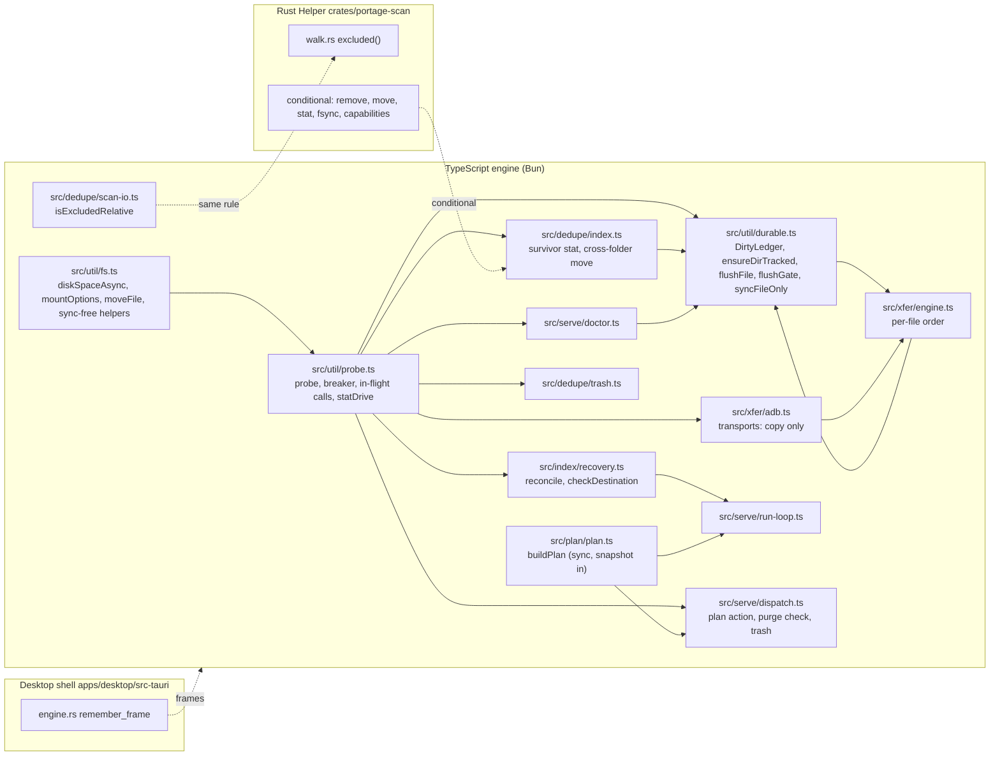
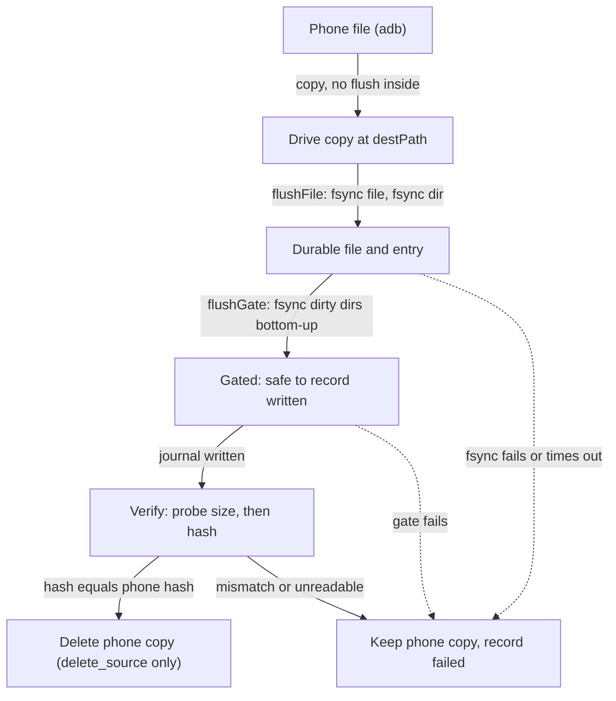

# Design Document: transfer-durability-and-fs-hardening

**Feature:** transfer-durability-and-fs-hardening
**Spec type:** feature
**Workflow:** requirements-first, design phase
**Requirements:** requirements.md (final and approved; this document does not change it)
**Status:** Draft. Owner approvals are recorded in Open items and marked **Decided**. Open items the owner has not decided stay open. No code is written. Measurements E1 to E5 have not run. Decisions that depend on them are marked **pending measurement**.

## Overview

Portage copies a phone file to the archive drive, checks the copy against the phone's own hash, and then deletes the phone copy. Three gaps weaken that sequence (requirements, Introduction):

1. **Durability.** The drive copy is flushed by `sync -f` (src/util/fs.ts:25-37). On the archive's ntfs-3g mount that call does not request a device flush (F1 to F3; these are owner-cited and were not verified in this workspace). A failed flush is recorded as success (C1). The design replaces it with an fsync of the file and then of its directory (R1). Those fsyncs run once per file, in the engine, before the copy is recorded as `written`.
2. **Blocking probes.** Drive reads run as synchronous child processes or synchronous stats, with no deadline (Appendix A). The design gives every drive call a deadline, moves it off the event loop, and reports a timeout as "could not be read" (R2).
3. **Exclusions.** A directory exclusion containing `/` matches a suffix of the path, not whole segments. `Android/data` therefore also excludes `MyAndroid/data` (C3). The Rust walker and the TypeScript fallback both have the bug. The fix is in both (R3).

The design also covers the conditional Helper moves (R4), a type-only frame peek in the desktop shell (R5), the CI checks (R6), and the measurement harness (R7).

### Decisions

- **One flush per file.** The flush is an fsync of the file, then an fsync of its directory (R1.2, R1.3). Flushes stay per file (requirements decided default 1).
- **A gate before `written`.** Before a copy is recorded as written, the engine fsyncs every directory marked dirty under the destination root, bottom up. This is a superset of the copy's own path, because R1.13 requires every flush-set member that gained an entry, not only the ancestors of one copy (DV-6).
- **A failed directory fsync poisons that directory.** A failed or timed-out directory fsync marks the directory poisoned until the Engine restarts. A later successful fsync does not clear it. Linux may report a writeback error once and then drop the data (see EH-4). This rule is not in the requirements text (DV-8). It needs owner confirmation (Open items, O-5).
- **One probe wrapper for every drive call.** `probe()` in `src/util/probe.ts` runs each probe with a 3-second deadline (R2.2). The verify read and the purge read of a drive copy take the flush deadline for the copy's size instead (R2.2, R2.10). Flushes use their own deadlines (R1.12, R1.13). Three consecutive deadline timeouts on one root trip a breaker. The breaker refuses drive work until restart (R2.12). A child process that outlives its deadline does not hold a result (probe section, RK-17).
- **`buildPlan` stays synchronous.** Its callers await the drive snapshot (`snapshotDestinations`) and the destination probe (`probeDestination`) first, then pass both in. `buildPlan` judges the probe with its own byte total (DV-10). This avoids an async conversion of `test/plan.test.ts`.
- **Helper moves wait for measurements.** E2 and E3 decide whether trash deletion, the cross-folder move, and the survivor stat move to the Helper (R4). Until a gate passes, TypeScript runs the operation and the result names TypeScript (R4.10). The Helper design is in its own section, and nothing in it is built.

### Deviations and verified contradictions

Every row below is a place where this design departs from the direction, or where a verified fact contradicts a requirement's text. The requirements file is not edited. Each row states the handling. Open items repeat the ones that need the owner.

| ID | Source | Finding | Evidence | Handling in this design |
|---|---|---|---|---|
| DV-1 | Direction 1: the 621 ms stat is "measured in main.rs" | The figure exists only in a doc comment. No committed record exists. | crates/portage-scan/src/main.rs lines 21-23; TODO.md line 70 says no benchmark artefact exists for the 4.1 s and 175 s claim. | Cited as a claim only. Requirement R7.1 needs a record, so E1 records stat latency directly (Measurement plan). |
| DV-2 | F7 and F10: archive is `/dev/sda1`, USB port 4-2 at 5000 Mbit | On this host the archive mounts as `/dev/sdb1`. Its USB device is `3-4` at 480 Mbit/s. The disk is rotational and writes back. | `/proc/mounts`; `/sys/block/sdb/queue/rotational` = 1; `/sys/block/sdb/queue/write_cache` = "write back"; `/sys/devices/pci0000:00/0000:00:14.0/usb3/3-4/speed` = 480. | The harness resolves the partition from the mount line, and reads the device name, the USB port, and the link speed at run time (R7.1). Records name the values they found. O-9 is decided: the records come from this host as it is now. The requirement text stays as written. |
| DV-3 | Direction 2 and 3: "make reconcile async" | `reconcile` is already async. Only its two `statSyncSafe` calls change. | src/index/recovery.ts lines 48, 82, 102. | Only the stat calls change. |
| DV-4 | Direction 3: reuse `mountOptions` | `mountOptions` is already async, but it is private to volumes.ts and uses a 5-second deadline. | src/device/volumes.ts lines 190-205. | Moved to src/util/fs.ts and exported. The destination check uses 3 seconds. Volume discovery keeps 5 seconds (out of scope). |
| DV-5 | Direction 6: E1 bullet | The direction's E1 bullet omits two measurements that the requirement's E1 definition requires: stat latency while a flush is pending, and stat time after it ends. | requirements.md, Measurements table, row E1. | Both measurements are included in E1 (Measurement plan, E1). |
| DV-6 | Direction 1: flushChain snapshots the dirty directories on the copy's path | R1.13 says each flush-set member that gained an entry. A flush-set member can be dirty without lying on the copy's path, for example a created sibling directory. | requirements.md R1.13 and decided default 7. | The gate fsyncs every dirty mark under the root, bottom up. |
| DV-7 | Direction 2: order is copy, flush, record, verify, delete | Direction omits the R1.13 gate. | requirements.md R1.13, R1.15. | Order adds the gate between the flush and "written" (Architecture, per-file order). |
| DV-8 | Not in direction or requirements | A failed directory fsync can be followed by a success that does not prove the lost data reached disk. | Kernel errseq documentation (a reported error is not re-reported to later samplers); PostgreSQL manual, section 19.14 (a retry can report success after data is lost). | Poison rule (EH-4). Owner decision O-5. |
| DV-9 | Direction 1 and R1.4 | Dirty marks left by a failed fsync in an earlier run must still block a later copy in the same directory. | requirements.md R1.4 and R1.13. | Marks persist in the ledger across runs for the life of the process. The gate retries them. |
| DV-10 | Direction 2 and 3: callers await `checkDestination` | `buildPlan` calls `checkDestination` (src/plan/plan.ts line 228) and reads the drive per file with `statSync` (line 168). `buildPlan` is synchronous and has two production callers plus a test helper. | src/plan/plan.ts lines 84, 168, 228; src/serve/run-loop.ts line 155; src/serve/dispatch.ts line 586; test/plan.test.ts line 62. | `buildPlan` stays synchronous. Callers pass the destination probe as `space` and the `onDisk` snapshot. `buildPlan` judges `space` with its own `bytesTotal`. See Components, planning. |
| DV-11 | Appendix A | The per-file `statSync` in `buildPlan` (src/plan/plan.ts line 168) is a synchronous read of the drive, and Appendix A does not list it. | src/plan/plan.ts line 168. | Decided (O-1): Appendix A row P17. The stat is converted through the snapshot (DV-10). |
| DV-12 | Appendix A | Doctor's `probeFstype` and `isReadOnly` run `findmnt` on the destination with a 5-second kill timer. Appendix A did not list them. Row P19 now lists them, and R2.2 gives them 3 seconds. | src/serve/doctor.ts lines 390-410. | Decided (O-1). Both move to `readMount`, with a 3-second deadline that is also the kill timer (Doctor section). |
| DV-13 | AGENTS.md rule 4 | Doctor calls `isDirectory` for the destination (line 162) and for the archive walk's readiness check (line 244). `isDirectory` returns false on any stat error, so an unreadable mount is reported as "does not exist" and the walk is skipped as not ready. | src/serve/doctor.ts lines 162 and 244; src/util/fs.ts lines 181-191 (`isDirectory` returns `stat?.isDir ?? false`). | Both calls use `statDrive` (row P18). An unreadable root prints "could not be read". "does not exist" is printed only for a missing path (R2.5). |
| DV-14 | R2.12 and the destination check | `findmnt --target` resolves an existing directory that is not a mount point to the parent filesystem. Verified: `findmnt -no TARGET,FSTYPE --target /home/node/Documents` returns `/ ext4`. So the current check passes for an empty mount directory with the drive unplugged. | Command run in this workspace. The current exit-status test catches only a missing path (exit 1). | Decided (O-3). The destination check refuses a destination whose nearest mount point is the root filesystem (R2.14). The rule needs no config value. See Components, destination check. |
| DV-15 | Direction 8: remove uses `symlink_metadata` plus `remove_dir_all` | Checking a path and then acting on it leaves a window in which a parent can be swapped for a link that points outside the trash root. | requirements.md R4.5 (parent directories must resolve inside the trash root). F5 (std's `remove_dir_all` resolves the top-level path once). | Conditional design walks the parent chain with `openat(O_NOFOLLOW)` and acts relative to the verified handle (Conditional Helper design). Owner decision O-8. |
| DV-16 | Direction 8: capability query "before it sends a command" | Kept literal: one capability query before each command. | Direction 8. | Costs one extra process start per action. Recorded so E2 and E3 timings include it. |
| DV-17 | Direction 7: `EngineStatus.last` as `HashMap<String, Box<RawValue>>` | `EngineState.last` is keyed by `&'static str` (engine.rs line 112). `EngineStatus.last` is keyed by `String` (line 123). | apps/desktop/src-tauri/src/engine.rs lines 85, 112, 123, 251, 314. | Internal key stays `&'static str`. `String` appears only at the serialization edge. |
| DV-18 | Direction 1: `fs.promises.open` plus `FileHandle.sync()` on the archive | Bun 1.4.5 accepts `sync()` on read-only and read-write file handles and on a directory handle, when run against `/tmp`. The device-level effect is not shown. Bun 1.4.5 also exposes `datasync()`. An earlier probe reported otherwise because of a bug in the probe, and it was rerun. | Capability probe in /tmp, run in this workspace. It is not E4. | Design uses `sync()` only. Branch for the directory step is **pending measurement** (E4). Both branches are specified. |
| DV-19 | R2.13 read literally | A literal reading lets flushes that keep arriving postpone a probe's deadline without limit, which would break R2.2 and R2.12. | requirements.md R2.13 and R2.2. | The design starts the probe's wait from the calls pending at the moment the probe starts (Direction 3 says the same). Owner confirms (O-6). |
| DV-20 | Direction 2 and R1.1 on the rsync path | `RsyncTransport.copy` passes the whole remote directory (`dirname(srcPath)/`) and the whole local directory as rsync arguments. rsync can write sibling files that the engine neither flushes nor records. | src/xfer/adb.ts lines 224-246 (argument list), 247 (`ensureDir`). | Flush covers the file the engine asked for. Sibling writes are an open item (O-2). Narrowing the rsync scope changes behaviour, so it needs owner approval. |
| DV-21 | Requirements Appendix A | The verify read and the purge read of a drive copy (`sha256File`) had no deadline. Row P20 now lists them. `sampleHash` is not in Appendix A. | src/util/hash.ts (both functions read the drive without a timeout). | Decided (O-1, row P20). `verifyFile` (src/xfer/engine.ts) and the purge read (src/xfer/purge.ts) each wrap `sha256File` in `probe()` with `flushDeadlineMs(size)` at the call site. A timeout counts toward the breaker. `sampleHash`, which the dedupe scan uses, stays out of scope, and src/util/hash.ts gets no deadline. |
| DV-22 | Scope: journal out of scope | The journal is `bun:sqlite` on the archive, with synchronous calls on the main thread (`journal.ts` line 19, `mkdirSync` at line 222, `PRAGMA synchronous = NORMAL` at line 230). A wedged drive blocks the event loop through the journal, and the probe wrapper cannot bound it. | src/index/journal.ts lines 19, 222, 229-230, 663. | Recorded as a ceiling (Risks, RK-1). Moving the journal is out of scope. |
| DV-23 | R1.8 and R1.13 | A cross-folder move on the same device uses `rename`. The rename changes the source directory's entries, and no requirement fsyncs the source directory. | src/util/fs.ts lines 193-205 (`moveFile`); src/dedupe/index.ts lines 449-450. | Open item O-4. |
| DV-24 | Pre-existing, found while reading | A row left in `written` after a crash is not reconciled. On the next run, `plan.ts` treats a same-size file on disk as already present, so the file is skipped and never verified. | src/index/recovery.ts lines 81-82 (only `verified` is checked); src/plan/plan.ts lines 170-172. | Not changed here. Open item O-7. The order change does not alter it. |
| DV-25 | CI and Bun version | Local Bun is 1.4.5. CI pins 1.4.4 in both the engine and desktop jobs. | `bun --version` in this workspace; .github/workflows/ci.yml (`bun-version: "1.4.4"`). | E4 runs on the CI-pinned version and records both (Measurement plan). |
| DV-26 | Reference matcher (P4) | `src/scan/scan.ts` `matchesExclude` tests `path.includes("/" + clean + "/")` and `endsWith("/" + clean)` (line 72). It is correct for absolute phone paths. It does not match a relative path whose first segment is an excluded name, because the path has no leading `/`. | src/scan/scan.ts lines 69-74. | The P4 reference matcher works on relative paths. The difference is recorded. `src/scan` is frozen and is not changed. |
| DV-27 | R3.6, test assertion | The walker parity test asserts `entry.includes("Android/data")` is false. The new `MyAndroid/data` fixture contains that substring, so the assertion would fail for a correct walker. | test/scan-io.test.ts, walker parity block. | The assertion becomes segment-aware and the expected count rises from 6 to 7. |
| DV-28 | R2.5 and P9 | `reconcile` treats any stat error as "missing". The partial scan skips an unreadable entry as "not a file". | src/index/recovery.ts lines 82-84 and 102. | Both become three-way (ok, missing, unreadable). Unreadable never reads as missing (EH-2). |
| DV-29 | Direction 3: P15 uses `flushFile` | P15 flushes a file in `/tmp`, outside any archive root. `flushFile` needs a root for the ledger and the breaker. | src/serve/doctor.ts line 457 (`sync -f` on a `/tmp` file). | `syncFileOnly` takes the same size-based deadline and records no ledger mark and no breaker count (R2.2). |
| DV-30 | Direction 1: `flushFile` returns ok, failed, or unreadable | R1.5 separates a deadline from an error, and the breaker counts deadlines. "Unreadable" has no separate meaning for a flush. | requirements.md R1.5, R2.3, R2.12. | `FlushOutcome` is `ok`, `failed`, `timeout`, or `refused`. A timeout counts as a deadline for the breaker. |
| DV-31 | requirements.md, Part 2, decided default 9 | Default 9 says P19 "keeps its 5-second kill timer". R2.2 gives P19 a 3-second deadline, and the owner set 3 seconds for both the wait and the kill timer. | requirements.md, default 9 and R2.2. | Decided (O-1). The design uses 3 seconds for the wait and the kill timer. The requirements text is not edited, so default 9 still reads 5 seconds. |

## Architecture

### Module map



`src/util/probe.ts` is new. `src/util/durable.ts` is new. No other new files are created in the engine. Conditional Helper work adds `src/util/helper.ts` only if E2 or E3 passes.

### Data flow



### Per-file order of operations (R1.1, R1.4 to R1.8, R2.7)

Each row names the function that performs the step. The numbers are the order of execution.

| Step | Action | Function and location | Failure result | Requirement |
|---|---|---|---|---|
| 1 | Probe the partial size on the drive | `statDrive` (probe.ts). Replaces `statSyncSafe` at engine.ts line 221 | Missing: size 0. Unreadable: file fails, and the partial is not reset to zero. | R2.5, R2.7 |
| 2 | Create the destination directory if missing | `ensureDirTracked` (durable.ts). Replaces `ensureDir` at adb.ts lines 53 and 247 | Unreadable or failed: file fails. | R1.13, R2.6 |
| 3 | Copy | `transport.copy` (adb.ts or the rsync transport). No flush and no mkdir inside | `failed`: recorded as failed with the reason. | R1.1 |
| 4 | Flush the drive copy | `flushFile` (durable.ts): fsync file, then fsync directory | `failed` or `timeout` or `refused`: recorded as failed. Phone copy kept. | R1.1 to R1.5, R1.12 |
| 5 | Gate on directory fsyncs | `flushGate` (durable.ts): fsync each dirty directory under the root, bottom up | Any failure: recorded as failed. Phone copy kept. | R1.13, R1.15 |
| 6 | Record `written` | `journal.setState(rowId, "written")` (engine.ts line 269, unchanged) | None. | R1.4 |
| 7 | Verify size | `statDrive` (replaces engine.ts line 364) | Missing: "destination disappeared". Unreadable: "the destination could not be read". | R2.7 |
| 8 | Verify hash | `probe()` around `sha256File` (hash.ts), with `flushDeadlineMs(size)` at the call site (P20). Compared with the phone's `sha256sum` | Null or timeout: failed, "the drive copy could not be read". Mismatch: failed. | R1.6, R2.3 |
| 9 | Delete the phone copy | `transport.removeSource` (engine.ts line 317), only when `delete_source` is `after-verify`, the default. `never` and `prompt` skip it (engine.ts line 316; src/config/schema.ts lines 22 and 95) | Refusal: kept, not deleted. | R1.6 |

Steps 4 and 5 run before step 6 for every copy, including copies that are not beneath a directory this run created (DV-6). That makes the rule stricter than R1.13 requires. It cannot be weaker, because stale marks from failed runs must also be retried (DV-9).

The phone copy is removed only at step 9, and only when `delete_source` is `after-verify`, the default. `never` and `prompt` skip the removal. The schema accepts `prompt`, but no code acts on it, so it behaves like `never` (RK-18). This feature does not change that.

### Appendix A rows and their change

Every row in Appendix A of requirements.md is asynchronous after this change (R2.15). Rows P1, P2, P3, P5 to P10, P14, P15, and P17 were synchronous before it. The table names the change for each row and the deadline that applies.

| Row | Call | Change | Deadline after the change |
|---|---|---|---|
| P1 | Flush of a drive copy | `fsyncPath` (src/util/fs.ts lines 25 to 37, `sync -f` with the bare `sync` fallback) is deleted. The three call sites in src/xfer/adb.ts call `flushFile` in durable.ts, which uses `fs.promises.open` and `handle.sync()`. | Flush deadline (R1.12) |
| P2 | Mount check (`findmnt`) | `checkDestination` no longer uses `Bun.spawnSync` (recovery.ts line 162). `probeDestination` reads the mount through `readMount`, which runs through `realSpawn`. | 3 s |
| P3 | Free space (`df`) | `diskSpace` (fs.ts lines 44 to 62) is deleted with its last caller (recovery.ts line 192, doctor.ts line 170). `diskSpaceAsync` is then the only reader. | 3 s |
| P4 | Free space around trash emptying | The existing call stays, and `probe()` wraps it. Its 3-second kill timer ends the child at the same moment. | 3 s |
| P5 | Partial-bytes stat before a copy | engine.ts line 221: `statSyncSafe` becomes `statDrive`, which is `fs.stat` and starts no child process. | 3 s |
| P6 | Stat after an adb pull | adb.ts line 93: `statDrive`. | 3 s |
| P7 | Stat after an rsync copy | adb.ts line 264: `statDrive`. | 3 s |
| P8 | Stat during verification | engine.ts line 364: `statDrive`. | 3 s |
| P9 | Reconcile stat on verified rows | recovery.ts line 82: `statDrive`. `reconcile` is already async (DV-3). | 3 s |
| P10 | Reconcile stat on partial files | recovery.ts line 102: `statDrive`. | 3 s |
| P11 | Survivor stat | dedupe/index.ts line 429: `statDrive`. | 3 s |
| P12 | Drive copy existence check before purge | dispatch.ts line 268: `Bun.file(...).exists()` becomes `statDrive`. | 3 s |
| P13 | Trash root stat | trash.ts line 83: `statDrive`. | 3 s |
| P14 | Rsync binary version check | adb.ts line 215: `RsyncTransport.available` becomes async and runs `realSpawn` under `probe()` with a `null` root. | 3 s |
| P15 | Doctor flush of a /tmp file | doctor.ts line 457: `Bun.spawnSync(["sync", "-f", tmp])` becomes `syncFileOnly`, which runs asynchronously. | `flushDeadlineMs(size)` |
| P16 | Cross-folder fallback (copy, then remove) | `moveFile` moves to durable.ts. Its copy branch calls `flushFile(root, to, size)`, then `flushGate(root, dirname(to))`, and unlinks the source only after both return ok. | Flush deadline (R1.12), and the 30-second fsync deadline of R1.13 for the gate |
| P17 | Per-file stat in the plan | plan.ts line 168: `buildPlan` no longer calls `statSync`. `snapshotDestinations` runs first, with one `statDrive` per path from `destinationsFor`. `buildPlan` reads the snapshot and stays synchronous (DV-10). | 3 s |
| P18 | Doctor's `isDirectory` checks | doctor.ts lines 162 and 244: `statDrive` replaces `isDirectory`. | 3 s |
| P19 | Doctor's `findmnt` probes | doctor.ts lines 390 to 410: `probeFstype` and `isReadOnly` call `readMount` under `probe()`. | 3 s, which is also the kill timer |
| P20 | Verify read and purge read | engine.ts line 374 and the purge read at purge.ts line 82: `probe()` wraps `sha256File` with `flushDeadlineMs(size)` at each call site. `sha256File` takes no deadline. | Flush rule for the copy's size (R2.2, R2.10) |

The purge existence check in purge.ts (`applyPurge`, line 151) is not an Appendix A row. R2.10 covers it, and `statDrive` gives it the 3-second probe deadline.

### Concurrency

`runTransfer` runs up to `jobs` workers (engine.ts, worker pool). The ledger, the breaker, and the in-flight registry are process-wide and keyed by destination root. A flush on one worker does not block a probe on another worker, but a probe waits for the flushes that were pending when it started (EH-6). The event loop does not wait on any drive call, because every drive call is async and bounded (R2.1, R2.8).

## Components and interfaces

Signatures only. Bodies are left to the task phase. Each interface names the requirement it serves.

### src/util/probe.ts (new): the one drive-call wrapper

```ts
export const PROBE_TIMEOUT_MS = 3_000;   // R2.2
export const BREAKER_LIMIT = 3;          // R2.12

export type ProbeResult<T> =
  | { kind: "ok"; value: T }
  | { kind: "missing" }                   // ENOENT only
  | { kind: "unreadable"; reason: "timeout" | "error" | "refused"; code: string | null; message: string };

export interface DriveStat { isFile: boolean; isDir: boolean; size: number; mtimeMs: number }

/** One read under its own deadline (R2.2). Waits first for flushes pending on `root` (R2.13), unless `root` is null. Resolves at its deadline even if the task has not settled (RK-17). */
export function probe<T>(root: string | null, label: string, task: () => Promise<T>, timeoutMs?: number): Promise<ProbeResult<T>>;

/** Pure. ENOENT is missing; any other error is unreadable (R2.5, R2.11). */
export function classifyError(err: unknown): Exclude<ProbeResult<never>, { kind: "ok" }>;

/** fs.stat through the probe. No child process (R2.6). Symlinks are followed, as `statSafe` does today. */
export function statDrive(root: string, path: string, timeoutMs?: number): Promise<ProbeResult<DriveStat>>;

export interface BreakerState { consecutiveTimeouts: number; tripped: boolean }
export function breakerFor(root: string): BreakerState;   // read-only view for Doctor and the status frame

/** Flushes and directory fsyncs register here, so a probe can wait for them (R2.13). */
export function runFlushCall<T>(root: string, label: string, deadlineMs: number, call: () => Promise<T>): Promise<DriveCallOutcome<T>>;
export type DriveCallOutcome<T> =
  | { kind: "ok"; value: T }
  | { kind: "error"; error: unknown }
  | { kind: "timeout"; deadlineMs: number };

/** Restart and tests only. A production Engine never resets a breaker (R2.12). */
export function resetDriveState(root?: string): void;
```

`probe()` does four things in order: refuse if the breaker is tripped; wait until every flush registered on `root` at this moment has returned or reached its own deadline; start its own timer; classify the result. `root` is `null` for a probe that reads nothing on the archive drive (P14). Such a probe does not wait for flushes, and it does not count toward the breaker. Only deadline timeouts count toward the breaker. Any call that returns, with a value or with an error, resets the count. The count tracks calls in a row (decided default 6).

The probe resolves at its own deadline, even when the task has not settled. The task's later result is ignored.

**Child processes.** `realSpawn` signals a timed-out child with SIGTERM and then SIGKILL (src/util/spawn.ts, lines 44 to 53). It then awaits `proc.exited` (line 79), and a child that survives SIGKILL keeps that await pending. The probe therefore races its task against its own timer, and it never waits on the spawn promise after the timer fires. Child-process probes (P2, P3, P4, P14, and P19) pass the same deadline to `realSpawn` as `timeoutMs`, so the child is signalled at the moment the probe resolves. The wait for the child's exit runs in the background. It changes no result, no breaker count, and no flush wait (RK-17).

### src/util/durable.ts (new): ledger, directories, flushes, gate

```ts
export const FLUSH_BASE_MS = 30_000;                 // R1.12
export const FLUSH_UNIT_BYTES = 10_000_000;          // decimal megabytes, R1.12
export const FLUSH_PER_UNIT_MS = 1_000;
export const DIR_FSYNC_DEADLINE_MS = 30_000;         // R1.13
/** 30 s + ceil(size / 10,000,000) s. Zero bytes gets 30 s. 10,000,001 bytes gets 32 s. */
export function flushDeadlineMs(size: number): number;

export interface DirtyMark { dir: string; depth: number; version: number; poisoned: string | null }

export class DirtyLedger {
  readonly root: string;
  /** A directory gained an entry (a file, or a created child directory). Bumps its version. */
  mark(dir: string): void;
  /** Every mark, deepest first, then by path. */
  snapshot(): DirtyMark[];
  /** Clears the mark only when its version still equals `version` (P2). */
  clearIfUnchanged(dir: string, version: number): boolean;
  /** Poisons `dir` for the life of the process (EH-4). The mark stays dirty. */
  poison(dir: string, reason: string): void;
  /** The first poisoned directory on the path from `dir` up to the root, or null. */
  chainPoison(dir: string): { dir: string; reason: string } | null;
}
export function ledgerFor(root: string): DirtyLedger;
export function resetLedgers(): void;                // restart and tests only

export type EnsureDirOutcome =
  | { kind: "exists" }
  | { kind: "created"; created: string[] }           // top-down; absolute paths
  | { kind: "failed"; reason: string };              // includes "could not be read"
/** Stats the target first. If it exists, returns `exists` without touching the ancestors. Otherwise walks up to the deepest existing ancestor, one probe per level, then creates each missing level top-down with non-recursive mkdir. EEXIST counts as existing (R1.13). */
export function ensureDirTracked(dir: string, root: string): Promise<EnsureDirOutcome>;

export type FlushOutcome =
  | { kind: "ok" }
  | { kind: "failed"; reason: string; target: "file" | "dir"; path: string }
  | { kind: "timeout"; deadlineMs: number; target: "file" | "dir"; path: string }
  | { kind: "refused"; reason: string };

/** R1.2, R1.3: fsync the file, then fsync its directory. Nothing else is in the Flush. */
export function flushFile(root: string, path: string, size: number): Promise<FlushOutcome>;
/** R1.13, R1.15: fsync every dirty, un-poisoned directory under `root`, bottom up. Stops at the first failure. */
export function flushGate(root: string, copyDir: string): Promise<FlushOutcome>;
/** Doctor P15 only: fsync one file outside any archive root. No ledger, no breaker (R2.2). */
export function syncFileOnly(path: string, size: number): Promise<FlushOutcome>;

export type MoveOutcome =
  | { kind: "moved"; via: "rename" | "copy" }
  | { kind: "failed"; reason: string };
/** Same device: rename, no flush (DV-23). Across devices (P16): copy, then flushFile(root, to, size), then flushGate(root, dirname(to)), then unlink the source. The unlink runs only after both return ok (R1.8). */
export function moveFile(root: string, from: string, to: string, deps?: { rename?: typeof rename }): Promise<MoveOutcome>;   // deps.rename is the test seam (Testing strategy)
```

The flush opens the file with `fs.promises.open(path, "r")`, calls `handle.sync()`, and closes it. The directory is opened the same way. Read-only opens are the default. E1 may change this (Measurement plan). `datasync()` (fdatasync) is not used, because R1.2 names an fsync (DV-18).

### src/util/fs.ts (changed)

| Export | Change |
|---|---|
| `fsyncPath` | Deleted with the bare `sync` fallback (R1, Migration). |
| `diskSpace` | Deleted with its last caller (recovery.ts 192, doctor.ts 170). After that, `diskSpaceAsync` is the only reader (P3). |
| `diskSpaceAsync(spawn, path)` | Unchanged call. Its 3-second `timeoutMs` is the probe deadline, so the child is signalled when the probe resolves (probe section). `null` means the read failed, and the caller reports it as unreadable. |
| `readMount(spawn, path, timeoutMs)` | New. Moved from volumes.ts `mountOptions` (DV-4). Runs `findmnt -rno FSTYPE,OPTIONS,TARGET --target <path>` once, and returns `MountState`. Escaped spaces in the fields are unescaped. |
| `statSafe` | Kept only for `globIo` (scan-io.ts line 217, not in Appendix A) and `isDirectory`'s other callers. Deleted when no caller remains. |
| `statSyncSafe` | Deleted after engine.ts, adb.ts, and recovery.ts move to `statDrive` (Migration). |
| `ensureDir` | Deleted. Callers use `ensureDirTracked`. |
| `ensureStateDirs(destRoot)` | Creates `.portage`, `partial`, `trash` through `ensureDirTracked`. Returns the same three paths. |
| `isDirectory` | Kept for non-drive callers. Drive callers use `statDrive`. |
| `moveFile` | Moved to durable.ts (`moveFile(root, from, to)`), because it now flushes. |

```ts
export type MountState =
  | { kind: "mounted"; fsType: string; options: string; target: string }
  | { kind: "not-mounted" }                          // findmnt exit 1, no output: the path does not exist
  | { kind: "unreadable"; reason: string };          // timeout, or any other failure
export function readMount(spawn: SpawnFn, path: string, timeoutMs?: number): Promise<MountState>;
```

`readMount` treats `res.signal === "TIMEOUT"` as unreadable. This is the flag `realSpawn` sets when it kills the child (spawn.ts). It never reports a timeout as "not-mounted". A directory on the root filesystem reads as mounted, with the target `/`. The destination check refuses that case (R2.14, DV-14, O-3).

### src/index/recovery.ts (changed)

```ts
export interface DestinationCheck {
  ok: boolean;                                       // kept for existing callers
  status: "ok" | "refused" | "unreadable";
  reason?: string;
  fix?: string;
  freeBytes: number; totalBytes: number; usedFraction: number;
}
export interface DestinationProbe {
  mount: MountState;                                  // readMount, 3-second deadline (P2)
  space: { kind: "ok"; free: number; total: number } | { kind: "unreadable"; reason: string };   // diskSpaceAsync, 3-second deadline (P3)
}
/** Async. Two reads, each under its own 3-second deadline (R2.2). Makes no decision. */
export function probeDestination(spawn: SpawnFn, destRoot: string): Promise<DestinationProbe>;
/** Pure. Refuses a mount whose target is `/` (R2.14) and any unreadable read (R2.4). Keeps the existing reasons for a full disk and a read-only mount. */
export function judgeDestination(probe: DestinationProbe, plannedBytes: number, headroom: number): DestinationCheck;
/** probeDestination, then judgeDestination. Tests and single-call callers use it. The plan path and the run path call the two halves, because judgeDestination needs the byte total from planning (DV-10). */
export function checkDestination(spawn: SpawnFn, destRoot: string, plannedBytes: number, headroom: number): Promise<DestinationCheck>;
/** Three-way per row: ok, missing, unreadable (R2.5). */
export function reconcile(journal: Journal, partialDir: string, root: string): Promise<RecoveryReport>;
```

**The root-filesystem rule (R2.14, O-3).** `readMount` returns the nearest mount point of the destination, which is the `TARGET` that `findmnt` reports. `judgeDestination` refuses when that target is `/`. The result has `status: refused` and `ok: false`, and its reason is the R2.14 report, "the archive drive is not mounted". The rule needs no config value. It covers an empty directory on the system disk. It does not check which drive is mounted (RK-10). An exit status of 1 with no output keeps its current reason text, "destination is not on a mounted filesystem" (src/index/recovery.ts). EH-13 has no row for the R2.14 report (O-17).

`RecoveryReport` gains `unreadable: string[]`, the paths that could not be stat-ed. A `verified` row whose destination is unreadable is not moved to `failed(missing)`, because "missing" would be a lie (R2.5). It is reported as unreadable and left as `verified`.

### src/plan/plan.ts (changed, still synchronous)

```ts
export interface PlanOptions {
  // existing fields unchanged
  space: DestinationProbe;                                       // probed by the caller, judged inside buildPlan (DV-10)
  onDisk: ReadonlyMap<string, ProbeResult<DriveEntryState>>;     // snapshot, one entry per destPath
}
export interface DriveEntryState { isFile: boolean; size: number }
/** The destination of every candidate, joined as buildPlan joins it: join(destRoot, candidate.relative). */
export function destinationsFor(candidates: readonly Candidate[], destRoot: string): string[];
/** Async. One statDrive per path, each with its own 3-second deadline (P17). Callers await it before buildPlan. */
export function snapshotDestinations(root: string, destPaths: readonly string[]): Promise<ReadonlyMap<string, ProbeResult<DriveEntryState>>>;
```

Behaviour of `buildPlan` with the snapshot:

- An entry that is `ok` and a file works as the old `diskSize`.
- `missing` gives the old `null`.
- `unreadable` makes the file **skipped** with the reason "the path could not be read; not transferred over" (P17, R2.3). The file is not transferred, because the transfer would overwrite a file whose state is unknown.
- An entry absent from the map is also treated as unreadable ("not checked"). A missing key can never produce a transfer.
- `space` is the destination probe. After the loop, `buildPlan` calls `judgeDestination(space, bytesTotal, spaceHeadroom)` (plan.ts line 228). The warning text is unchanged.
- `destinationsFor` covers every candidate, so the snapshot holds every path that `buildPlan` can stat. `buildPlan` reads only the entries it needs.
- Callers, in order: `destinationsFor`; then `snapshotDestinations` and `probeDestination`, both awaited; then `buildPlan`. The run path then calls `judgeDestination` with `planResult.bytesTotal`, and refuses when the result is not ok (R2.4).

### src/xfer/transport.ts and src/xfer/adb.ts (changed)

```ts
export interface CopyRequest {
  // existing fields unchanged
  root: string;                                  // destination root, for probes and the breaker
}
export type TransportVerdict =
  | { kind: "available" }
  | { kind: "absent"; reason: string }           // binary missing, or a version check that answered "no"
  | { kind: "failed"; reason: string };          // the check reached its deadline (R2.3, P14)
export interface Transport {
  readonly name: "adb" | "rsync";
  available(deviceId: string): Promise<TransportVerdict>;
  copy(req: CopyRequest): Promise<CopyOutcome>;  // no flush and no mkdir inside (R1.1)
  removeSource(serial: string, srcPath: string): Promise<boolean>;
}
```

Transports keep their copy logic. They lose `ensureDir` (adb.ts lines 53 and 247), `fsyncPath` (lines 106, 176, 273), and `statSyncSafe` (lines 93, 264). Their post-copy existence check uses `statDrive(req.root, req.destPath)`. Missing gives `failed` with "does not exist". Unreadable gives `failed` with "the destination could not be read", as R2.7 requires.

`RsyncTransport.available` (adb.ts line 215) becomes an async probe (P14). It runs `realSpawn([bin, "--version"], { timeoutMs: 3000 })` under `probe()` with a `null` root, because it reads nothing on the archive drive. A `TIMEOUT` signal gives `failed` with "check failed: no answer within 3 s", never `absent` (R2.3).

### src/xfer/engine.ts (changed)

`EngineOptions` gains `root: string`. `processFile` follows the per-file order in Architecture. The journal states do not change: `copying`, `written`, `verified`, `source_deleted`, `done`, `failed`, `skipped_duplicate`. The new failure reasons are text only, not new states.

`verifyFile` replaces `statSyncSafe` (line 364) with `statDrive`. Its hash read (line 374) runs under `probe()` with `flushDeadlineMs(local.size)`. The message at line 376 changes from "could not read the destination for hashing" to "the drive copy could not be read" (P20, R2.3). A timeout counts toward the breaker (DV-21).

### src/serve/doctor.ts (changed)

- Destination block: `statDrive` replaces `isDirectory` at line 162 (P18). An unreadable root prints "could not be read". "does not exist" is printed only for a missing path (R2.5). A mount whose target is `/` prints "the archive drive is not mounted", in place of the filesystem name (R2.14).
- `probeFstype` and `isReadOnly` (P19) each call `readMount` under `probe()`, with a 3-second deadline that is also the kill timer (O-1, DV-12). A timeout prints "the mount check could not be read". It never prints an unknown filesystem or a drive that is not read-only (R2.3).
- Line 170: `diskSpaceAsync` replaces `diskSpace` (P3).
- Line 244: `statDrive` replaces `isDirectory` for the walk's readiness check (P18). An unreadable root skips the walk, and the Doctor says so.
- Line 457: `syncFileOnly(tmp, size)` replaces `Bun.spawnSync(["sync","-f",tmp])` (P15), under `flushDeadlineMs(size)`. A deadline timeout reports "check failed" (R2.3), never "healthy".

### src/serve/dispatch.ts (changed)

- `withFreshDriveCopies` (line 265): `statDrive` replaces `Bun.file(...).exists()` (line 268). `missing` gives the existing refusal "the drive copy is gone — nothing was deleted". `unreadable` refuses with the reason "drive copy unreadable" (R2.10). A directory gives "the drive copy is not a file — nothing was deleted" (P12).
- The plan action (line 586) calls `destinationsFor`, awaits `snapshotDestinations` and `probeDestination`, then calls `buildPlan` (DV-10).
- Trash free-space reads (lines 1118 and 1120) stay on `diskSpaceAsync` (P4, already bounded).

### src/xfer/purge.ts (changed)

- `applyPurge` (line 151): `statDrive` replaces `Bun.file(...).exists()`. `missing` keeps "drive copy no longer exists". `unreadable` refuses with "drive copy unreadable" (R2.10). A directory refuses as not a file. This check is not an Appendix A row. R2.10 covers it, and `statDrive` gives it the 3-second probe deadline. `PurgeOptions` gains `root`, the destination root.
- The verify read in the purge plan (line 82): `probe()` wraps `sha256File(row.dest_path)` with `flushDeadlineMs(row.size)` (P20). A timeout counts toward the breaker. A timeout or a null result refuses with "drive copy unreadable" (R2.3, R2.10). The phone-side hash is not bounded here, because the adb transport is out of scope.

### src/dedupe/index.ts (changed)

- Survivor check (line 429): `statDrive(root, other.path)`. Only `ok` counts as a survivor. `missing` and `unreadable` do not, and the deletion is refused (R2.9). EH-13 has no survivor row, so until the owner decides, the refusal uses the unreadable row "the destination could not be read; nothing was changed" (O-17).
- Apply step (lines 449 to 450): `ensureDirTracked(dirname(to), root)`, then `moveFile(root, target, to)` from durable.ts. A `failed` result refuses the move (R1.8).

### src/dedupe/trash.ts (changed)

```ts
export interface TrashStatus {
  // existing fields unchanged
  unreadable: string | null;                     // reason, when the trash root could not be read (R2.11)
}
```

`readTrash` uses `statDrive(destRoot, root)`. `missing` gives `exists: false`. `unreadable` sets `unreadable` to "the trash could not be read" (R2.3, R2.11) and leaves `exists` false. It never reports "no trash" for an unreadable root. `emptyTrash` keeps its `lstat` and containment checks, which are not drive probes in Appendix A.

### src/dedupe/scan-io.ts (changed)

`isExcludedRelative` is rewritten with the segment rule (R3.2). The signature does not change:

```ts
export function isExcludedRelative(relative: string, patterns: readonly string[]): boolean;
```

### crates/portage-scan/src/walk.rs (changed)

```rust
impl Walker<'_> {
    fn excluded(&self, name: &str) -> bool;          // same signature; the body changes
}
/// True when the segments of `pattern` equal the last segments of `trail` followed by `name` (R3.1).
/// Reads the trail by index. Does not clone it.
fn tail_matches(pattern: &str, trail: &[String], name: &str) -> bool;
```

Rules for `tail_matches`: a pattern with no `/` is handled by the caller as an exact name match (R3.4). A pattern with `/` must match the trailing segments exactly. A `MyAndroid` segment never matches an `Android` segment.

### apps/desktop/src-tauri/src/engine.rs (changed)

```rust
/// Remembers `line` as the last frame of its type when that type is one of the 18 known types (R5.3, R5.4).
/// Leaves `last` unchanged for any other input. Reads only the top-level `type` (R5.2).
pub fn remember_frame(last: &mut HashMap<&'static str, Box<RawValue>>, line: &str);

/// The known type that `kind` names, or None (R5.3).
fn known_type(kind: &str) -> Option<&'static str>;

/// Visitor that captures the top-level `type` and skips every other value with IgnoredAny (R5.2).
struct TypePeek;
impl<'de> serde::de::Visitor<'de> for TypePeek { type Value = Option<Cow<'de, str>>; /* ... */ }

pub struct EngineState { /* ... */ last: Mutex<HashMap<&'static str, Box<RawValue>>>, /* ... */ }
#[derive(Serialize)]
pub struct EngineStatus { running: bool, last: HashMap<String, Box<RawValue>> }   // R5.5
```

`on_stdout` (line 314) forwards `line` unchanged (R5.1) and then calls `remember_frame`. It does not build a `Value`.

## Data models

### Process-wide state (in memory only)

The journal schema does not change (out of scope). Everything below lives in memory for the life of the Engine process. A restart clears it, which is the intended reset for breakers and poison (R2.12).

| Structure | Key | Fields | Written by | Read by |
|---|---|---|---|---|
| `DirtyLedger` | destination root (one per root) | `dir`, `depth`, `version`, `poisoned: string or null` | `mark` (on file add and on directory create), `clearIfUnchanged` (after a successful fsync), `poison` (after a failed or timed-out directory fsync) | `flushGate`, `chainPoison` |
| `breaker` | destination root | `consecutiveTimeouts`, `tripped` | `runFlushCall` and `probe`: a deadline timeout adds 1; any call that returns, with a value or an error, sets 0; reaching 3 sets `tripped` | `probe`, `runFlushCall`, Doctor |
| in-flight registry | destination root | set of `{ label, deadlineMs, settled: Promise<void> }` | `runFlushCall` (add on start, remove on settle) | `probe` (snapshot at start) |

The in-flight entry settles on return or on its own deadline, whichever comes first. A timed-out flush settles at its deadline even if the kernel call is still running (EH-5).

### Results

| Type | Values | Meaning |
|---|---|---|
| `ProbeResult<T>` | `ok(value)`, `missing`, `unreadable(timeout / error / refused, code, message)` | Only ENOENT is `missing`. A timeout, a breaker refusal, and any other error are `unreadable` (P3). |
| `FlushOutcome` | `ok`, `failed(target, path, reason)`, `timeout(deadlineMs, target, path)`, `refused(reason)` | `target` names the file or the directory that failed. |
| `EnsureDirOutcome` | `exists`, `created(paths)`, `failed(reason)` | `created` is top-down, so a caller can mark each path. |
| `DestinationCheck` | `status`, `ok`, `reason`, `fix`, sizes | `status: "unreadable"` is the R2.4 result. The run path refuses on `!ok`. |
| `MountState` | `mounted` (with its target), `not-mounted`, `unreadable` | Separates a missing path from a timeout (R2.3). A target of `/` is refused (R2.14). |
| `DestinationProbe` | `mount`, `space` | The two async reads. `judgeDestination` decides from them and makes no read of its own. |
| `DriveEntryState` | `{ isFile, size }` | One per destination path in the plan snapshot. |
| `TransportVerdict` | `available`, `absent`, `failed` | `failed` is the P14 deadline result (R2.3). |

### Requests and responses (conditional Helper)

These models apply only if E2 or E3 passes, or E4 fails for directories. The full shapes are in the Conditional Helper design. Summary:

| Command | Request | Response |
|---|---|---|
| `capabilities` | `{ "command": "capabilities" }` | `{ ok, version, commands: string[] }` |
| `remove` | `{ command, trashRoot, paths: string[] }` | `{ results: [{ path, outcome, reason?, files, bytes }] }` |
| `move` | `{ command, destRoot, trashRoot, moves: [{ from, to }] }` | `{ results: [{ from, to, outcome, reason? }], createdDirs: string[] }` |
| `stat` | `{ command, root, paths: string[] }` | `{ results: [{ path, outcome, size, mtimeMs, reason? }] }`, where `outcome` is `file`, `dir`, `missing`, or `unreadable` |
| `fsync` | `{ command, root, targets: [{ path, kind }] }` | `{ results: [{ path, outcome, reason? }] }`, where `kind` is `file` or `dir` and `outcome` is `ok` or `failed` |

### Journal and reconciliation (unchanged schema)

The states and transitions in `src/index/journal.ts` do not change. `written` now means "flushed and gated". The meaning changes, and the README state machine is updated to say so (R7.5, Migration). `reconcile` gains the `unreadable` list and never moves an unreadable row (R2.5).

## Error handling

Each rule has an identifier (EH-n) that the other sections cite. Every failure keeps the phone copy. A failure never deletes anything, and a probe failure never produces a "missing" or "zero" result.

### EH-1: flush failure fails one copy

When `flushFile` or `flushGate` returns `failed` or `timeout`, the engine records the row as `failed` with the reason. It does not call `removeSource`. The next run plans the file again, because a `failed` row is not "already on the drive" (plan.ts, `priorFailed`). A file fsync failure fails that copy only and poisons nothing (EH-4).

Flush failures are not fatal to the run. They use the existing `fatal: false` convention (transport.ts), because retrying the file is reasonable.

### EH-2: unreadable is never missing

Every drive read has one of three results. The table gives the handling at each call site.

| Call site | `ok` | `missing` (ENOENT) | `unreadable` (timeout, refusal, other error) |
|---|---|---|---|
| Partial size before copy (engine.ts, was line 221) | Resume rules apply | Size 0 | File failed: "the destination could not be read". The partial is not reset to zero, because zero lets the pull overwrite an existing drive copy. |
| Size check after pull (adb.ts 93, rsync 264) | Compare with the phone size | Failed: "does not exist" | Failed: "the destination could not be read" |
| Verify size (engine.ts, was line 364) | Compare, then hash | Failed: "destination disappeared before verification" | Failed: "the destination could not be read before verification" |
| Reconcile, `verified` rows (recovery.ts, was line 82) | Leave as is | Failed: "missing" (existing rule 2) | Left `verified` and listed in `unreadable` (R2.5) |
| Reconcile, partial files (recovery.ts, was line 102) | Partial entry, same as before | Skipped, as before | Listed as unreadable. Not reported as orphan or absent. |
| Survivor check (dedupe/index.ts 429) | Counts as survivor | Not a survivor | Not a survivor. Deletion refused (R2.9). Refusal text: O-17. |
| Purge check (dispatch.ts 268) | Eligible | Refused: "gone" | Refused: "drive copy unreadable" (R2.10) |
| Trash root (trash.ts 83) | Read the trash | No trash | `unreadable` set to "the trash could not be read", not "no trash" (R2.11) |
| Destination check (findmnt, P2) | Mounted, and the target is not `/` | `not-mounted`, or a target of `/`: refused with "the archive drive is not mounted" (R2.14, O-17) | "the destination could not be read", and the run refuses (R2.3, R2.4) |
| Doctor destination (doctor.ts 162, P18) | Show the drive | "does not exist" (missing path only) | "the path could not be read" |
| Verify hash read (engine.ts 374 and purge.ts 82, P20) | Hashes compared | Not separated: `sha256File` returns null for a missing file and for a read error | Null or timeout: "the drive copy could not be read" (engine), or "drive copy unreadable" (purge). A timeout counts toward the breaker. |

The probe wrapper decides the category. Call sites do not reclassify. `classifyError` maps `ENOENT` to `missing` and every other code to `unreadable`. A `timeout` is always `unreadable`.

### EH-3: breaker after three consecutive deadline timeouts

Each root has one breaker. A timeout on any drive call adds one: a flush, a directory fsync, a probe, or a per-file stat. A call that returns, with a result or an error, sets the count back to zero. An error such as `EIO` or `ENOENT` is an answer, so it does not count.

At three, the breaker trips. Until restart:

- every later drive call returns `unreadable(refused)` without starting;
- `flushFile` and `flushGate` return `refused`;
- the engine stops taking new files. The run ends as failed, with the message "the archive drive stopped answering; restart the Engine after checking the drive";
- the status frame and Doctor report the drive as unreadable (R2.12).

A new run in the same process does not reset the breaker. Only restart does.

### EH-4: a failed directory fsync poisons the directory

When a directory fsync fails or reaches its deadline, the ledger poisons that directory for the life of the process. The rule exists because of how Linux reports writeback errors:

- The kernel's errseq mechanism reports an error once, to the first sampler that has not yet seen it. After that the error is "seen" and is not reported again (kernel documentation for errseq).
- After a reported writeback failure, the kernel may drop the dirty pages. A later fsync can then return success although the data never reached disk. The PostgreSQL manual describes the same risk (section 19.14, "Error Handling").

Consequences:

- A later successful fsync on the poisoned directory does not clear the mark, and does not make a copy durable.
- `flushGate` skips the fsync for a poisoned directory and returns `refused` for every copy whose chain contains it (EH-10).
- Copies in other directories under the same root are not affected, unless the poisoned directory lies on their path.
- Restart clears the poison. A restart does not prove that entries lost in an earlier process reached disk. This is residual risk RK-3.

This rule is not in the requirements text (DV-8). Owner decision O-5 chooses between this rule and a retry rule.

### EH-5: a timed-out call can still hold a worker

A flush that reaches its deadline settles in the engine. Its promise resolves as `timeout`, and the in-flight registry drops it. The underlying kernel call may still be running. Bun's worker for that call stays busy until the kernel returns. The breaker stops new drive calls after three timeouts. A restart ends the process and releases the workers (RK-2).

### EH-6: how long a probe can wait

A probe waits for the flushes registered on its root when it starts. Each of those flushes has its own deadline. The probe's own timer starts after they settle. The worst case for a 3-second probe is therefore the longest pending flush deadline plus three seconds. A flush-rule read (P20) waits in the same way, and then runs for its own flush deadline. For a 5 GB drive copy, the flush deadline is 30 s + 500 s = 530 s, so a probe can wait about 533 s. Flushes that start after the probe are not waited for (DV-19). This keeps probes from starving, but it means a probe can be slow while a large copy is being flushed. The UI shows the probe as pending, and no result is invented.

### EH-7: directory creation failure fails the copy

`ensureDirTracked` returns `failed` when a stat or a `mkdir` is unreadable or times out. The copy that needed the directory fails with that reason, and no bytes are transferred. An `EEXIST` from a concurrent job counts as existing and is not an error (R1.13).

### EH-8: a flush failure does not stop the run

Only the breaker stops the run (EH-3). A single failed copy is recorded and the next file starts. The run summary counts failed files and lists their reasons.

### EH-9: a stat that cannot answer does not change a decision

Every decision that depends on a drive stat is a decision that refuses, skips, or keeps (EH-2). None of them deletes or moves. `plan.ts` skips an unreadable destination with a reason (Components, planning).

### EH-10: a poisoned directory fails its copies at the gate

Copies that reach `flushGate` with a poisoned directory on their chain fail with `refused`. Each such copy keeps its phone copy. A copy in another directory does not fail on the poison (EH-4). This is how a failure in one directory reaches every in-flight copy that depends on it, without an extra fsync.

### EH-11: refusals in the Helper path (conditional)

If a Helper command is used (R4), each path gets its own result. A path outside its root is `refused` with its reason. Other paths in the same request still run. A capability query that fails sends the operation down the TypeScript path, and the result says so (R4.10).

### EH-12: frame parsing never fails a frame

A line that is not a JSON object, or whose type is unknown, is forwarded and not remembered (R5.4). A line whose `type` value is not a string is treated as unknown. No error is emitted to the webview, because the forwarding path has no failure mode.

### EH-13: user-facing text

Each message names the failing thing and what was done. The following strings are fixed, so tests can match them:

| Situation | Text |
|---|---|
| Flush of a file failed | "flush failed: the drive did not confirm the file was written" |
| Directory fsync failed | "flush failed: the drive did not confirm the folder entry: <dir>" |
| A deadline was reached | "flush timed out after <s> s: <path>" |
| Poisoned directory | "flush skipped: an earlier flush of this folder failed; restart the Engine to retry: <dir>" |
| Unreadable destination | "the destination could not be read; nothing was changed" |
| Breaker tripped | "the archive drive stopped answering; restart the Engine after checking the drive" |
| Doctor P14 or P15 deadline | "check failed: no answer within <s> s" |

Honest UI (AGENTS rule 4): none of these strings says "missing", "zero", or "healthy" for an unreadable result.

## Correctness Properties

*A property is a characteristic or behavior that should hold true across all valid executions of a system: essentially, a formal statement about what the system should do. Properties serve as the bridge between human-readable specifications and machine-verifiable correctness guarantees.*

**PBT applicability.**

This feature suits PBT. Its subjects are pure or near-pure functions with universal rules: the flush order over copy sequences, the dirty ledger, the deadline formula, the error classifier, the breaker, the exclusion matcher, the frame memory, and path containment in the Helper.

It does not apply to: CI configuration, hardware measurements (E1 to E5), the process gate in R1.11 and R7, and the UI text in EH-13. Those are covered by examples, scripts, or review, as the Testing strategy states.

**Test harness rule.**

No new dependency is added. Each property is a seeded generator inside an existing test file. Each run uses at least 100 iterations, with a fixed seed printed on failure so that the case can be replayed. Each test carries a comment in this form:

`// Feature: transfer-durability-and-fs-hardening, Property {n}: {property text}`

**Reflection.**

The prework produced 68 criteria. Before the properties were written, the overlaps were removed:

- R1.1 and R1.9 are one ordering rule. Property 1 covers both, and R1.9 is its fixed-sequence example.
- R1.13 and R1.15 state the same gate invariant. Property 1 holds it, and Property 2 holds the ledger that makes the gate's clears safe.
- R2.5 and R2.11 use the same classifier, so Property 3 covers both.
- R2.3 and R2.7 share the rule "a timeout is unreadable". Property 3 covers both.
- R4.2, R4.3, and R4.13 are one routing rule, so Property 9 covers them.
- R5.1 is the forwarding half of R5.2, so Property 5 covers both.
- R4.5 and R4.6 are one containment rule. Property 6 covers both.

### Property 1: Ordering of durability steps

For all sequences of copies processed by `processFile` against a recording fake of the transport and of the fsync calls, and for all outcomes each fsync can return (success, failure, or timeout):

1. A drive copy is recorded as `written` only after its file fsync and its directory fsync both returned success, and after `flushGate` returned success for that copy's directory.
2. Every directory that was dirty under the root at that moment has been fsynced successfully, or is poisoned and lies on a path that makes the copy fail (EH-10).
3. A phone copy is deleted only after the hash comparison of the drive copy with the phone's hash is equal, and only after the three conditions above.
4. For a cross-folder move whose copy branch runs, the source is removed only after the flush and gate of the copy succeed (R1.8).

**Validates: Requirements 1.1, 1.4, 1.6, 1.8, 1.9, 1.13, 1.15**

### Property 2: The ledger clears only unchanged marks

For all sequences of operations on one destination root (mark a directory, take a snapshot, clear a mark with a version, poison a directory), and for all interleavings:

- `clearIfUnchanged(dir, v)` removes the mark for `dir` only when the mark's current version equals `v`.
- A mark that was bumped after the snapshot survives a clear made with the snapshot's version.
- A poisoned mark is never cleared by any sequence of operations.
- After any sequence, `snapshot()` lists every mark that was never cleared, in deepest-first order.

**Validates: Requirements 1.13, 1.15**

### Property 3: The probe classifier is honest

For all error codes (including none), and for all outcomes of a task (success, a thrown error with a code, a deadline timeout, and a breaker refusal):

- The result is `missing` if and only if the outcome is an error whose code is `ENOENT`.
- A deadline timeout and a breaker refusal are always `unreadable`, with reasons `timeout` and `refused`.
- Every other error is `unreadable`, with that error's code.
- Only a success yields `ok`, and it carries the task's value unchanged.
- A timeout on a row P14 or P15 check is reported as `failed`, never as `unreadable` or `ok` (R2.3).

**Validates: Requirements 2.3, 2.4, 2.5, 2.7, 2.9, 2.10, 2.11**

### Property 4: Exclusions match whole segments in every walker

For all relative paths and all exclusion patterns, the three implementations below agree:

- the Rust walker's `excluded` (through `tail_matches`),
- the TypeScript `isExcludedRelative`,
- a reference matcher defined as: a pattern with a slash excludes a directory when the pattern's segments equal the last segments of the directory's path, and a pattern without a slash excludes a directory when the directory's name equals it, at any depth.

For the fixed pair `Android/data` against `Videos/MyAndroid/data`, every implementation keeps the directory. That pair is R3.3's example and is asserted separately.

**Validates: Requirements 3.1, 3.2, 3.4**

*Note on the phone-side matcher.* `src/scan/scan.ts` is not one of the three implementations. It needs a leading slash (DV-26). The reference matcher therefore works on relative paths, and the property does not claim anything about the phone-side matcher.

### Property 5: The frame memory holds the last known-type line

For all sequences of stdout lines, where each line is one of: a JSON object with a known `type` and random extra fields; a JSON object with an unknown or non-string `type`; a non-object JSON value; or malformed text:

- Every line is forwarded byte for byte (R5.1).
- After the sequence, for each of the 18 known types, the remembered line is the last line in the sequence whose top-level `type` equals that type, or nothing if no such line exists.
- A line of any other kind leaves the remembered set unchanged.
- The JSON value returned by `engine_status` for each type equals the value of the remembered line, as JSON, and matches the value the previous `Value`-based implementation would return for the same sequence (R5.5).

The property is tested in the Rust module tests of `engine.rs` (Property 5 uses the same generator as the unit tests).

**Validates: Requirements 5.1, 5.2, 5.3, 5.4, 5.5**

### Property 6: The Helper touches only paths inside its roots (conditional)

*This property applies only if E2 or E3 passes, or E4 fails for directories.*

For all request paths, including relative paths with `..`, absolute paths, paths whose parent is a symbolic link, names with separators, and empty names:

- A `remove` deletes a path only when every parent of the path resolves inside the trash root, using the parent walk in the Conditional Helper design. The entry itself is removed without following a symbolic link (R4.6).
- A `move` moves a source only when it resolves inside the destination root, and places a target only when it resolves inside the trash root.
- Every path that does not satisfy these rules gets a `refused` result with a reason, and no filesystem call is made for it.
- The number of results equals the number of input paths, in the same order (R4.4).

**Validates: Requirements 4.4, 4.5, 4.6**

### Property 7: The flush deadline is a function of size

For all sizes `s` in bytes (non-negative integers), `flushDeadlineMs(s) = 30000 + 1000 × ceil(s / 10000000)`. The function is monotone non-decreasing in `s`, and it is at least 30000 for every `s`. A partial unit counts as a whole unit, so `s = 0` gives 30000, `s = 10000000` gives 31000, and `s = 10000001` gives 32000.

**Validates: Requirements 1.12**

### Property 8: The breaker trips on three consecutive timeouts, and waiting is bounded

For all sequences of drive-call outcomes on one root (success, error, or timeout):

- `tripped` becomes true exactly when the third of three consecutive timeouts is recorded.
- Any success or error sets the consecutive count back to zero.
- Once tripped, no drive call starts, and every call returns `refused`.

For all schedules of flush calls and probe calls on one root, with a controllable clock:

- A probe's own deadline (3 seconds, or the flush rule for P20) starts only after every flush that was registered when the probe started has returned or reached its own deadline.
- A flush that starts after the probe does not delay the probe's deadline.
- A probe therefore completes within the longest pending flush deadline plus 3 seconds (EH-6).

**Validates: Requirements 2.12, 2.13**

### Property 9: Helper routing and trash equivalence (conditional)

*This property applies only if E2 or E3 passes.*

For all combinations of gate state (passed or not passed, for each of E2 and E3) and Helper presence (present or absent, including a Helper whose capability query fails):

- Each Helper-capable action runs on the path that the routing rule names. The result carries that path's name (R4.10).
- The survivor stat issues one Helper request per group of candidates, not one per file (R4.3).

For all trash trees and target lists, the TypeScript path and the Helper path of `emptyTrash` return the same `removedDays`, `removedFiles`, and refusals, with the same paths and reasons (R4.9). Their `bytesFreed` values differ by at most 4,096 bytes for each removed file (R4.9).

**Validates: Requirements 4.2, 4.3, 4.9, 4.10, 4.13**

### Property 10: The benchmark fixture guard

For all contents of a fixture root (empty, holding only entries that the benchmark created and listed in its manifest, or holding a foreign entry at any depth), the guard deletes only paths listed in the manifest, and it refuses to run when any entry is not in the manifest (R4.12).

**Validates: Requirements 4.12**

**Coverage of the criteria that are not properties.**

| Criteria | Why no property | How they are tested |
|---|---|---|
| R1.2, R1.7, R1.14 | Examples per branch or per liveness scenario | Examples in the Testing strategy |
| R1.10, R1.11, R4.1, R5.6, R5.7, R6.5, R6.6, R7.1 to R7.7 | Measurements, process gates, CI configuration, documentation | Measurement plan, CI changes, Testing strategy (exercise) |
| R2.1, R2.2, R2.6, R2.8, R2.15 | Liveness and per-row constants | Examples with stalled fakes and a spy on spawn |
| R2.14 | A pure judgement over the mount target | Examples in test/units.test.ts (a target of `/` refuses; a non-root target passes) |
| R3.3, R3.5, R3.6 | Named fixture | Examples in `scan-io.test.ts` and `walk.rs` tests |
| R4.7, R4.8, R4.11 | Structural or process rules | Examples and process checks. R4.6 is covered by Property 6. R4.12 is covered by Property 10. |
| R6.1 to R6.4, R6.7, R6.8 | Repository state | Fixture repositories in CI scripts, and text checks |

## Testing strategy

The suite has four layers. Each layer names the file that holds its tests, so the task phase can place them without new files.

### Layer 1: unit tests with recording fakes (TypeScript)

| Subject | File | What it checks |
|---|---|---|
| Flush order (R1.9, R1.15) | `test/verify-gate.test.ts` | The fake records every call. The test asserts exactly two fsync calls per flush (R1.3) and the order from Property 1, for one fixed copy and for random sequences. |
| Probe classifier (R2.3, R2.5) | `test/units.test.ts` | Property 3, with the error codes ENOENT, EACCES, EIO, EINVAL, and random codes. A timeout test uses a short `timeoutMs` (50 ms), not the 3-second default. A fake child that never exits resolves at the deadline (RK-17). |
| Breaker and probe waiting (R2.12, R2.13) | `test/verify-gate.test.ts` | Property 8, with a controllable clock. Fakes that never resolve model stalled flushes. |
| Flush deadline (R1.12) | `test/units.test.ts` | Property 7, plus the three boundary examples (0, 10,000,000, 10,000,001 bytes). |
| Survivor, purge, trash checks (R2.9 to R2.11) | `test/trash.test.ts`, `test/serve.test.ts` | Each refusal names its reason. An unreadable drive copy gives "drive copy unreadable". An unreadable trash root never gives the "no trash" text. |
| Planner over the snapshot (DV-10) | `test/plan.test.ts` | An unreadable entry is skipped and not transferred over. An absent key is skipped as "not checked". |
| Exclusion, TypeScript (R3.2, R3.3, R3.4) | `test/scan-io.test.ts` | Property 4 against the reference matcher, and the named pair. |
| Routing and trash equivalence (conditional, R4.9 to R4.13) | `test/trash.test.ts` | Property 9, including the 4,096-byte tolerance of R4.9, once E2 has passed. Until then, the test asserts the TypeScript path and names it. |

The planner's existing tests call `buildPlan` synchronously. They keep working when the helper builds an explicit `space`, a destination probe for a mounted, healthy destination, and an `onDisk` map with `missing` entries for each destination.

### Layer 2: real-filesystem tests in a temporary directory (TypeScript)

These tests do not touch the archive drive. They use `mkdtemp` under the system temporary directory.

- `ensureDirTracked` on a deep missing path creates each level top-down, and marks each created level and its parent. Two concurrent calls on the same path both return without error, and one reports `created` while the other reports `exists` (EEXIST handling, R1.13).
- `flushGate` on a tree with one poisoned directory returns `refused` for copies beneath it and `ok` for copies elsewhere under the same root (EH-10).
- `moveFile` takes an injected `rename` (test seam, see Components). The test forces `EXDEV` on the first call. The copy branch must then flush the copy and gate it before the source is unlinked (R1.8). A failing flush keeps the source.

Every existing test that runs the real destination check on a temporary directory passes a probe result for a mounted destination (a fake spawn that reports a mount target other than `/`), so that the root-filesystem rule in R2.14 does not change what the test means. The two calls at test/verify-gate.test.ts lines 459 and 466 are the cases.

### Layer 3: Rust unit tests

| Subject | File | Contents |
|---|---|---|
| Exclusion (R3.1, R3.4, R3.5) | `crates/portage-scan/src/walk.rs` (tests module) | The named pair from R3.3, the no-slash rule, and Property 4 over a seeded generator. |
| Helper containment (R4.5, R4.6) | conditional module tests in `crates/portage-scan` | Property 6 over a seeded generator, and the symbolic-link cases. Present only if E2 or E3 passes. |
| Frame memory (R5.2 to R5.5) | `apps/desktop/src-tauri/src/engine.rs` (tests module) | Five unit tests: (1) a known type is remembered; (2) the last line of a type wins; (3) an unknown type is ignored; (4) a non-object line is ignored; (5) `engine_status` returns the stored JSON unchanged. Plus Property 5. |

Each Rust test uses a fixed seed and at least 100 iterations. The seed is printed on failure. No crate is added. `cargo test` runs the examples too, so `fsbench.rs` must compile under `cargo clippy --all-targets -- -D warnings`.

### Layer 4: parity, CI, and the archive

- **Parity suites** (`test/scan-io.test.ts`, walker and digester). In CI, with `PORTAGE_REQUIRE_SCANNER=1` and a built Helper, each parity test runs. When the Helper is absent under that flag, each test fails. Nothing is skipped (R6.7). The built-in default test keeps its skip.
- **Desktop**: `bun run check` (svelte-check, 0 errors and 0 warnings), `bun run test`, and `bun run ui:sweep` are unchanged. The sweep is not edited.
- **Rust**: `cargo test` and `cargo clippy --all-targets -- -D warnings` in `crates/portage-scan` and `apps/desktop/src-tauri`, and `cargo fmt --check` in both.
- **Archive exercise** (R7.4), done on the owner's drive, in this order, and each step records `df` before and after where space is claimed:
  1. A scan of a folder under a dedicated exercise root that contains `Android/data` and `MyAndroid/data` in a fixture the exercise creates. Expect the first path to be excluded and the second to be scanned.
  2. A trash run on a fixture the exercise creates under the trash root. Expect the freed bytes to match the `df` delta within one 4,096-byte block per removed file, the same bound as R4.9.
  3. Doctor, from the desktop app, with the drive mounted. Then with `dest_root` pointed at an empty, unmounted directory on the system disk. Expect a refusal with the R2.14 report, "the archive drive is not mounted", and never "healthy". EH-13 has no row for that report, so its wording is open (O-17).
  4. The exercise deletes only its own fixtures (R4.12 rule applied to every fixture).

**Phone run (R7.7).** One real phone transfer, with `delete_source` set to `never`. The run shows that the flush happens before the drive copy is recorded as written, and that no phone copy is deleted. Its record goes in `bench/results/`.

### Test seams

- `probe(..., timeoutMs)` accepts a timeout, so tests use 50 ms.
- `moveFile(root, from, to, deps?)` accepts `{ rename }`, default `fs.rename`.
- `realSpawn` is replaced by a fake `SpawnFn` in `test/helpers.ts`. The fake returns `signal: "TIMEOUT"` for the timeout tests.
- `resetLedgers()` and `resetDriveState()` exist only for tests and restart.

## Measurement plan

Every measurement is a committed script under `scripts/bench/`, and its raw output and a JSON record are committed under `bench/results/` (R7.1). The records are named `YYYY-MM-DD-<experiment>.json`. A record that is not committed cannot be cited.

### Harness modules (new, under scripts/bench/)

| File | Role |
|---|---|
| `record.ts` | Captures the environment and writes the JSON record. Fields are listed below. |
| `fixtures.ts` | Builds the deep fixture (one chain of 462 segments, with a short name per segment) and the shallow fixture (three segments or fewer) under a fixture root. Each holds 1,000 files of 4 KiB each. Refuses to run if the root holds a file it did not create (R4.12). |
| `e1-flush.ts` | E1 (flush counter, Dirty and Writeback, stat latency during a pending flush). |
| `e4-bun-sync.ts` | E4 (Bun file and directory sync, with the counter before and after each call). |
| `e2-trash.ts` | E2 (TypeScript `rm` against the Helper `remove`, when the Helper exists). |
| `e3-move-stat.ts` | E3 (TypeScript rename and stat against the Helper move and group stat). |
| `e5-frames.ts` | E5. Runs `cargo test -- --ignored remember_frame_bench` and writes the record. |

The fixtures are owner-approved. Each holds 1,000 files of 4 KiB each, so both fixtures hold the same file count. The deep fixture is one chain of 462 path segments. The shallow fixture has three path segments or fewer. The Measurements section of requirements.md does not say where the 1,000 files sit in the deep chain (O-18).

The Rust candidates for E2 and E3 live in `crates/portage-scan/examples/fsbench.rs`. It is bench-only. The TypeScript side uses `rm` for E2 and `rename` and `stat` for E3.

### Record fields

| Field | Source |
|---|---|
| `experiment`, `startedAt`, `finishedAt` | The script |
| `commit` | `git rev-parse HEAD`, and whether the tree was dirty |
| `host` | `hostname`, CPU model, memory |
| `kernel` | `uname -r` (R7.2) |
| `bun` | `bun --version`, and the CI pin from `.github/workflows/ci.yml` |
| `mount` | The mount line for the destination from `/proc/mounts`, and `findmnt -no SOURCE,FSTYPE,OPTIONS --target <dest>` (R7.1) |
| `device` | The device name, from the mount source (for example `/dev/sdb1`), and its disk (for example `/dev/sdb`). Both are read at run time (R7.1, O-9). |
| `usb` | The USB port, from the disk's sysfs path (for example `3-4`), and the link speed in Mbit/s from that port's `speed` file. Both are read at run time (R7.1, O-9). |
| `driver` | `fuseblk` is recorded as `ntfs-3g`, `ntfs3` as `ntfs3` (R7.2) |
| `block` | Disk and partition, resolved from the mount source. Rotational flag, write-cache mode, and the USB link speed read from the disk's sysfs ancestor with a `speed` file (R7.1) |
| `counters` | For the partition and for its disk: column 19 of `/proc/diskstats` (flush requests completed), before and after each step |
| `meminfo` | `Dirty` and `Writeback` from `/proc/meminfo`, before and after each step |
| `runs` | One entry per run with its raw timing samples |
| `raw` | The raw stdout of the run, unchanged |
| `verdict` | The gate, whether it passed, and the numbers it used |

### E1: flush counter and stat latency on the archive

**Question.** Does a flush on the archive drive increase the flush-requests-completed counter? How long does a healthy flush take, against the deadline in R1.12? How long does a stat wait for a flush that is pending?

**Steps**, in order:

1. Record the environment.
2. Read the counters and `Dirty` and `Writeback`. This is the baseline.
3. Write 300 MB under `<dest>/.portage/bench/<run-id>/e1.bin`. Read `Dirty` again, so that the rise is visible.
4. For each form, run five times, recording the counters, `Dirty`, `Writeback`, and the wall time of the flush:
   - form 0: `sync -f <file>`, run through `Bun.spawn`, as the current code does;
   - form 1a: `fs.promises.open(file, "r")`, `handle.sync()`, `close`;
   - form 1b: the same with `"r+"`;
   - form 2: form 1a, then `open(dir, "r")`, `handle.sync()`, `close`.
   The first run of each form is kept, not discarded.
5. Stat latency. Start a form 2 flush in the background, and in the same process time 50 `statDrive` calls on the same drive while it is pending. Record the longest latency, and the latency of the first stat after the flush ends.
6. Delete the 300 MB file and its run folder. Record the counters afterwards.

**Decides.** R1.11 (merge gate: form 1a or 1b, or form 2, must move the counter). R1.12 (whether a healthy flush finishes within the deadline). R2.13 (how long a probe waits for a pending flush). The open mode for E4 and for the production code (the default is read-only). Whether `handle.sync()` runs off the event loop: a stat issued while a flush is pending must answer before the flush ends. If it does not answer, the flush blocks the loop.

**Form 0 is the baseline.** The current production flush is `sync -f`. The record must show whether it moves the counter, which is the reason for the change.

The owner approved the E1 total of 6.3 GB: 20 timed runs of 300 MB (four forms, five runs each), plus one stat-scenario file of 300 MB. Each file is deleted after its run.

### E4: Bun's sync calls on the archive

**Question.** Does `FileHandle.sync()` succeed on an archive file and on an archive directory, and does the counter move?

**Steps.** Using the same fixture as E1, record the counter before and after each call, and record success or the error text:

- file, opened `"r"`;
- file, opened `"r+"`;
- directory, opened `"r"`.

Record the Bun version. CI pins 1.4.4 (DV-25). Run on 1.4.4, and also record 1.4.5 if it is installed.

**Decides.** The directory step (R1.14). If the directory call fails, the Helper's `fsync` command is used for directory fsyncs, as in the Conditional Helper design. If it succeeds and the counter moves, no Helper is needed for directories. **Pending measurement.**

### E2: trash deletion, TypeScript against the Helper

**Question.** Is the Helper `remove` faster than Bun `rm` on the deep fixture, and not slower on the shallow fixture?

**Protocol.** Both fixtures hold the same number of files: 1,000 files of 4 KiB each, which is 4,096,000 bytes per fixture (owner-approved). Each path runs five times. The order alternates between runs (TypeScript first, then Helper, then the reverse), so that the page cache does not favour one path. Each run builds a fresh fixture and times only the deletion.

**Gate (R4.1).** Deep: TypeScript median at least 2.0 × Helper median. Shallow: Helper median at most 1.10 × TypeScript median. If the Helper does not exist, the record says so and the gate is not met.

### E3: cross-folder move and survivor stat

**Question.** Is the Helper move (renameat with two directory handles) faster than `rename`, and is a Helper group stat faster than the same number of TypeScript stats?

**Protocol.** Same fixtures and runs as E2. The move moves every file from the deep or shallow tree into a trash day folder. The group stat covers all moved paths in one request. The Helper stat is timed as one group request (decided default 4).

**Gate.** The same thresholds as E2 (R4.1), applied separately to the move and to the stat (R4.2, R4.3).

### E5: frame forwarding and memory

**Question.** How much time and peak memory does `remember_frame` use for one 33,000-file dupes frame, compared with the previous `Value`-based implementation?

**Protocol.** An ignored test in `apps/desktop/src-tauri` (`remember_frame_bench`) generates the frame with a seed, times `remember_frame` on it, and reads `VmHWM` from `/proc/self/status` before and after. The previous implementation is kept in the test module as a legacy helper, so both are measured in one process, in the same order, five times. The record states the host, the frame size in bytes, and the shell build (the commit). It also states that the measurement covers the remember path only, not the whole app.

**Decides.** Nothing (R5.6, R5.7). The change ships either way.

### Decision table

| Experiment | Outcome | Decision |
|---|---|---|
| E1 counter moves for form 1a or 1b, and form 2 finishes within the 30-second directory deadline | Pass | Durability change may merge (R1.11) |
| E1 counter does not move for any file form | Fail | Stop. Revisit the mechanism before any merge |
| E1 read-only open does not move the counter but `"r+"` does | Mixed | Production uses `"r+"` for flushes. Record the change in this document |
| E4 directory call fails | Branch A | Helper `fsync` for directories (Conditional Helper design) |
| E4 directory call succeeds and the counter moves | Branch B | Bun directory sync. No Helper fsync command is built |
| E2 gate passes | Pass | Trash deletion runs on the Helper, with TypeScript as fallback |
| E3 gate passes for the move, or for the stat | Pass | That operation runs on the Helper, separately |
| E5 | Any | Ships regardless (R5.6) |

## CI changes

The only workflow file that changes is `.github/workflows/ci.yml`. One script is added, `scripts/range-start.sh`, so that the commits job and the frozen check share one definition of the base revision (open item O-15). The script prints the same `range_start` value that the commits job computes today: `BASE_SHA`, else `BEFORE` when it is not all zeros, else the merge-base with `origin/master`.

### engine job

| Change | Detail | Requirement |
|---|---|---|
| Job-level environment | `PORTAGE_SCAN: ${{ github.workspace }}/dist/portage-scan` and `PORTAGE_REQUIRE_SCANNER: "1"` | R6.5, R6.6, R6.7 |
| Rust toolchain | `dtolnay/rust-toolchain@stable` and `swatinem/rust-cache@v2` with `workspaces: crates/portage-scan -> target`. The engine job currently has no Rust. | R6.5 |
| Build before tests | `bun run build:scanner` (cargo build --release, then stages `dist/portage-scan`, per `scripts/scanner.ts` and package.json). Placed before the test step. | R6.5 |
| Test step | Unchanged: `bun run test`. With the flag set, the parity suites run and fail when the Helper is absent. None of them skips. | R6.6, R6.7 |
| Frozen check | Replaced. See below. | R6.1 to R6.4 |

Frozen check, as it will read in the workflow (the shell is shown, the YAML is generated in the task phase):

```bash
range_start="$(./scripts/range-start.sh)"          # same rule as the commits job
base="$(git merge-base "$range_start" HEAD)"       # the branch point, R6.4
changed="$(git diff --name-only "$base" HEAD -- src/scan)"   # committed changes only, R6.1, R6.2
if [ -n "$changed" ]; then
  echo "::error::src/scan is frozen by the acceptance gate. Revert these committed changes:"
  echo "$changed"
  exit 1
fi
```

The old check, `git status --porcelain src/xfer src/index src/plan src/scan`, is removed. It saw only uncommitted edits, and a clean checkout has none (C5). The frozen list shrinks to `src/scan` (R6.3).

### rust and scanner jobs

No step changes. Both jobs run `clippy --all-targets -- -D warnings`. The `scanner` job therefore compiles `crates/portage-scan/examples/fsbench.rs`, which must be clippy-clean. The `rust` job runs the new frame tests. The E5 benchmark is `#[ignore]`, so `cargo test` skips it.

### desktop job

No change. The sweep and the check run as before.

### Validation

`actionlint` 1.7.12 is installed in this workspace (`/home/node/.local/bin/actionlint`). It runs on `ci.yml` before the change is committed. `scripts/check-commits.sh HEAD~1 HEAD` runs before the commit (R7.6).

## Migration and removal

There is no data migration. The journal schema is unchanged. Partial files and drive copies are not converted. Behaviour changes only for new runs.

### Order of work

The order below is the order the task phase should use. Each removal follows the move of its last caller, so every step builds.

1. Add `src/util/probe.ts` and `src/util/durable.ts` with their unit tests. Nothing calls them yet.
2. Move `mountOptions` from `volumes.ts` into `fs.ts` as `readMount`. `volumes.ts` imports it. Its tests stay as they are.
3. Convert the callers, one file at a time: `engine.ts` (stats, flush, gate, order), `adb.ts` (copy paths, `available`, no `ensureDir`, no `fsyncPath`), `recovery.ts` (stats, async `checkDestination`, `reconcile` with the root), `plan.ts` (snapshot and `space` inputs), `run-loop.ts` (one check, await), `dispatch.ts` (plan action, purge check, trash listing), `doctor.ts` (destination, walk readiness, P15), `dedupe/index.ts` (survivor, `ensureDirTracked`, `moveFile`), `trash.ts` (`readTrash`). `config/load.ts` line 213 creates a directory with a plain `mkdir` when it writes a config file. If that write can land under an archive root, it moves to `ensureDirTracked` too. `test/verify-gate.test.ts` lines 459 and 466 `await` the new `checkDestination(realSpawn, …)` signature.
4. Move `moveFile` from `fs.ts` into `durable.ts`.
5. Delete what has no caller left: `fsyncPath` and its bare `sync` fallback (`fs.ts` lines 25 to 37), `diskSpace` (lines 44 to 62), `statSyncSafe` (lines 147 to 159), and `ensureDir` (lines 162 to 165). Keep `statSafe` while `globIo` (`scan-io.ts` line 217) and `volumes.ts` use it.
6. Make the exclusion change in `walk.rs` and `scan-io.ts`. Update the parity fixture, the count (6 to 7), and the segment-aware assertion in `test/scan-io.test.ts` (DV-27).
7. Make the frame change in `engine.rs`, and add `raw_value` to `serde_json` in `apps/desktop/src-tauri/Cargo.toml`.
8. Change `ci.yml` and add `scripts/range-start.sh`.
9. Update the documents and comments listed below.

### Documents and comments

| Location | Current text | Change |
|---|---|---|
| `README.md` line 75 | `copying --> written: bytes landed, then fsync` | `written` follows the flush: file fsync, then directory fsync, then the gate (R7.5) |
| `README.md` lines 104 to 108 | Describes the flush before "finished" | Describe the file and directory fsyncs and the gate, and the deadline rule (R7.5) |
| `README.md` line 298 | "Local drive only." | Unchanged. The destination check and its unreadable result are described where the check is described (R7.5) |
| `TODO.md` line 70 | "No benchmark artefact for the 4.1 s / 175 s claim" | Updated after the E-records are committed. Until then the entry stays open (DV-1) |
| `TODO.md` lines 222, 366, 368 | Name `src/index` as frozen | Change to the new freeze list: `src/scan` only (R6.8) |
| `apps/desktop/src-tauri/src/...` and `src/serve/dispatch.ts` lines 251 to 255 | "`src/xfer` is a frozen acceptance surface" | Remove the freeze claim for `src/xfer` (R6.8) |
| `apps/desktop/src/lib/state/prefs.ts` lines 15 to 18 | "`src/index` (the journal) is frozen" | Remove the freeze claim for `src/index` (R6.8) |
| `src/util/paths.ts` lines 43 to 46, `test/serve.test.ts` lines 1431 to 1434 | Name `src/scan` as frozen | Unchanged, because `src/scan` stays frozen (R6.8) |
| `src/util/fs.ts` header | Describes `sync -f` | Rewritten to describe the flush in `durable.ts` |

## Conditional Helper design

This section applies only if E2 or E3 passes, or E4 fails for directories. Nothing here is built now. The task phase builds only the branches whose gates pass, and only after their records are committed.

### Routing and capability

`src/util/helper.ts` (new, conditional) holds a gate table with one boolean per operation: `remove`, `move`, `stat`. A boolean is set to `true` only in a commit that cites the benchmark record (R4.11). The routing rule is:

- The Helper runs an operation when the gate for that operation is `true`, and the Helper's capability list includes the command.
- Otherwise the TypeScript path runs. The result names `typescript` and gives the reason (R4.10).

The capability query runs before each command, as directed (DV-16). It sends `{"command":"capabilities"}` and reads `{ok, version, commands}`. A failed or timed-out query means the TypeScript path runs. The cost is one extra process start per action, and E2 and E3 time it.

### Requests and responses

Every request is one JSON line on stdin. Every response is one JSON object on stdout, with `ok` and `version` at the top, as `main.rs` does today. Rejections exit with code 2 and carry `error` (`main.rs`, `reject`).

**remove**

```json
{"command":"remove","trashRoot":"/abs/.../.portage/trash","paths":["/abs/.../.portage/trash/2026-11-08/a.mkv"]}
```

```json
{"ok":true,"version":"0.1.15","results":[
  {"path":"/abs/.../trash/2026-11-08/a.mkv","outcome":"removed","files":1,"bytes":4096},
  {"path":"/abs/.../trash/x/../../../etc","outcome":"refused","reason":"outside the trash root"},
  {"path":"/abs/.../trash/gone.mkv","outcome":"missing"},
  {"path":"/abs/.../trash/locked","outcome":"unreadable","reason":"permission denied"}
]}
```

Outcomes: `removed`, `refused` (with reason), `missing` (ENOENT only), `unreadable` (any other error). `files` and `bytes` count what was removed under a directory.

**move**

```json
{"command":"move","destRoot":"/abs/archive","trashRoot":"/abs/archive/.portage/trash",
 "moves":[{"from":"/abs/archive/Videos/a.mkv","to":"/abs/archive/.portage/trash/2026-11-08/Videos/a.mkv"}]}
```

```json
{"ok":true,"version":"0.1.15",
 "results":[{"from":"...","to":"...","outcome":"moved"}],
 "createdDirs":["/abs/archive/.portage/trash/2026-11-08","/abs/archive/.portage/trash/2026-11-08/Videos"]}
```

Outcomes: `moved`, `refused` (source outside `destRoot`, target outside `trashRoot`, or a symbolic link in a parent), and `failed` (with reason). A cross-device error (`EXDEV`) is returned as `failed` with reason "crosses devices". The TypeScript side then runs the copy branch of `moveFile` (R1.8). `createdDirs` is top-down, so the TypeScript side can mark each one in the ledger, as `ensureDirTracked` does.

**stat**

```json
{"command":"stat","root":"/abs/archive","paths":["/abs/archive/Videos/a.mkv"]}
```

```json
{"ok":true,"version":"0.1.15","results":[
  {"path":"/abs/archive/Videos/a.mkv","outcome":"file","size":4096,"mtimeMs":1731000000000}
]}
```

`outcome` is `file`, `dir`, `missing` (ENOENT only), or `unreadable`. The group deadline is 3 seconds per path, because each path is one probe (R2.2, O-12).

**fsync** (only under branch A of E4)

```json
{"command":"fsync","root":"/abs/archive","targets":[{"path":"/abs/archive/Videos","kind":"dir"}]}
```

```json
{"ok":true,"version":"0.1.15","results":[{"path":"/abs/archive/Videos","outcome":"ok"}]}
```

`kind` is `file` or `dir`. Each target is opened with `std::fs::File::open` and synced with `sync_all` (R1.14). A target outside `root` is `failed` with reason "outside the archive root".

### Containment: the parent walk (DV-15)

Lexical checks come first: the path must be absolute, contain no `..` component, and begin with the root. Lexical checks alone do not stop a race, so the Helper then opens the root and walks every parent component with `openat(O_DIRECTORY | O_NOFOLLOW)`. A component that is a symbolic link fails with `ELOOP` or `ENOTDIR`, and that path is refused. The final entry is handled relative to the verified parent handle:

- `fstatat(parent, name, AT_SYMLINK_NOFOLLOW)` decides the kind. A symbolic link is unlinked, and its target is not followed (R4.6).
- A regular file or link is removed with `unlinkat(parent, name, 0)`.
- A directory is removed by a recursive walk that opens each child with `openat(O_NOFOLLOW)` and calls `unlinkat`, with `AT_REMOVEDIR` for directories, all relative to handles. No path is resolved by name after the containment check.

This differs from the direction, which named `symlink_metadata` and `remove_dir_all` (DV-15). The difference is the race window. Standard library `remove_dir_all` resolves its top-level path once. A parent swapped between the check and that call would redirect the removal. O-8 asks the owner to confirm the walk.

### Rust rules

- `io::Result` inside every function. `String` only where JSON is built.
- No `unwrap` outside tests.
- A `// SAFETY:` comment on every `unsafe` block.
- Every libc call is in one module, `crates/portage-scan/src/sys.rs`. It covers `openat`, `renameat`, `mkdirat`, `unlinkat`, `fstatat`, and `close`.
- The `PR_SET_PDEATHSIG` setup in `main.rs` is unchanged.
- `panic = "abort"` is set in the release profile (`Cargo.toml`). A panic in a command therefore ends the process, and TypeScript reports an empty answer (`scanner.ts`, `ask`).

### Module layout

| File | Contents | Status |
|---|---|---|
| `crates/portage-scan/src/sys.rs` | libc wrappers | new, conditional |
| `crates/portage-scan/src/remove.rs` | remove command and parent walk | new, conditional |
| `crates/portage-scan/src/relocate.rs` | move command | new, conditional |
| `crates/portage-scan/src/stat.rs` | stat command | new, conditional |
| `crates/portage-scan/src/fsync.rs` | fsync command | new, only under E4 branch A |
| `crates/portage-scan/src/main.rs` | request variants and dispatch | changed, conditional |
| `src/util/helper.ts` | TypeScript client, gate table, routing | new, conditional |

`scanner.ts` exports its `ask` function, or `helper.ts` imports it, so that one client handles timeouts and the kill (`scanner.ts`, `ask`).

## Risks and ceilings

Each risk states its effect, what the design does, and the upgrade path. Numbers refer to the references in other sections.

| ID | Risk or ceiling | Effect | Handling now | Upgrade path |
|---|---|---|---|---|
| RK-1 | The journal is `bun:sqlite` on the archive, with synchronous calls on the main thread (DV-22) | A wedged drive blocks the event loop through a journal write. No probe can bound it. | Out of scope by the requirements. Recorded here. | Move the journal to local storage, or run journal writes in a worker. Both change the journal, which is out of scope. |
| RK-2 | A stuck kernel call keeps its Bun worker until the kernel returns (EH-5) | Workers are held. If Bun's pool for file operations fills, other file calls queue. The pool size is not verified (decided default 6). Whether Bun runs `FileHandle.sync` and `stat` off the event loop is also not verified. E1 tests it (Measurement plan, E1). | The breaker stops new drive calls after three timeouts. A restart releases the workers. | Run drive calls in the Helper, with the kill-on-deadline pattern already used by `ask`, so a stuck call dies with its process. |
| RK-3 | fsyncgate residual after restart (EH-4) | A later process can see a successful fsync for a directory whose lost entries never reached disk. | Poison lasts for one process. Failed copies keep their phone copies, and the next run copies them again. | Persist the poison in the journal (schema change, out of scope), or re-create the affected entries before the next fsync. |
| RK-4 | Each per-file flush is two device-wide syncs on ntfs-3g (F3: `ntfs_device_sync`) | Cost scales with the number of files, not bytes. | Flushes stay per file (decided default 1). E1 measures the cost. | Batching, after a measurement shows it is safe. |
| RK-5 | A probe can wait for a large pending flush (EH-6) | A probe behind a 5 GB flush can take about 533 seconds. | The UI shows the check as pending. No result is invented. | Shorter flush deadlines, if E1 shows a healthy drive is well inside them. |
| RK-6 | A same-device rename does not fsync the source directory (DV-23) | After a crash, a moved copy could appear at its old path as well as the new one. No data is lost, but the state is wrong. | Not covered by R1. Open item O-4. | fsync the source directory after the rename. |
| RK-7 | The rsync transport copies the whole remote directory (DV-20) | Sibling files written by rsync are never flushed or recorded. | Open item O-2. | Narrow the rsync arguments to the one file. That changes the fallback's behaviour, so it needs approval. |
| RK-8 | The verify read and the purge read of a drive copy had no deadline (DV-21) | A wedged drive stalls the verification or the purge check of one file. | Decided (O-1, row P20). Each read takes `flushDeadlineMs(size)` at its call site, and a timeout counts toward the breaker. | None needed for this feature. `sampleHash` stays without a deadline (DV-21). |
| RK-9 | Drive calls outside Appendix A | `Journal.open` calls `mkdirSync` on the drive, on the main thread. `sampleHash` has no deadline. Volume discovery keeps its 5-second bound (DV-4). | Recorded. RK-1 covers the journal. `sampleHash` stays out of scope (DV-21). Doctor's `findmnt` probes are now row P19, at 3 seconds (O-1). | Moving the journal (RK-1). Give `sampleHash` a deadline only when the dedupe scan needs one. |
| RK-10 | `findmnt --target` cannot see an unmounted directory (DV-14) | The destination check can pass for an unplugged drive whose mount directory still exists. Writes then go to the system disk. | Decided (O-3). The check refuses when the nearest mount point is `/` (R2.14), so an unplugged drive whose mount directory is on the root filesystem is refused. The check does not identify which drive is mounted. | Identifying the drive needs an expected mount point, which means a config value. The owner has not approved one. |
| RK-11 | Bun version divergence (DV-25) | Local tests run on 1.4.5, and CI on 1.4.4. | E4 is recorded on the CI pin. | Pin the local version in the workspace. |
| RK-12 | E4 has not run | The directory step's branch is unknown. | Both branches are specified. | Decided by E4 (decision table). |
| RK-13 | Each Helper call starts a process, and the capability query doubles that | Overhead on small actions. | E2 and E3 time it. The gates use the measured numbers. | Cache the capability result per Engine process, after E2 and E3 show the cost matters. |
| RK-14 | Rows left in `written` after a crash are skipped on the next run (DV-24) | A file is never verified. | Pre-existing. Open item O-7. | Reconcile `written` rows in `reconcile`. |
| RK-15 | Host facts differ from F7 and F10 (DV-2) | Records made on another machine do not describe the archive the owner uses. | Decided (O-9). The records come from this host as it is now. The harness reads the device and the USB port at run time, and the record names the host. | None needed. |
| RK-16 | Probe deadline versus concurrent workers | The breaker is per root, so a stuck call on one worker stops work on every worker. | This is the intended behaviour (R2.12). | None needed. |
| RK-17 | A child process survives SIGKILL (probe wrapper) | `realSpawn` awaits `proc.exited` after it signals the child (src/util/spawn.ts line 79). A child that survives SIGKILL keeps that await pending, and the process stays until the kernel releases it. | The probe resolves at its own deadline. No result, breaker count, or flush waits for the child's exit, and the await runs in the background (probe section). | Run child-process probes in the Helper, with a kill that ends the process, as RK-2 describes. Or settle the spawn promise at the kill. |
| RK-18 | The schema accepts `delete_source` = `prompt`, and no code acts on it | src/config/schema.ts line 22 accepts `after-verify`, `never`, and `prompt`. Only `after-verify` removes a phone copy (engine.ts line 316). `prompt` therefore behaves like `never`: the phone copy is kept, and nothing prompts the person. | No behaviour change in this feature. The per-file order states the rule (Architecture). | A separate decision about what `prompt` should do. Until then it behaves like `never`. |

## Requirements traceability

Every acceptance criterion is listed. The second column names the section that meets it. The third column names the test or check that shows it.

### Requirement 1

| Criterion | Where it is met | Verified by |
|---|---|---|
| 1.1 | Architecture, per-file order, steps 3 and 4 | Property 1 |
| 1.2 | `flushFile` (`durable.ts`) | Layer 1 flush-order example |
| 1.3 | `flushFile` issues two calls | Layer 1, call count per path |
| 1.4 | `FlushOutcome`, and durable only on `ok` | Property 1 |
| 1.5 | Error handling EH-1, and step 4 failure path | Property 1 (failure injection) |
| 1.6 | Per-file order, step 9 | Property 1 |
| 1.7 | Probe and flush do not block (`probe`, `runFlushCall`) | Example with a stalled fake (Layer 1) |
| 1.8 | `moveFile` copy branch | Property 1(4); Layer 2 with injected `EXDEV` |
| 1.9 | Recording fake of the call order | Layer 1 flush-order test |
| 1.10 | E1 | Measurement record `e1-flush` |
| 1.11 | Decision table: E1 gate before merge | Process check, and commit citing the record |
| 1.12 | `flushDeadlineMs` | Property 7; E1 timing |
| 1.13 | `flushGate`, `ensureDirTracked`, EH-4, EH-10 | Properties 1 and 2; Layer 2 |
| 1.14 | Conditional Helper `fsync`; E4 branch | Example per branch once E4 runs |
| 1.15 | `flushGate` bottom-up order | Property 1; Property 2 |

### Requirement 2

| Criterion | Where it is met | Verified by |
|---|---|---|
| 2.1 | Async `checkDestination` in `run-loop` and in the plan action | Example with a stalled fake `SpawnFn` |
| 2.2 | Per-call `PROBE_TIMEOUT_MS`; P15 uses `flushDeadlineMs`; P19 uses 3 s for its wait and its kill timer | Example per Appendix A row |
| 2.3 | EH-2 table; `ProbeResult`; `TransportVerdict` | Property 3 |
| 2.4 | `DestinationCheck.status` is `unreadable`, so `ok` is false | Property 3 (checker) and a run-path refusal example |
| 2.5 | `classifyError`; reconcile's `unreadable` list | Property 3 |
| 2.6 | `statDrive` uses `fs.stat` | Spy on `spawn` during a run (example) |
| 2.7 | Copy and verify stats return `failed` with "could not be read" | Property 3 |
| 2.8 | Liveness of status requests during pending calls | Example with stalled fakes |
| 2.9 | Survivor check in `dedupe/index.ts` | Property 3, plus refusal example |
| 2.10 | `withFreshDriveCopies` | Property 3, plus refusal example |
| 2.11 | `readTrash` `unreadable` | Property 3, plus `trash.test.ts` |
| 2.12 | Breaker | Property 8 |
| 2.13 | `probe` waits for flushes pending at its start | Property 8 (schedules) |
| 2.14 | `judgeDestination` refuses a mount whose target is `/` (R2.14) | Example in test/units.test.ts (destination check) |
| 2.15 | Every Appendix A row runs asynchronously (Architecture, Appendix A rows) | Spy on `spawn` and on the stat calls during a run (example) |

### Requirement 3

| Criterion | Where it is met | Verified by |
|---|---|---|
| 3.1 | `tail_matches` in `walk.rs` | Property 4; Rust test with the named pair |
| 3.2 | `isExcludedRelative` in `scan-io.ts` | Property 4; `scan-io.test.ts` |
| 3.3 | The `Android/data` and `MyAndroid/data` pair | Rust test and TypeScript test (examples) |
| 3.4 | No-slash rule in both walkers | Property 4 |
| 3.5 | Rust unit tests include the pair | Rust test (example) |
| 3.6 | Parity fixture includes the pair; count 7 | Parity suite in CI |

### Requirement 4

| Criterion | Where it is met | Verified by |
|---|---|---|
| 4.1 | Gate for trash deletion | E2 record; decision table |
| 4.2 | Routing rule; `moveFile` TypeScript path | Property 9 (conditional) |
| 4.3 | Routing rule; one group request for the stat | Property 9 (conditional) |
| 4.4 | Helper returns one result per path | Property 6 (result count) |
| 4.5 | Parent walk and root checks | Property 6 |
| 4.6 | Symbolic links are unlinked, not followed | Property 6; example |
| 4.7 | Survivor decision stays in TypeScript | Structural example: no Helper call in `dedupe/index.ts`'s decision |
| 4.8 | Confirmation and pending record unchanged | Existing `serve.test.ts` confirmation flow |
| 4.9 | Same counts and refusals on both paths; freed bytes within one 4,096-byte block per removed file | Property 9 (conditional), and the tolerance example in the Layer 4 exercise |
| 4.10 | Result names the path that ran | Property 9; routing example |
| 4.11 | Gate table flipped only with a cited record | Process check |
| 4.12 | Fixture guard in `fixtures.ts` | Property 10 |
| 4.13 | Routing rule names TypeScript | Property 9 (conditional) |

### Requirement 5

| Criterion | Where it is met | Verified by |
|---|---|---|
| 5.1 | `on_stdout` forwards the line unchanged | Property 5 |
| 5.2 | `TypePeek` reads only `type` | Property 5 |
| 5.3 | `remember_frame` stores the last known-type line | Property 5; unit tests |
| 5.4 | Non-object and unknown types leave the memory unchanged | Property 5; unit tests |
| 5.5 | `engine_status` returns `RawValue` | Property 5 (legacy equivalence) |
| 5.6 | E5 record | Measurement record `e5-frames` |
| 5.7 | E5 record fields | Record module check |

### Requirement 6

| Criterion | Where it is met | Verified by |
|---|---|---|
| 6.1 | Frozen check uses `range-start.sh` and the merge-base | Fixture repository check (example) |
| 6.2 | Frozen check fails on committed changes to `src/scan` | Fixture commit (example) |
| 6.3 | Frozen list is `src/scan` only | Configuration review |
| 6.4 | Merge-base judges only the branch's changes | Fixture with a moved base (example) |
| 6.5 | Build step placed before tests | Step order review; actionlint |
| 6.6 | Parity suites run against the built Helper | CI run |
| 6.7 | `PORTAGE_REQUIRE_SCANNER` makes absence fail | Example with the flag set and no binary |
| 6.8 | Comments and TODO entries updated | Text check, and review |

### Requirement 7

| Criterion | Where it is met | Verified by |
|---|---|---|
| 7.1 | Harness, records, committed scripts, and the device name and USB port in each archive record | Record module (`device` and `usb` fields) and each `e*.ts` |
| 7.2 | Record fields `kernel` and `driver` | Record module |
| 7.3 | Typecheck, root tests, desktop suites, cargo tests, `ui:sweep` | Local and CI runs |
| 7.4 | Archive exercise | Testing strategy, Layer 4 |
| 7.5 | README and TODO updates | Migration table; review |
| 7.6 | `scripts/check-commits.sh` over the range | CI commits job |
| 7.7 | One real phone transfer with `delete_source` set to `never` | Layer 4, phone run; record in `bench/results/` |

## Open items

### Part 1 of the requirements (decided by the owner)

- **(a)** Decided by the owner, as the requirements' "Decided by the owner" section records (entry a). The Requirement 4 thresholds are approved: on the deep fixture, the TypeScript median time is at least 2.0 times the Helper median time, and on the shallow fixture, the Helper median time is at most 1.10 times the TypeScript median time. Each path gets five runs. Both fixtures hold the same file count, and the shallow fixture has three path segments or fewer.
- **(b)** Decided by the owner, as the requirements' "Decided by the owner" section records (entry b). The freeze lift on `src/xfer`, `src/index`, and `src/plan` is permanent after this feature merges. `src/scan` stays frozen. This design uses the freeze list that R6.3 states, and the CI change follows it.

### Decisions needed from the owner

| ID | Question | Design position | Reference |
|---|---|---|---|
| O-1 | Appendix A is incomplete. Add rows for: the plan's per-file stat (`plan.ts` line 168, now a snapshot); Doctor's `isDirectory` calls (`doctor.ts` lines 162 and 244); Doctor's `findmnt` probes (5 s today; 3 s after O-1); the verification hash reads; and the journal's drive calls (RK-1, out of scope) | **Decided: approved.** Rows P17 to P20 are in Appendix A. The Architecture section names each change, including P17 to P20. The journal's drive calls stay out of scope (RK-1). | DV-11, DV-12, DV-13, DV-21, RK-8, RK-9 |
| O-2 | The rsync transport passes the whole remote directory. Narrow it to one file, or accept sibling writes that are not flushed or recorded | Accept for now, and record. Narrowing changes the fallback | DV-20, RK-7 |
| O-3 | Add a mount-target check to the destination check, so an unmounted mount directory is refused | **Decided: approved.** The destination check refuses a destination whose nearest mount point is the root filesystem (R2.14). The rule needs no config value. The probe is an async `findmnt` call for the nearest mount point, under the 3-second deadline. The judgement refuses when that mount point is `/`. See Components, destination check. | DV-14, RK-10 |
| O-4 | After a same-device rename, fsync the source directory | Accept for now, and record | DV-23, RK-6 |
| O-5 | Poison until restart (EH-4), or a retry policy that re-copies and re-syncs | Poison until restart. Retry needs a design of its own | DV-8, RK-3 |
| O-6 | The R2.13 reading: a probe waits only for flushes pending when it starts | Adopt that reading. The literal text can starve probes | DV-19, EH-6 |
| O-7 | Rows left in `written` after a crash are skipped on the next run | Out of scope. Record | DV-24, RK-14 |
| O-8 | Helper removal uses a parent walk with `openat`, not `symlink_metadata` and `remove_dir_all` as directed | Use the parent walk | DV-15 |
| O-9 | The archive host's values (device, USB speed) differ from F7 and F10 | **Decided: approved.** The records come from this host as it is now. The harness reads the device name, the USB port, and the link speed at run time, and each record names the values it found (R7.1) | DV-2, RK-15 |
| O-10 | Bun version for E4 | Run E4 on the CI pin, 1.4.4 | DV-25 |
| O-11 | Group stat deadline is 3 seconds per path (the Helper cannot time out one syscall) | Accept | Conditional Helper design, stat |
| O-12 | Measurement choices not in the requirements: five runs per form in E1; 1,000 files of 4 KiB per fixture in E2 and E3; alternating order | **Partly decided.** The owner approved the fixture (1,000 files of 4 KiB each) and the E1 total, which gives five runs per form. The alternating run order is not approved, and it stays open. | Measurement plan |
| O-13 | Flush deadline behaviour under a probe wait (EH-6): a 5 GB flush can hold a probe for about 533 s | Accept, and see RK-5 | EH-6, RK-5 |
| O-14 | E4 result and the directory branch | **Pending measurement.** The E4 record decides the branch. No owner approval applies. | DV-18, RK-12 |
| O-15 | One new script, `scripts/range-start.sh`, shared by the commits job and the frozen check | Accept. The alternative is duplicating the logic in YAML | CI changes |
| O-16 | Text of new user-facing messages (EH-13) | **Decided: approved as written.** EH-13 stands as written. Texts that EH-13 lacks are open in O-17. | EH-13 |
| N1 | E1 total of 6.3 GB: 20 timed runs of 300 MB, plus one stat-scenario file of 300 MB (tasks.md, Notes N1) | **Decided: approved.** The Measurement plan states the total. | Measurement plan (E1) |
| N10 | Trash tolerance: one 4,096-byte block per removed file (tasks.md, Notes N10) | **Decided: approved.** R4.9 states the same bound, and Layer 4 step 2 uses it for the `df` comparison. | R4.9; Testing strategy, Layer 4 |
| N11 | Phone run with `delete_source` set to `never` (tasks.md, Notes N11) | **Decided: approved.** R7.7 requires the run, and Layer 4 describes it. | R7.7; Testing strategy, Layer 4 |
| O-17 | EH-13 has no text for two refusals that the requirements need: the not-mounted report of R2.14, and the Doctor and destination refusal of an empty unmounted directory (Layer 4, step 3). EH-13 also has no survivor row. The owner approved EH-13 as written (O-16), so a new row needs a decision. | **Open.** Design position until the owner decides: the R2.14 report reads "the archive drive is not mounted", and an unreadable survivor uses the EH-13 row "the destination could not be read; nothing was changed". | R2.9, R2.14; EH-2; Testing strategy, Layer 4 |
| O-18 | The Measurements section of requirements.md does not say where the 1,000 files sit in the deep chain of 462 segments. | **Open.** Design position until the owner decides: fixtures.ts places all 1,000 files in the deepest directory, and writes that placement to its manifest. | Measurement plan (Fixtures) |


