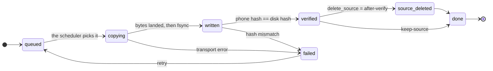

<div align="center">

# portage

**Get your phone's downloads onto an archive drive. Every copy is checked before anything is deleted, and you can stop at any time.**

[](https://bun.sh)
[](https://www.typescriptlang.org/)
[](#build-and-develop)
[](#desktop-app)
[](#what-it-does-not-do)

<sub>
<a href="#the-contract">The contract</a> ·
<a href="#quickstart">Quickstart</a> ·
<a href="#why-it-is-fast">Why it's fast</a> ·
<a href="#commands">Commands</a> ·
<a href="#install">Install</a> ·
<a href="#build-and-develop">Build</a>
</sub>

</div>

The MTP mount that Android gives you takes **9 to 27 minutes** to move an 8 GB
season, and it often fails halfway through. Portage takes about **3 minutes**. If
the cable comes out, it resumes. It checks every byte before it changes anything
on the phone, and it tells you which episodes you already have before it copies
one.

## Quickstart

The product is the **desktop app** (`apps/desktop`). It plans the move, shows
exactly what will happen, verifies each file, and lets you reclaim space on the
drive afterwards. `scripts/apull.sh` is the one-command pull for when a workflow
is overkill — see below.

There is no command-line front end. An earlier version shipped a CLI and a
terminal UI; both were removed in favour of the app, so there is one surface to
keep honest instead of three.

## The contract

**Nothing is deleted from your phone until the copy on the drive has been
proven byte-for-byte identical.**

This is enforced in code: the tool refuses to call a file `verified` unless a
`sha256` from the phone matches the file on disk. Deletion is a separate step,
and it only runs on a file that was just transferred and just verified.

This failure is easy to cause by accident, and it is the reason the tool exists:

```bash
rsync -a --remove-source-files   # exits 0, deletes the source,
                                 # leaves a corrupt file behind
```

A corrupt file on the drive can still have the right size and the right mtime, so
it looks up to date. rsync skips it, then deletes the only good copy. There is no
warning and no non-zero exit code, so nothing tells you that it happened.

Portage never passes that flag. It copies the file, hashes both sides, compares
them, and only then deletes the phone copy, as a separate step.

## What happens to a file

Every file goes through the same steps, and it never moves backwards. `verified`
is the gate: a file does not pass it unless a hash from the phone matches the
bytes on disk.



A `failed` file keeps its partial data in `.portage/partial/`, not in your archive
tree, so a half-written file never looks like a real episode.

## Why it is fast

The slow part is the transport, not the code. These numbers are from real
hardware:

| Path                          | Speed         | 8 GB season              |
| ----------------------------- | ------------- | ------------------------ |
| MTP mount (what you have now) | 5 to 15 MB/s  | 9 to 27 min, often fails |
| **`adb pull`**                | **35.5 MB/s** | **~4 min**               |
| `adb pull`, ×3 concurrent     | **40.8 MB/s** | **~3.3 min**             |

`adb` talks to Android's filesystem directly, so it skips the translation layer
that MTP adds. There is no app to install on the phone, no Termux, and no SSH
server. It uses the `adb` you already have for debugging.

adb also reports 35 MB/s before the bytes are actually written to the disk. About
a quarter of a transfer's time is writeback that adb has already counted as done,
so Portage flushes each file before it calls it finished, and reports the real
rate instead of adb's number.

## It knows what you already have

The most expensive mistake here is copying files you already have. On my first
real run, **17 of the 23 episodes** in a season were already on the drive. That
was 6.8 GB I did not need to copy, so the real job was 6 files, not 23.

The **Plan** screen shows you that before anything moves:

```
destination:       /media/you/2TB/Videos/$Anime
to transfer:       6 files · 2.4 GB
already have:      17 files · 6.8 GB
```

## When something goes wrong

```
Transfer screen
→ [SubsPlease] Frieren - 13 (1080p) [A1B2C3D4].mkv
x cable pulled mid-transfer

History
failed  412 MB  /sdcard/Movies/Frieren/S01/ep13.mkv   adb pull exited 1
```

Reconnect and press Pull again; it picks up where it stopped, because the
journal knows which files were already verified.

Partial files live in `.portage/partial/` on the drive itself, so they never mix
with your archive. A journal at `<drive>/.portage/portage.db` records every
device, file, hash, and run. The journal travels with the drive, so any machine
you plug it into can answer "what did I move, and when?"

## Keep it on the phone for now

Not every file should disappear the moment it lands.

Start a transfer in **Copy only** mode: it copies and verifies, and leaves the
phone alone. The **Purge** screen later lists the files a verified drive copy
already covers, shows the proof for each, and deletes on your say-so — whenever
you want, not the moment the copy finished.

`purge` will not remove a phone file unless it can prove the same content is on
the drive. It checks the stored hash, or does a fresh comparison when you pass
`--verify-hash` to recompute both sides. Files it cannot prove are listed with the
reason, not skipped silently.

## The engine, not a CLI

The app spawns a single binary as a sidecar and talks to it over a line protocol
on stdin/stdout: one JSON request per line, one frame per line back. The app owns
every decision a person sees; the engine owns the transfer, the hashing and the
journal.

```bash
bun run build          # dist/portage — the sidecar the app runs, plus dist/portage-scan
./dist/portage serve   # speak the protocol on stdin/stdout
./dist/portage --version
```

Settings live in the config file, not in flags. The app's Settings screen writes
it; the same precedence applies (drive config, then user config, then defaults):

```toml
# <drive>/.portage/config.toml
dest_root = "/media/you/2TB/Videos"
jobs = 3
```

## `apull.sh`: just pull, no ceremony

Not every transfer needs a workflow. `scripts/apull.sh` is an `adb pull`
wrapper that sits next to portage. It never deletes anything from the phone and
verifies nothing — the quick pull, not the safe move. Two conveniences keep it
from being fiddly: `--tree` / `--list` show you where things are on the phone
(so `--from` is never a guess), and a re-run is incremental, skipping files
already on the drive under the same name and size. Flag-based (`--from` /
`--to`), with `--devices`, `--pick`, `--overwrite`, `--dry-run`, and the same
exit-code scheme as above. It can also stream phone-to-phone
(`--to-phone` + `--from-device` / `--to-device`) through host RAM with no
laptop-disk copy.

```bash
./scripts/apull.sh --tree /sdcard/Download
./scripts/apull.sh --from /sdcard/Movies/Frieren --to /media/you/2TB/Videos
```

Install/update it globally (a single script copy onto your `PATH`; re-run
after `git pull` to update, then confirm with `apull --version`):

```bash
mkdir -p ~/.local/bin
install -m 755 scripts/apull.sh ~/.local/bin/apull
```

Full guide: [docs/apull.md](docs/apull.md).

## Roadmap

These are designed but not built yet. The plan is in the git history:

- **Duplicate detection.** Byte-identical and same-episode-different-release
  reports across all archive roots, with per-item deletion into a recoverable
  trash. Both tiers report-only; there is no `--yes` for deletion at either
  tier, by design.
- **A live terminal dashboard** for `pull`, behind a renderer interface so every
  action stays available as `--plain` and `--json`.
- **`--organize`**, opt-in, previewed before it acts, and it never guesses a
  season number.
- **`verify --deep`** and **`retry`** as first-class commands.

## Desktop app

Versions move with every commit. A commit bumps a patch; a breaking change
(a `!` before the colon) bumps a minor, and nothing reaches 1.0.0 while the
project is pre-major. `scripts/check-commits.sh` enforces the commit type in
CI, because release-please only bumps for the types it understands.

A Tauri window over the same engine, for when a terminal dashboard is not what
you want to look at. The engine ships inside the app as a sidecar, so installing
the `.deb` and opening it from the menu is the whole setup.

```bash
# download from the latest release, then:
sudo dpkg -i Portage_<version>_amd64.deb
```

It shows the same numbers as the Transfer screen because it reads the same state: two
labelled rates, an ETA that stays blank until it can be honest, and a proof strip
that counts written, verified, deleted and kept as the run goes.

Build it yourself with `bun run sidecar` then `bun x tauri build` in
`apps/desktop`.

## Install

Requires [Bun](https://bun.sh) ≥ 1.2 and `adb` from the Android platform-tools.
Nothing gets installed on the phone.

```bash
git clone https://github.com/Michael-Obele/portage
cd portage
bun install
bun run build
install -Dm755 dist/portage ~/.local/bin/portage
```

Then tell it where the drive is:

```bash
dest_root = "/media/you/2TB/Videos/$Anime"
jobs = 3
```

Per-device folders go in the drive's own config, so they travel with it:

```toml
# <drive>/.portage/config.toml
dest_root     = "/media/you/2TB/Videos/$Anime"
quiet_seconds = 120
jobs          = 3
delete_source = "after-verify"    # after-verify | never | prompt

[devices."<sha1-of-serial>"]
label = "Pixel 10 Pro XL"
roots = ["/sdcard/Movies", "/sdcard/Download/Anime"]
```

The device key is `sha1(ro.serialno)`, not the serial number. Configuration
resolves in this order: the drive's config, then your user config, then the
defaults, with `PORTAGE_*` environment variables over the top. The app's
Settings screen shows where each value came from.

## What it does not do

Here are the limits, stated plainly. A tool that hides them costs you an
afternoon.

- **It is not a backup.** One USB drive has no redundancy. This moves files off
  a phone and tells you where they went; it does not protect you from the drive
  dying.
- **No background daemon.** You have to run it yourself. "Plug in a phone and it
  starts on its own" is not safe to build without a notification system, and
  nobody has built one.
- **No metadata lookups and no automatic renaming.** Your folder layout is kept
  exactly as it is.
- **Absolute anime numbering is not mapped.** `- 25` is often S02E01. Mapping it
  needs per-show episode counts from a metadata source, and a wrong guess would
  merge two different episodes, so it stays in the backlog instead of the code.
- **Local drive only.** A network destination needs a different durability
  story.
- **Linux and macOS only**, because it is built on `adb` and `find`.

## Build and develop

Everything runs on Bun. There is no `npm` step and no tooling beyond `bun` itself.

| Command                 | What it does                                      |
| ----------------------- | ------------------------------------------------- |
| `bun install`           | install dependencies                              |
| `bun test`              | 184 tests; no phone, no drive, and no `adb` needed |
| `bun run typecheck`     | `tsc --noEmit`                                    |
| `bun run build`         | compile a single binary to `dist/portage`         |
| `bun run dev`           | run the engine with `--watch`                     |
| `bun run build:scanner` | build the Rust scanner (`cargo build --release`)  |
| `bun run ui:sweep`      | drive the built app in headless Chrome (7 steps)  |
| `./scripts/rehearse.sh` | the whole pipeline against a fake device          |

```bash
bun install
bun test
bun run build
install -Dm755 dist/portage ~/.local/bin/portage
```

The tests use deliberately broken fixtures: a transport that dies mid-file, one
that exits 0 after writing corrupt bytes, and a device whose hash disagrees with
the disk. A fake that only ever succeeds would prove nothing about a tool whose
main job is not deleting your files.

### Run it from this folder (no install)

`bun run build` writes a self-contained binary to `dist/portage`. It bundles the
Bun runtime, so it runs on its own and you can leave it where it is. No copy to
`~/.local/bin` and no `PATH` change:

```bash
./dist/portage --version
./dist/portage serve
```

Keep the leading `./`: the repo folder is not on your `PATH`. The desktop app
spawns this binary itself, so you only run it by hand when you are debugging the
protocol.

While you are still changing the code, `bun run dev` watches the engine source
and the app's `PORTAGE_DEV_ENGINE` mode uses it directly.
