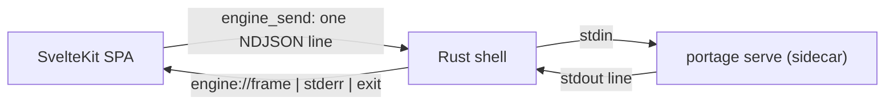

# Portage Desktop

The desktop app: a SvelteKit SPA inside a [Tauri v2](https://v2.tauri.app) shell,
with the Portage engine running as a **sidecar** — a child process Rust spawns and
supervises. The engine does all the real work (adb, scanning, planning, transfers,
dedupe); the Rust shell owns the window, the process and the pipes, and nothing
else.

## What's here

| Path         | What it is                                                          |
| ------------ | ------------------------------------------------------------------- |
| `src/`       | The SvelteKit SPA — Svelte 5 runes, Tailwind v4, shadcn-svelte      |
| `src-tauri/` | The Rust shell: one window, the sidecar spawn, a stdio↔event bridge |
| `scripts/`   | `sidecar.ts` (stage the engine), `contrast.ts` (a11y), `solve.ts`   |
| `tests/`     | `bun:test` specs                                                    |

## Prerequisites

- **Bun** ≥ 1.2 (CI and the lockfile pin 1.4.4).
- **Rust** ≥ 1.90 with `cargo` (the crate is `edition = "2024"`, `rust-version = "1.90"`).
- Linux system libraries (Tauri links against these; the 4.0 webkit package will not do):

  ```sh
  sudo apt install -y libwebkit2gtk-4.1-dev libayatana-appindicator3-dev \
    librsvg2-dev libxdo-dev build-essential pkg-config
  # only for the AppImage bundle:
  sudo apt install -y libfuse2 patchelf zsync
  ```

- Optional, for real work: `adb`, a phone, and a drive.

## Setup

```sh
bun install                 # repo root — engine dependencies
cd apps/desktop
bun install                 # the app's dependencies
```

## Run it (development)

The engine is a Tauri _external binary_, so it must be staged before the shell can
start it. From `apps/desktop`:

```sh
bun run sidecar      # builds dist/portage at the repo root, then stages it as
                     # src-tauri/binaries/portage-<target-triple>
bun run tauri:dev    # vite on http://localhost:5174 + compiles the Rust shell + opens the window
```

UI changes are hot-reloaded. A change under `src-tauri/` recompiles and relaunches
the window.

`tauri:dev` runs `tauri dev --config src-tauri/tauri.dev.conf.json`, which merges one
dev-only key (`withGlobalTauri`, needed by the MCP debug bridge below) on top of
`tauri.conf.json`. Release builds never see it.

To run the engine **from source** instead of the staged binary (so engine edits
show up without restaging):

```sh
PORTAGE_DEV_ENGINE="$PWD/../.." bun run tauri:dev
```

`PORTAGE_DEV_ENGINE` must point at the **repo root** — the directory that contains
`src/cli/index.ts`. If it points anywhere else, the shell falls back to the sidecar.

## Run just the UI in a browser

```sh
bun run dev          # http://localhost:5174
```

A plain browser tab has no Tauri IPC bridge, so the app tells you so ("This window
is not running inside the desktop shell…"). That is expected, not a bug.

### Fixtures

Drive any screen with deterministic fixture data — no engine, phone or drive
needed. Append `?mock=<scenario>`; the app reads it on load:

```
http://localhost:5174/dev/kit?mock=run-failed
```

Scenarios: `fresh`, `run`, `run-failed`, `plan`, `dupes`, `purge`, `doctor`.
`/dev/kit` is the component kitchen sink (tokens, type scale, primitives).

## The "engine is not running" screen

When the engine child exits and does not come back, the shell shows:

> **The engine is not running.**
> Nothing can be scanned, planned, pulled or verified until it is back.
> Restart it below. If it stops again straight away, the last line it wrote is
> underneath.

…followed by the last stderr lines. This is the `connection === 'stopped'` band in
`src/routes/+layout.svelte`.

The Rust shell auto-restarts the engine **once** after a crash
(`MAX_AUTO_RESTARTS = 1` in `src-tauri/src/engine.rs`). A second crash in a row
leaves it down.

Reproduce it deliberately:

```sh
# (a) start with an engine that cannot run — the shell shows the band, and the
#     reason the child printed sits underneath it
PORTAGE_DEV_ENGINE=/tmp bun run tauri:dev

# (b) or crash the running engine twice
pkill -9 -x portage      # 1st crash -> auto-restart
pkill -9 -x portage      # 2nd crash -> budget spent -> the band sticks
```

Use `-9`: the compiled engine ignores `SIGTERM`, so a plain `kill` will not stop it.

Recover: click **Restart engine** (that resets the crash budget), or relaunch.

## Checks and tests

```sh
bun run check     # svelte-check (types)
bun run test      # bun test tests/
bun run a11y      # AAA contrast (scripts/contrast.ts; alias: contrast)
bun run lint      # prettier --check
bun run format    # prettier --write
```

The Rust shell is checked by the `rust` CI job (`cargo fmt --check`, clippy with `-D warnings`, `cargo test`); the same, by hand:

```sh
cd src-tauri
cargo fmt --check
cargo clippy --all-targets -- -D warnings
cargo test
```

## Build the installers

```sh
cd apps/desktop
bun run tauri build --bundles deb,appimage
```

Output lands in `src-tauri/target/release/bundle/{deb,appimage}/`.

> `beforeBuildCommand` is `bun run build && bun run sidecar`, so `tauri build`
> builds the SPA and stages the engine itself. That chaining is load-bearing:
> Tauri fails at compile time if the `externalBin` file is missing, so the stage
> cannot be left to the caller.

## How it fits together



Rust is a forwarder: it reads only a frame's top-level `type`, buffers the last frame
of each type (so a late-mounted window can catch up via `engine_status`), and never
touches a file, a device or the database. Every rule the app enforces stays in the
engine, in one codebase, next to its tests.

## Inspect the running app from an AI assistant (MCP)

`tauri dev` loads a **debug-only** bridge (`tauri-plugin-mcp-bridge`) that exposes
the live webview to the [MCP server for Tauri](https://github.com/hypothesi/mcp-server-tauri):
screenshots, a structured DOM/accessibility snapshot, computed styles, JavaScript
evaluation, the console buffer, and Tauri IPC traffic — no external driver, and no
hand-taken screenshots.

- The bridge binds to `127.0.0.1` only and is registered under
  `#[cfg(debug_assertions)]`, so it is absent from release builds.
- Point your MCP client at it (Zed: add to `context_servers` in `settings.json`,
  then restart Zed):

  ```json
  { "mcpServers": { "tauri": { "command": "npx", "args": ["-y", "-p", "@hypothesi/tauri-mcp-server", "mcp-server-tauri"] } } }
  ```

- The app must be running (`bun run tauri:dev`); the server finds it on loopback.
- `withGlobalTauri` (which the bridge needs) is supplied only in dev, by `tauri.dev.conf.json`.
